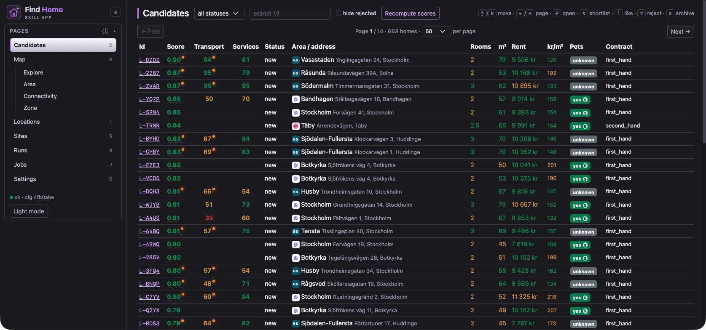
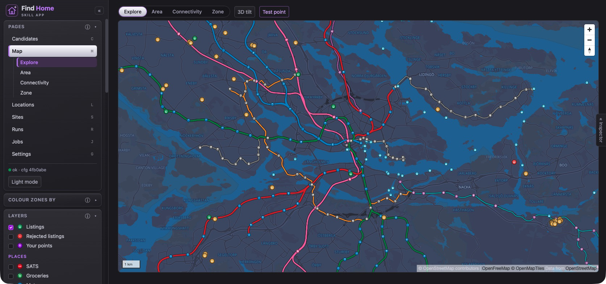
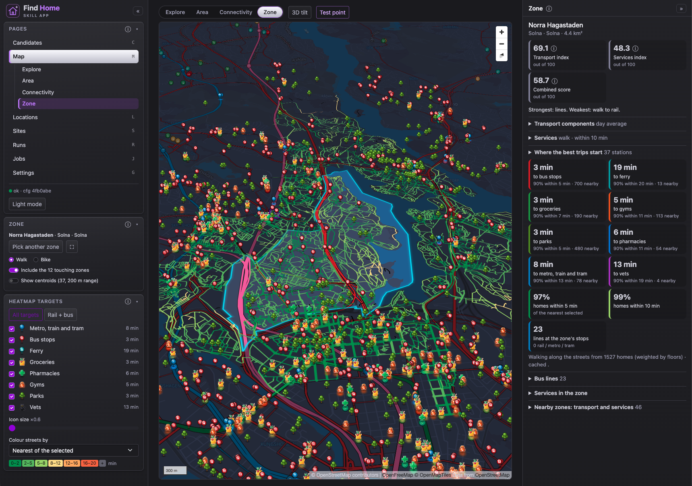
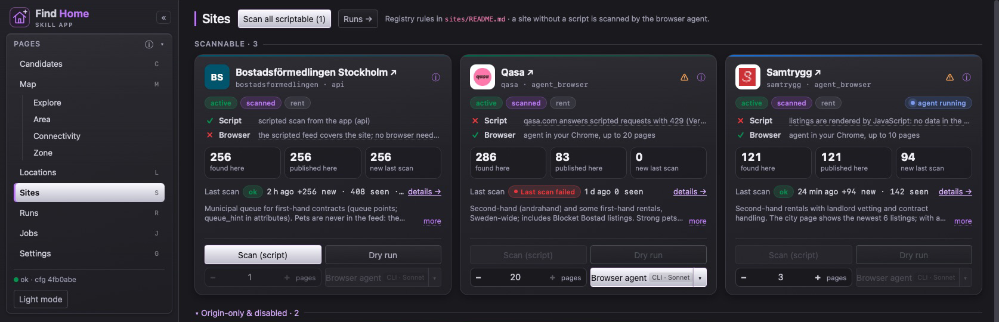

<h1>
  <picture>
    <source media="(prefers-color-scheme: dark)" srcset="frontend/public/brand.svg">
    
  </picture>
</h1>

**A skill app for finding your next rental home.**

find_home helps you search across home rental websites, bring listings into one place and compare the homes
against what matters to you. It is an agent skill extended with a local web UI: Claude Code or Codex helps
collect and evaluate listings, while the app gives you a place to explore, compare and decide.

The project is built around **Stockholm, Sweden**. It can be extended to other Swedish cities, and potentially
other countries, with extra work on rental websites, local data and providers. Renting is the supported workflow;
buying is planned.



*Compare homes from different websites in one table, with scores and the details behind each candidate.*

## What it helps you do

- **Search across rental websites.** Use scripted scanners where supported, or an external agent's browser for
  sites that need it. Site integrations include Bostadsförmedlingen Stockholm, Qasa and Samtrygg.
- **Keep one list of homes.** Deduplicate listings across sources and track what is new, liked, shortlisted,
  rejected or archived.
- **Compare more than the rent.** Evaluate size, rooms, contract terms, pet policies, commute times and access
  to everyday services, using your own limits and scoring weights.
- **Understand the neighbourhood.** Explore listings, transit, nearby places and walkability on a 2D/3D map.
- **See why a home scores well.** Open score explanations and distinguish estimated travel times from computed
  routes. Review the evidence behind pet-policy decisions.
- **Keep track of the work.** Inspect site scans and agent runs, and review or undo supported job results.

## Explore where you could live

The map connects the search to the city. Explore homes and neighbourhoods, compare transport and services,
inspect individual zones and use the house view to see what is within reach. Personal places and commute
preferences are configured locally.



*Explore Stockholm geographically. The map also offers Area, Connectivity and Zone modes for deeper analysis.*

### Zone view

Focus on a neighbourhood to see walking times along its streets, nearby services and public transport.
The side panel brings together transport and services indices, walking coverage and the area's transit lines.



*See how easily you could reach groceries, parks, gyms and transit from homes in the selected zone.*

## Rental sites and agent workflows

Each website has its own integration, navigation notes and scan capabilities. The UI shows which methods are
available, lets you start a supported scan or agent workflow, and links the results back to the homes it found.
The Runs page records progress and outcomes; Jobs groups reviewable analyses such as pet-policy checks.



*Manage the websites you search and see whether each supports a script, a browser agent or needs onboarding.*

Screenshots show public rental listing and site data. Personal map points, commute overlays and drawn search
areas are hidden. Listing availability and scan results can change after capture.

## A skill app, in practice

The skill supplies the search workflow and the agent's instructions. The UI supplies persistent data, maps and
review tools. The agent runs outside the app; the app itself contains no LLM. The three layers stay separate:

1. **The app** (`backend/`, `frontend/`, `docker-compose.yml`): FastAPI + Postgres + Angular, no GenAI inside.
   It stores and dedupes listings, computes commute and nearby-service metrics, scores candidates against your
   configuration, shows a 2D/3D map, records your feedback and can start an agent run.
2. **Open configuration** (`config/`, `sites/`): YAML and Markdown files validated by JSON Schemas. Limits, weights,
   locations and their time slots, tags, providers and per-site scan rules all live here.
3. **The skill** ([`find-home`](.agents/skills/find-home/SKILL.md)): instructions and prompts for Claude Code or Codex to scan, evaluate
   and onboard sites, writing results back through the `findhome` CLI.

Code-level documentation lives in [`guide/`](guide/overview.md). Planning history lives in [`tasks/`](tasks/README.md).

## Beyond Stockholm

For another Swedish city, adapt the search area and preferences, add or adjust rental website integrations,
and build the local geodata and transit coverage used by the map and commute analysis. The site definitions,
YAML configuration and provider adapters give this work a starting point.

Other countries are possible with more effort: local websites and routing or transit data need support, and
Swedish assumptions such as SEK-based prices and housing contract types may need code and schema changes.
This is an early project centred on Stockholm; each new region needs integration work.

## Prerequisites

| Tool | Version | Notes |
|---|---|---|
| Docker (Desktop or colima) | recent | Postgres :5434, pgAdmin :5052 |
| Python | 3.11 | backend interpreter |
| Poetry | ≥ 1.8 | `pipx install poetry`; venv is created in `backend/.venv` |
| Node.js | 20+ | Angular dev server |
| Claude Code or Codex CLI | optional | for agent runs |
| Trafiklab / Google keys | optional | see [providers](guide/documentation/providers.md) |

## Install and run

Open the `find_home` folder as the VS Code workspace and press F5 on **FH: Full Stack**. It frees the app ports,
creates anything missing (`backend/.venv` with Poetry or uv, `frontend/node_modules`, `config/*.env`), starts
Postgres and pgAdmin, applies migrations, starts Angular as a background task, then launches FastAPI under the
debugger. There is one app debug configuration. The first run takes a few minutes because of the installs.

Infrastructure startup uses `scripts/infra-up.sh`: it stops all existing project containers, starts them with
the current Compose configuration, and waits up to 90 seconds for both services to be healthy. Compose recreates
containers whose configuration changed. A startup failure prints diagnostics and stops the containers.
Ending **FH: Full Stack** stops Angular and all project containers; restarting it runs the same startup sequence.

Postgres stores its database files in the local, gitignored `data/postgres/` folder, bind-mounted into the
container. Stopping or deleting containers, including `docker compose down -v`, preserves this folder.
Keep it when cleaning the repo; deleting `data/postgres/` deletes the database. Local database backups belong
under the gitignored `data/backups/` folder.

`scripts/install.sh` does the same installs from a terminal and forces a clean reinstall.

| URL | What |
|---|---|
| http://localhost:4400 | the app |
| http://localhost:8200/docs | API (OpenAPI) |
| http://localhost:5052 | pgAdmin (server preloaded) |

Without VS Code: `scripts/infra-up.sh`, then `backend/.venv/bin/findhome db migrate`,
`backend/.venv/bin/findhome serve` and `cd frontend && npx ng serve --port 4400 --proxy-config proxy.conf.json`.

Check everything: `scripts/smoke-check.sh`.

## Your personal files

The repo is meant to be public, so what is personal stays on your machine. Where you work, your budget and your
keys live in `config/locations.yaml`, `config/profile.yaml`, `config/search_area.yaml`, `config/providers.env` and
`config/backend.env`. All five are **gitignored**; the repo holds a dummy `*.example.*` file for each.
`scripts/ensure-env.sh` (run by `scripts/install.sh` and by F5) creates a missing real file from its example and
never overwrites it. After the first run, edit the copies, then `scripts/findhome config validate`. Which file holds
what, and how to add one: [config/README.md](config/README.md). The rule behind it:
[guide/principles/personal_data.md](guide/principles/personal_data.md).

## Everyday commands

```bash
findhome config validate          # after editing any YAML
findhome scan --all               # scripted scan of active sites
findhome digest history           # what has been seen, liked, rejected
findhome commute L-7Q2K --dry-run # how many routing calls a commute matrix would cost
```

Ports and how they avoid the other local stacks: [ports](guide/documentation/ports.md).
