<h1>
  <picture>
    <source media="(prefers-color-scheme: dark)" srcset="frontend/public/brand.svg">
    
  </picture>
</h1>

**A skill app for finding your next rental home.**

find_home brings the listings of several rental websites into one place and helps you judge each home against what
matters to you: rent and size, contract and pets, how long it takes to get to the places you go, and what is within
a short walk. It is an agent skill extended with a local web UI. Claude Code or Codex scans the sites and evaluates
listings; the app stores everything, scores it, puts it on a map and gives you the tools to compare and decide.

> [!IMPORTANT]
> **For now find_home is built and tuned for Stockholm and the municipalities around it.** The rental site
> integrations, the statistical zones, the transit timetable and the scoring defaults are Swedish and
> Stockholm-specific. Using it for another Swedish region, or another country, takes extra work: see
> [Beyond Stockholm](#beyond-stockholm). Renting is the supported workflow; buying is planned.

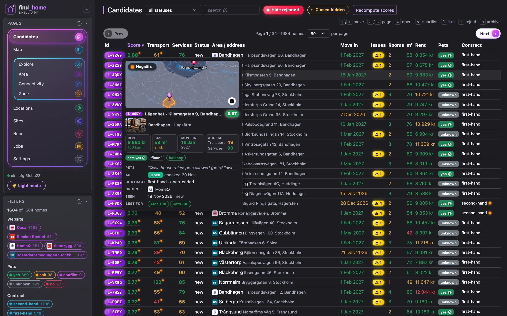

*Every home from every site in one table. Hover an id for the home card; filters on the left.*

## Contents

- [What it helps you do](#what-it-helps-you-do)
- [A tour of the app](#a-tour-of-the-app): [Candidates](#candidates) · [A listing](#a-listing) · [Explore](#map-explore) ·
  [Area](#map-area) · [Connectivity](#map-connectivity) · [Zone](#map-zone) · [Locations](#locations) ·
  [Sites](#sites) · [Runs](#runs) · [Jobs](#jobs) · [Settings](#settings)
- [A skill app, in practice](#a-skill-app-in-practice)
- [Beyond Stockholm](#beyond-stockholm)
- [Install and run](#install-and-run)

## What it helps you do

- **Search many rental websites at once.** Scripted scanners where a site allows them, an agent in your own Chrome
  where it does not. Integrations: Bostadsförmedlingen Stockholm, Qasa (including Blocket Bostad and HomeQ listings),
  Samtrygg.
- **Keep one list of homes.** The same flat found on two sites is one home. Each keeps its status (new, shortlisted,
  on hold, applied, assigned elsewhere, rejected …) and every change is logged with its date.
- **Compare more than the rent.** Size, rooms, move-in date, contract type and end, pet policy, commute times to
  your places and the walk to groceries, pharmacies, gyms, parks, vets and stops, scored with your own limits and
  weights.
- **See the city.** A 2D/3D map with the homes sized and coloured by score, transit lines, places, walking-time
  heatmaps, your search area and the commute from every neighbourhood.
- **Know why.** Every score opens its derivation; estimates are marked as estimates; missing data is listed as an
  issue with what to do about it; pet decisions show the sentence they came from.
- **Keep track of the work.** Scans, agent runs and jobs are recorded with their results and cost, and job changes
  can be undone per listing.

## A tour of the app

The screenshots use public listing data from the rental sites. Your own places and search area are personal and
never committed: in these images they come from the repo's example files (`Office (example)`, `Partner (example)`,
a made-up search area), and the travel minutes to them are illustrative.

### Candidates


The triage table of every home that passes your hard filters.

- **Score, transport and services** for each home, coloured from red to green; an orange dot marks a value that is
  partly estimated.
- **Values coloured against your targets**: move-in against your window, rent, size and price per m² against the
  homes still in the running.
- **Filters** with a histogram under each range slider (hover a bar for its homes), and bright chips for the
  website, pets, contract type and issues.
- **Columns** you choose and order, saved as named views; **Hide rejected** and **Hide closed** with one click.
- **The home card** on hovering an id: zone minimap, key figures, badges, ad status and the score groups it is best
  for.
- **Small signals**: ⚠ issues, an orange dot on a fixed-term contract, a clock when the ad was not confirmed open
  recently. Each opens a tooltip (below).
- **Keyboard**: `j`/`k` move, `←`/`→` page, `⏎` open, `s` shortlist, `l` like, `r` reject, `a` archive.

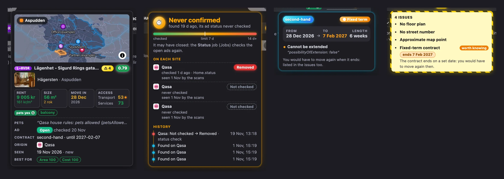

*The home card; the clock: how long since the ad was confirmed, each site's status and the history; the contract:
dates, length and terms; the issues, with the fixed term as "worth knowing".*

### A listing

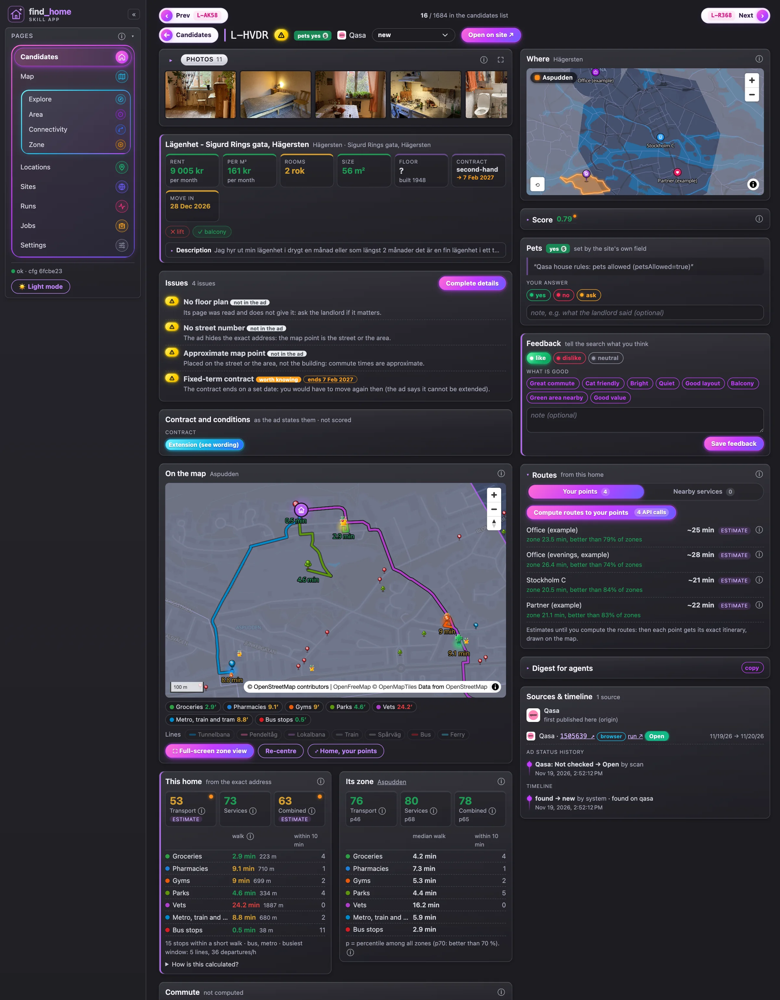

Everything about one home, with the previous and next home of your list one key away.

- **Key facts** coloured like the table, sized to fit; the description folded to one line until you open it.
- **Issues** with their class (*not in the ad*, *check the extraction*, *worth knowing*) and **Complete details**,
  which reads the listing's page again.
- **On the map**: every nearby service and stop, the walking path to the nearest of each with its minutes, the
  transit lines, and a button for the full-screen 3D zone view.
- **This home and its zone** side by side: the home's transport and services indices from its exact address,
  against the zone's medians and percentiles.
- **Routes** in two tabs, *Your points* and *Nearby services*: free estimates first, then exact ResRobot itineraries
  on request (the button shows how many API calls it will cost), drawn on the map.
- **Score** with one bar per group and its derivation, **Pets** with the evidence and your answer, **Feedback**,
  and **Sources & timeline** with each site's ad status history.

### Map: Explore

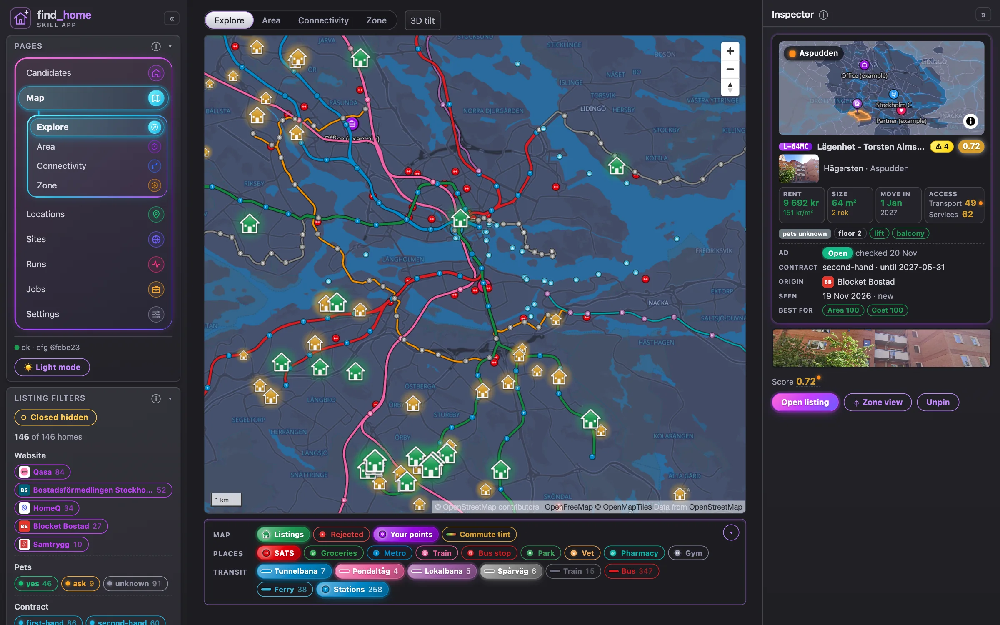

- **Houses sized and coloured by score**; the homes you have not looked at yet (status *new*, ad open) glow with a
  slow pulse.
- **The same filters as Candidates**, shared both ways.
- **Hover a house** for its card; **click** to pin it in the Inspector with its photos, the score and
  **⌖ Zone view**.
- **The Layers sheet** slides up under the map in every mode: rejected homes, your points, a commute tint, places
  (groceries, pharmacies, gyms, parks, vets …) and each transit mode with its stations.
- **Colour zones by** any index or service density, as a heatmap behind the houses.

### Map: Area

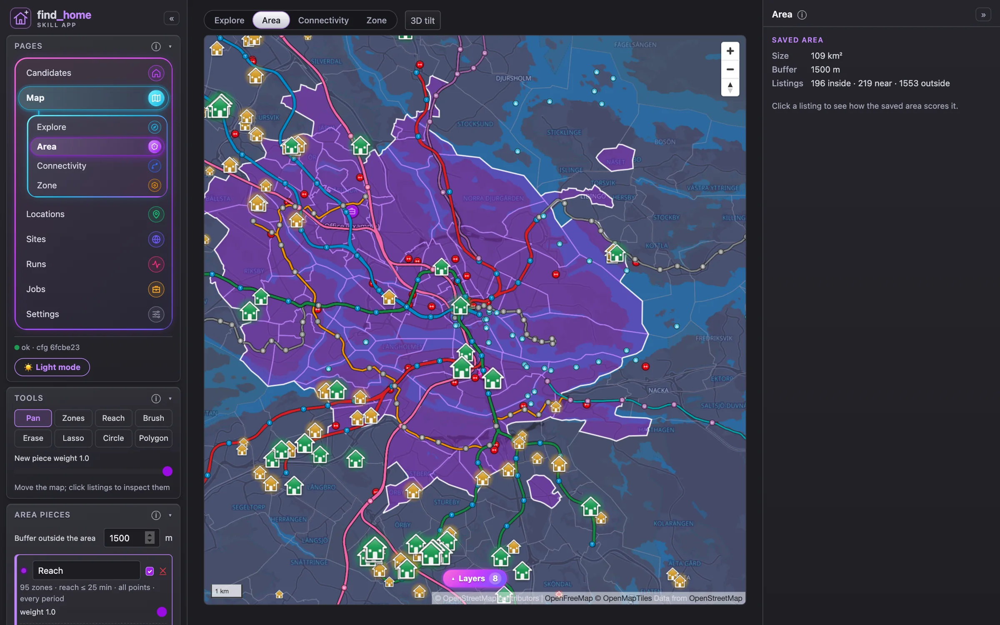

Draw where you want to live. An area is made of weighted pieces: whole zones, a **reach** (the zones within N
minutes of your points), brush strokes, lasso, circle or polygon shapes, and erasers. A buffer softens the edge.
Homes inside score full marks for area, those just outside less, the rest are filtered out.

### Map: Connectivity

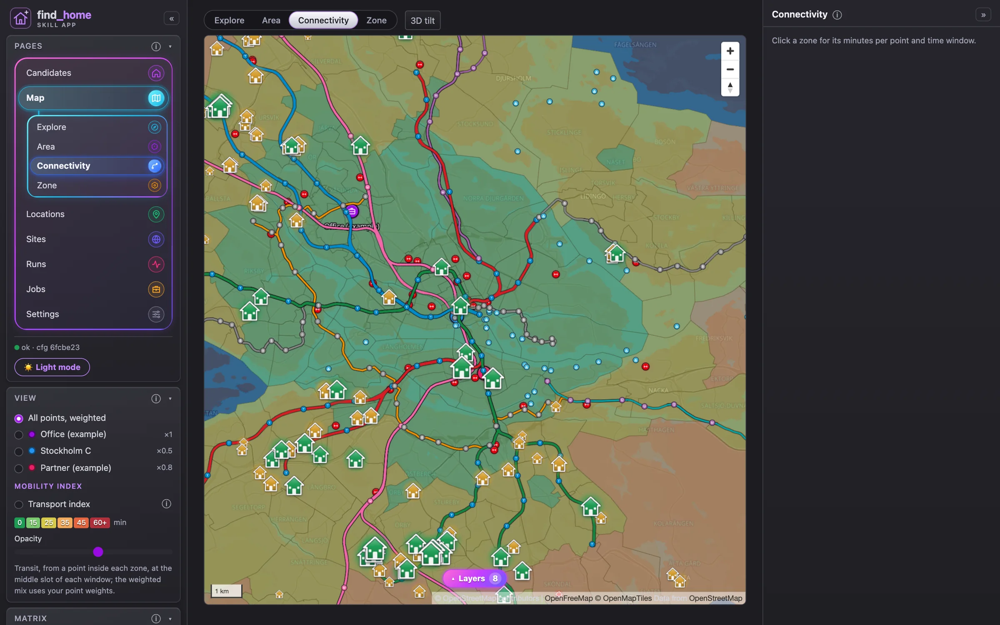

How well each neighbourhood is connected: the transit minutes from every zone to each of your points and their
weighted mix, or the **transport index** (lines, frequency and stops within a short walk, by time of day) as a
percentile. The matrix bubble shows how many routes are computed, failed or estimated, and what refreshing them
would cost in API calls.

### Map: Zone

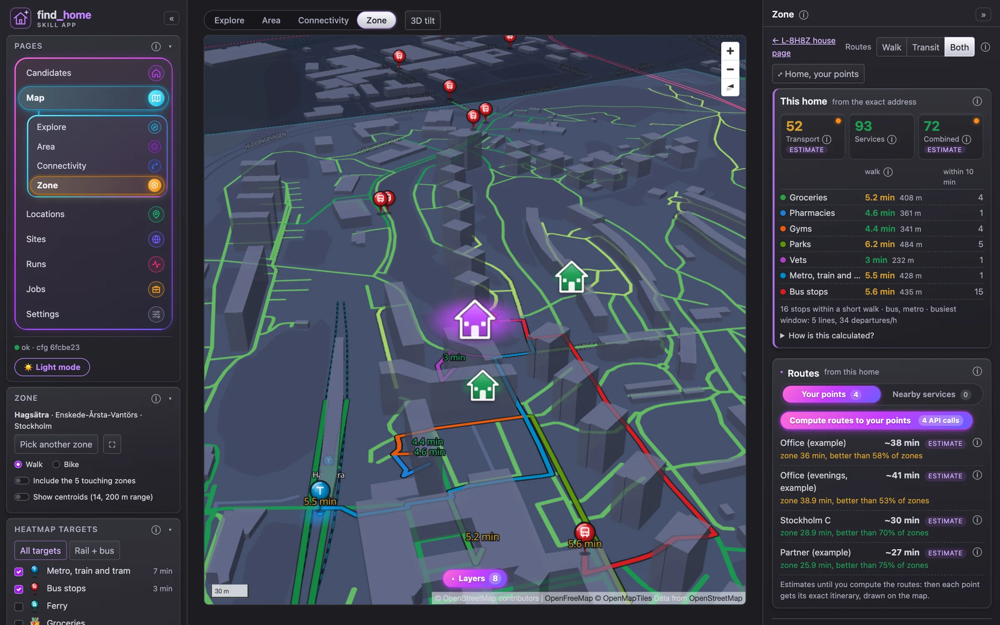

One neighbourhood in 3D. Streets are coloured by the walking minutes to the targets you choose (stops, groceries,
gyms …) and lie under the buildings, so the depth reads. Opened from a home, the view focuses on it: a large violet
house, its walking paths to the nearest service of each kind, its routes, and its scores beside the zone's
transport and services indices.

### Locations

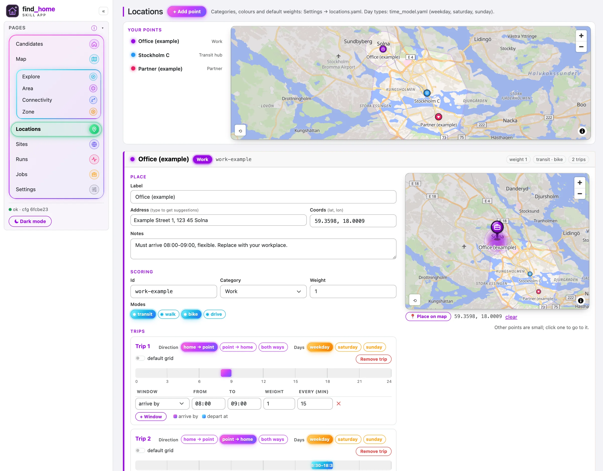

The places that matter to you, with the trips you make to them: direction, days, and time windows such as
"arrive by 08:00–09:00" drawn on a 24-hour bar (windows may run past midnight). Each point has its own movable map,
with the other points smaller; **Place on map** sets its position with a click. Addresses are suggested as you type.

### Sites

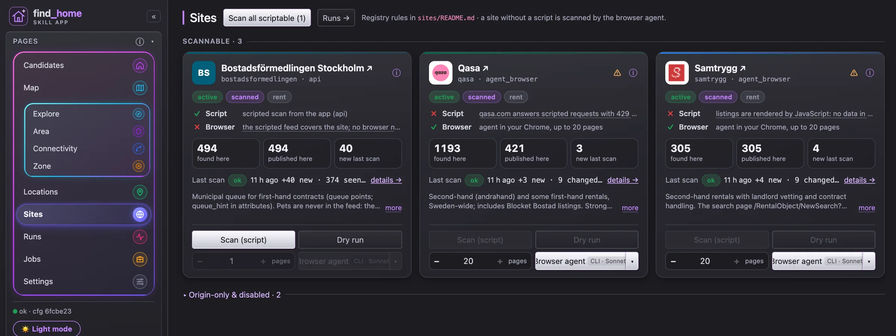

Each rental website is an integration with its own notes and scan methods: a **script** run by the app where the
site allows it, or the **browser agent** working in your Chrome. The cards show what each site found and published,
and the last scan.

### Runs

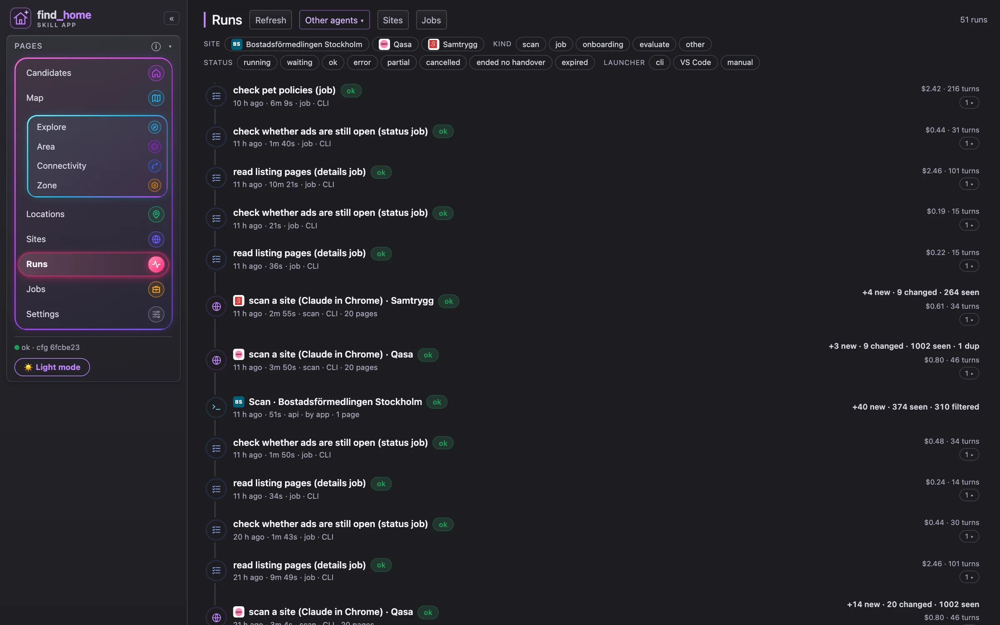

Every scan and agent run, live and past: status, duration, turns and cost, and what it found (new, changed, seen),
with links to the homes.

### Jobs

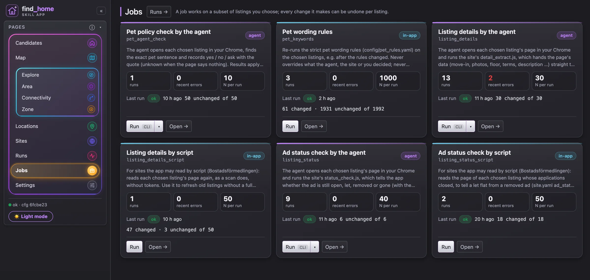

Jobs work on a set of listings you choose: check pet policies, read listing pages again for missing details, check
whether ads are still open. Agent jobs run in your Chrome through Claude Code or Codex; in-app jobs run without
tokens. Every change a job makes can be undone per listing.

### Settings

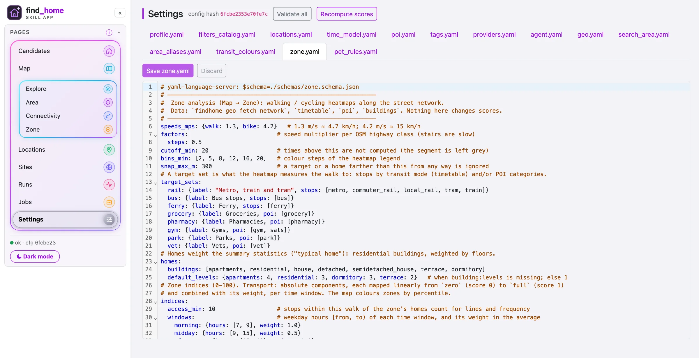

All configuration is plain YAML validated by JSON Schemas: limits and weights, locations, time model, places,
statuses and tags, providers, zones. Edit it here or in your editor; **Validate all** checks it. A change to a file
that affects scores marks them stale until **Recompute scores**.

## A skill app, in practice

The skill supplies the search workflow and the agent's instructions. The UI supplies persistent data, maps and
review tools. The agent runs outside the app; the app itself contains no LLM. The three layers stay separate:

1. **The app** (`backend/`, `frontend/`, `docker-compose.yml`): FastAPI + Postgres + Angular, no GenAI inside.
   It stores and dedupes listings, computes commute and nearby-service metrics, scores candidates against your
   configuration, shows a 2D/3D map, records your feedback and can start an agent run.
2. **Open configuration** (`config/`, `sites/`): YAML and Markdown files validated by JSON Schemas. Limits, weights,
   locations and their time slots, tags, providers and per-site scan rules all live here.
3. **The skill** ([`find-home`](.agents/skills/find-home/SKILL.md)): instructions and prompts for Claude Code or Codex to scan, evaluate
   and onboard sites, writing results back through the `findhome` CLI.

Code-level documentation lives in [`guide/`](guide/overview.md). Planning history lives in [`tasks/`](tasks/README.md).

## Beyond Stockholm

What ties find_home to Stockholm today:

| Part | Stockholm-specific today | To use it elsewhere |
|---|---|---|
| Rental websites | Bostadsförmedlingen Stockholm, Qasa, Samtrygg | add or adapt a site integration (`sites/`, onboarded with the skill) |
| Neighbourhoods | SCB RegSO statistical zones of the 9 municipalities around Stockholm | set the municipalities in `geo.yaml` and rebuild the zones; outside Sweden, a different zone source |
| Transit | SL's GTFS timetable (Trafiklab) and ResRobot routing | another GTFS feed and routing provider |
| Walking and places | OpenStreetMap extracts for the region | fetch the region's network and places again |
| Money and contracts | SEK prices, Swedish first-hand and second-hand contracts, queue points | code and schema changes |

**Another Swedish region** mostly needs configuration and data: the municipalities and search area, the rental
sites of that region, and the zones, walking network, places and timetable rebuilt for it (`findhome geo fetch …`).
ResRobot already covers all of Sweden. **Another country** needs more: local rental websites, a source of
neighbourhoods, transit data and routing, and changes where Swedish assumptions are built in (currency, contract
types). The site definitions, YAML configuration and provider adapters give this work a starting point.

## Prerequisites

| Tool | Version | Notes |
|---|---|---|
| Docker (Desktop or colima) | recent | Postgres :5434, pgAdmin :5052 |
| Python | 3.11 | backend interpreter |
| Poetry | ≥ 1.8 | `pipx install poetry`; venv is created in `backend/.venv` |
| Node.js | 20+ | Angular dev server |
| Claude Code or Codex CLI | optional | for agent runs |
| Trafiklab / Google keys | optional | see [providers](guide/documentation/providers.md) |

## Install and run

Open the `find_home` folder as the VS Code workspace and press F5 on **FH: Full Stack**. It frees the app ports,
creates anything missing (`backend/.venv` with Poetry or uv, `frontend/node_modules`, `config/*.env`), starts
Postgres and pgAdmin, applies migrations, starts Angular as a background task, then launches FastAPI under the
debugger. There is one app debug configuration. The first run takes a few minutes because of the installs.

Infrastructure startup uses `scripts/infra-up.sh`: it stops all existing project containers, starts them with
the current Compose configuration, and waits up to 90 seconds for both services to be healthy. Compose recreates
containers whose configuration changed. A startup failure prints diagnostics and stops the containers.
Ending **FH: Full Stack** stops Angular and all project containers; restarting it runs the same startup sequence.

Postgres stores its database files in the local, gitignored `data/postgres/` folder, bind-mounted into the
container. Stopping or deleting containers, including `docker compose down -v`, preserves this folder.
Keep it when cleaning the repo; deleting `data/postgres/` deletes the database. Local database backups belong
under the gitignored `data/backups/` folder.

`scripts/install.sh` does the same installs from a terminal and forces a clean reinstall.

| URL | What |
|---|---|
| http://localhost:4400 | the app |
| http://localhost:8200/docs | API (OpenAPI) |
| http://localhost:5052 | pgAdmin (server preloaded) |

Without VS Code: `scripts/infra-up.sh`, then `backend/.venv/bin/findhome db migrate`,
`backend/.venv/bin/findhome serve` and `cd frontend && npx ng serve --port 4400 --proxy-config proxy.conf.json`.

Check everything: `scripts/smoke-check.sh`.

## Your personal files

The repo is meant to be public, so what is personal stays on your machine. Where you work, your budget and your
keys live in `config/locations.yaml`, `config/profile.yaml`, `config/search_area.yaml`, `config/providers.env` and
`config/backend.env`. All five are **gitignored**; the repo holds a dummy `*.example.*` file for each.
`scripts/ensure-env.sh` (run by `scripts/install.sh` and by F5) creates a missing real file from its example and
never overwrites it. After the first run, edit the copies, then `scripts/findhome config validate`. Which file holds
what, and how to add one: [config/README.md](config/README.md). The rule behind it:
[guide/principles/personal_data.md](guide/principles/personal_data.md).

## Everyday commands

```bash
findhome config validate          # after editing any YAML
findhome scan --all               # scripted scan of active sites
findhome digest history           # what has been seen, liked, rejected
findhome commute L-7Q2K --dry-run # how many routing calls a commute matrix would cost
```

Ports and how they avoid the other local stacks: [ports](guide/documentation/ports.md).
