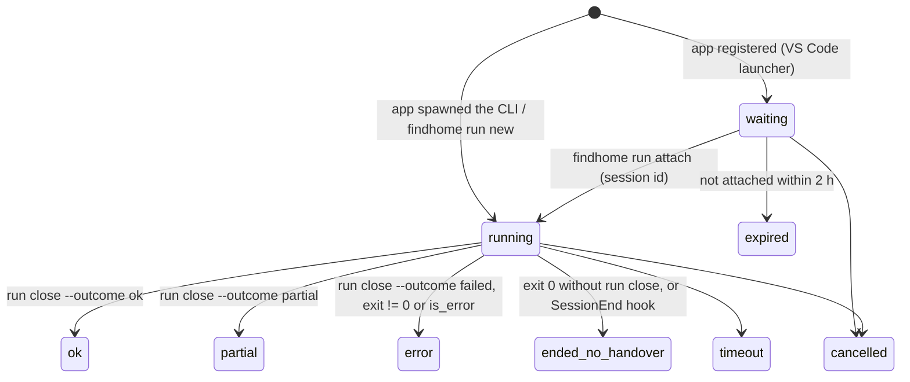

# Architecture: agent contract

The GenAI work happens outside the app, in an agent driven by the
[`find-home` skill](../../.agents/skills/find-home/SKILL.md). This page describes what the agent reads, what it may
write and through which interfaces. See the [introduction](introduction.md) for the components.

## Skills and entry files

Skills live in `.agents/skills/<name>/` (Codex scans this folder and follows symlinks).
[`scripts/sync-skills.sh`](../../scripts/sync-skills.sh) links each one into `.claude/skills/` for Claude Code;
`--check` reports drift and `--copy` copies instead of linking. [`AGENTS.md`](../../AGENTS.md) is the shared
instruction file; [`CLAUDE.md`](../../CLAUDE.md) points to it.

The `find-home` skill holds the run protocol, one prompt per task in
[`prompts/`](../../.agents/skills/find-home/prompts/run_scan.md), and references (CLI cheatsheet, token rules,
config guide and [`data_contract.md`](../../.agents/skills/find-home/references/data_contract.md), generated by
`findhome config schema ingest --markdown` from the pydantic models).

## Reading: digests first

- `GET /api/digest/history` ([`digest/history.py`](../../backend/src/findhome/digest/history.py)): profile limits and
  weights (unset values listed separately), liked and disliked tag counts, pipeline counts and active short ids,
  recent rejections with tags, items seen per site, listings whose pet policy is unclear, and how many new
  listings lack an evaluation. Lists are capped (`list_limit`), so its size stays bounded.
- `GET /api/digest/listing/{short_id}` ([`digest/listing.py`](../../backend/src/findhome/digest/listing.py)): four
  fixed lines (facts, pets and contract, commute per point with its best mode, score and status and tags), and with
  `full=true` text excerpt, latest evaluation, image links and sources. Commute values marked `~` are estimates.
- `GET /api/listings/exists?site=&ref=` tells whether a site item (external id or URL) is already known.

Listings are referred to by `short_id` (`L-` + 4 characters without ambiguous letters).

## Writing: only through the API

| Write | Endpoint | CLI |
|---|---|---|
| Listings (`ListingIn` list) | `POST /api/ingest/listings` (`run` groups calls into one scan run per site) | `findhome ingest listings -f file.json [--source agent_browser] [--parser <slug>] [--run <id>]` |
| Evaluations (`EvaluationIn` list) | `POST /api/ingest/evaluations` | `findhome ingest evaluations -f file.json` |
| Pet check of a job's listing | `POST /api/job-runs/{id}/next`, `POST /api/job-runs/{id}/submit` | `findhome jobs next <job_run>`, `findhome jobs submit <job_run> <short_id> --pet … --evidence "…"` |
| Status | `POST /api/listings/{id}/status` (statuses from `tags.yaml`) | `findhome listings status` |
| Feedback | `POST /api/listings/{id}/feedback` (tags must exist in `tags.yaml`) | `findhome listings feedback` |
| Config | YAML files directly, then `findhome config validate`; the UI uses `PATCH`/`PUT /api/config/{name}` | — |

`--parser <slug>` converts raw site items (for example the output of
[`sites/qasa/extract.js`](../../sites/qasa/extract.js), run by the agent on a page loaded in the user's browser)
with the `to_listing` function of `sites/<slug>/scanner.py` before posting them.

The contract models are in [`domain/models.py`](../../backend/src/findhome/domain/models.py). `ListingIn` and
`EvaluationIn` forbid unknown fields. An evaluation may set `pet_status` only together with `pet_evidence`. Who
decides a listing's pet status (user > agent > site > keywords) is described in
[config_and_locations.md](pets.md); agents never set `conflict`, and scanners hand the site's
pet badge over as `attributes.pets_flag` instead of setting `pet_status`.
When `FINDHOME_AGENT_RUN_ID` is set, `ingest evaluations` links the evaluations to that run.

## File inbox (agents without API access)

Claude in the desktop app works through the connected folder and its built-in browser and usually cannot reach
`127.0.0.1:8200`. It writes JSON files into `inbox/` instead ([`inbox/README.md`](../../inbox/README.md)):
`{"site", "parser", "source", "run", "page", "docs"}` for raw site items converted by the site's `to_listing`, or
`{"listings": [ListingIn], "run"}`. Files that share a `run` value fill one scan run (see Runs below). [`findhome.inbox`](../../backend/src/findhome/inbox.py) imports them on API startup,
when a file appears (watcher) and on `POST /api/inbox/import` (`findhome ingest inbox`), then moves each file to
`inbox/processed/` or `inbox/failed/` with an `.error.txt`.

The API also writes `runs/state/<site>.json` (on startup, on config changes and after each inbox import):
`last_published` (newest `attributes.publishedAt` seen), `known_listings`, and `scan_urls`, the result-page URLs
(as many as the site's `politeness.max_pages_per_run`) built by the same filter mapping as the scripted scanner,
and for sites whose result page has search fields (`scan.browser.inputs`), `inputs`, `input_sets` and
`avoid_paths`: [`browser_inputs()`](../../backend/src/findhome/inbox.py) computes every value combination from
the profile (a move-in field gets `move_in_from`, then the 1st of each month up to `move_in_to`), so the agent
tries each set instead of the page's default, and closes the run as `failed` when the profile leaves them unset; and `next_page` when further result pages are reached inside the page
(the agent then pages up to the requested number for every set).
Browser prompts such as [`browser_scan_site.md`](../../.agents/skills/find-home/prompts/browser_scan_site.md) and
[`qasa_browser_scan.md`](../../.agents/skills/find-home/prompts/qasa_browser_scan.md) (Claude desktop) read only
this file and `extract.js`, so a small model can run them.

## Runs

Every scan of a site is a **scan run** (`scan_runs`), whatever its method: a scripted scan
([`scan_site()`](../../backend/src/findhome/scanning/runner.py)), the inbox import of a browser scan, or an
agent's `ingest listings --run`. Every agent session is an **agent run** (`agent_runs`), and the scan runs and
job runs it produced point to it. The Runs page shows them as one timeline
([`timeline()`](../../backend/src/findhome/db/runs_repo.py#L184)); the Sites page's "last scan" is the latest scan
run of the site.

A clean process exit only says the CLI did not crash. The agent gives its own verdict when it closes the run
(`findhome run close --outcome ok|partial|failed`, stored in `agent_runs.outcome`), and
[`status_for()`](../../backend/src/findhome/db/runs_repo.py) turns exit and verdict into the final status: a process
failure wins; after a clean exit the verdict decides; a run whose prompt asked the agent to close it (`{run_id}` in
the profile's prompt) but was not closed ends as `ended_no_handover`. Profiles that never attach (no `{run_id}`) are
`ok` on a clean exit. Refused tool calls are kept in `result.permission_denials` and shown with the verdict on the
Runs page.

**Starting an agent.** The app starts an agent only through
[`launcher.start()`](../../backend/src/findhome/agentrun/launcher.py#L156), from a profile in `config/agent.yaml`.
It validates the profile's parameters first ([`resolve_params()`](../../backend/src/findhome/agentrun/launcher.py#L48):
site exists and allows a browser scan, pages within the site's limit, job run id). Then it creates the run folder
and the `agent_runs` row **before** the agent starts, so the run is recorded whatever the agent does. Two launchers:

| Launcher | What the app does | How the run is recorded |
|---|---|---|
| `cli` | spawns `command args…` without a shell, `{prompt}`, `{run_id}`, `{session_id}`, `{max_turns}`, `{allowed_tools}` and the parameters substituted ([`build_argv()`](../../backend/src/findhome/agentrun/launcher.py#L126)); environment limited to `env_passthrough` plus `FINDHOME_RUN_DIR`, `FINDHOME_API`, `FINDHOME_AGENT_RUN_ID`, `FINDHOME_ROOT`; stdout to `log.jsonl` | status from the exit code and the final stream-json `result` event (cost, turns, `is_error`, permission denials) |
| `vscode` | no process: returns `vscode://anthropic.claude-code/open?prompt=…` ([`vscode_link()`](../../backend/src/findhome/agentrun/launcher.py#L152)); the UI opens it, VS Code shows a Claude Code tab with the prompt filled in, you press Enter | `waiting` until the agent runs `findhome run attach <id>` (stores `CLAUDE_CODE_SESSION_ID`); `expired` after 2 h |

`claude` is found through `FINDHOME_CLAUDE_BIN`, else on the passed-through `PATH`
([`resolve_command()`](../../backend/src/findhome/agentrun/launcher.py#L140)). One run at a time per profile and
site (or job run).

**Browser scans and the inbox.** The `browser_scan` profile runs
[`browser_scan_site.md`](../../.agents/skills/find-home/prompts/browser_scan_site.md): the agent attaches to its
run, opens the URLs of `runs/state/<site>.json` in your Chrome, runs `sites/<site>/extract.js` on each loaded page
and writes `inbox/<site>-<ts>-p<N>.json` with `"run": "<run id>"`.
[`import_file()`](../../backend/src/findhome/inbox.py#L90) puts every file with the same `run` into one scan run
([`batch_scan_run()`](../../backend/src/findhome/db/runs_repo.py#L55), linked to the agent run when `run` is one,
otherwise a batch id) and adds its counts ([`add_to_scan_run()`](../../backend/src/findhome/db/runs_repo.py#L74)).
A file without `run` is a scan run of its own. `listing_sources.scan_run_id` is the last run that saw a source,
`first_scan_run_id` the run that found it. `findhome run backfill-inbox`
([`backfill_runs()`](../../backend/src/findhome/inbox.py#L208)) records runs for older files in `inbox/processed`.

**Runs started outside the app.** `findhome run new` registers a run (`POST /api/agent-runs/register`) and stores
the session id when `CLAUDE_CODE_SESSION_ID` is set; `findhome run close --outcome ok|partial|failed [--run id] [--summary]`
stores the handover and the verdict. An optional SessionEnd hook in the project's personal `.claude/settings.local.json` posts to
`POST /api/hooks/session-end` ([`session_ended()`](../../backend/src/findhome/db/runs_repo.py#L158)): it closes a run
of that session still open as `ended_no_handover` and ignores every other session (setup:
[agent-permissions.md](../documentation/agent-permissions.md)).

**Run folder.** `runs/<UTC timestamp>-<profile>/` holds `run.yaml`, `scratchpad.md` (Goal, Context loaded, Sites
planned, Findings, Decisions, Handover), `context/history_digest.md`, `.run_id` and, for CLI-launched runs,
`log.jsonl`. The skill's [`preflight.sh`](../../.agents/skills/find-home/scripts/preflight.sh) checks the API and
the config and creates a folder when `FINDHOME_RUN_DIR` is unset. Scheduling is outside the app.

**Jobs.** A job run of an agent job (pet policy check) is started from the Jobs page with the same launchers; the
agent pulls listings with `findhome jobs next` and records each answer with `findhome jobs submit` (see
[jobs.md](jobs.md)).

## Where the code lives

| Concern | File |
|---|---|
| CLI | [`cli/main.py`](../../backend/src/findhome/cli/main.py) |
| Contract models | [`domain/models.py`](../../backend/src/findhome/domain/models.py) |
| Ingest and dedupe | [`db/repo.py`](../../backend/src/findhome/db/repo.py) |
| Digests | [`digest/`](../../backend/src/findhome/digest/listing.py) |
| Run folders, launcher | [`agentrun/`](../../backend/src/findhome/agentrun/launcher.py) |
| Run records | [`db/runs_repo.py`](../../backend/src/findhome/db/runs_repo.py), [`api/routers/runs.py`](../../backend/src/findhome/api/routers/runs.py) |
| Inbox import, backfill | [`inbox.py`](../../backend/src/findhome/inbox.py) |
| Jobs | [`jobs/`](../../backend/src/findhome/jobs/service.py), [`api/routers/jobs.py`](../../backend/src/findhome/api/routers/jobs.py) |
| Tests | [`tests/db/test_api.py`](../../backend/tests/db/test_api.py), [`tests/db/test_runs.py`](../../backend/tests/db/test_runs.py), [`tests/db/test_jobs.py`](../../backend/tests/db/test_jobs.py), [`tests/unit/test_launcher.py`](../../backend/tests/unit/test_launcher.py), [`tests/unit/test_cli.py`](../../backend/tests/unit/test_cli.py) |
