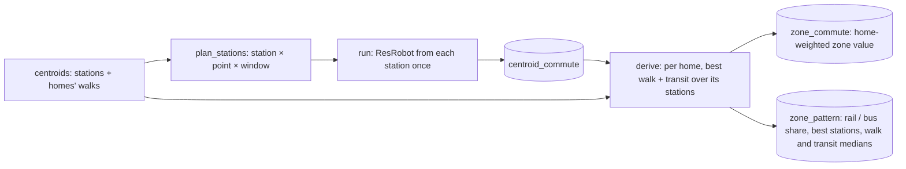
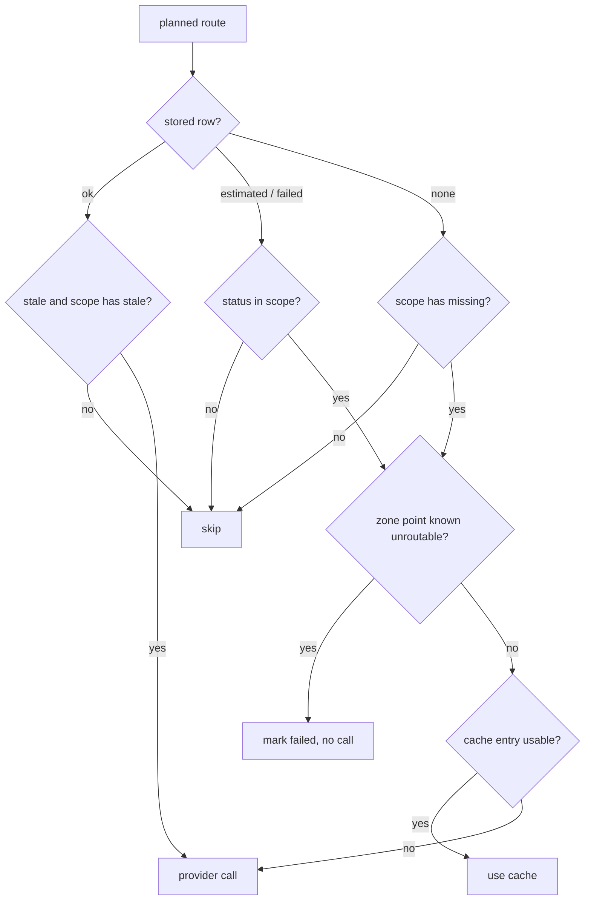
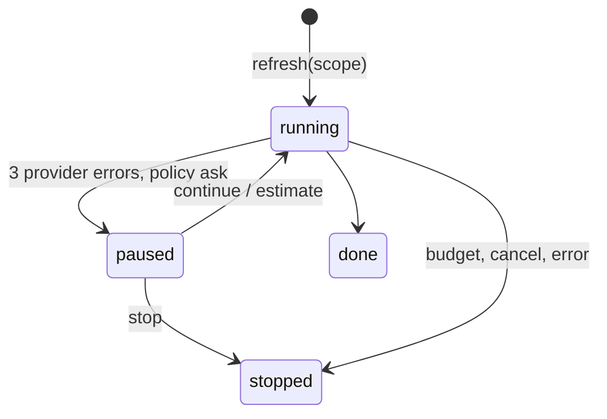
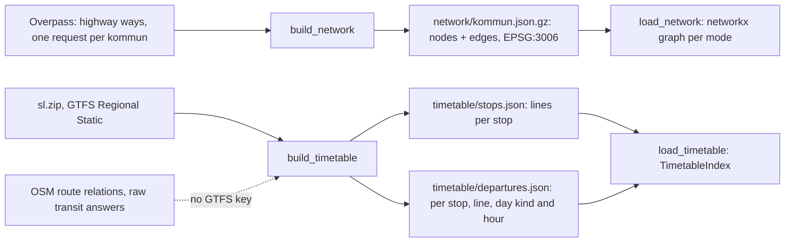
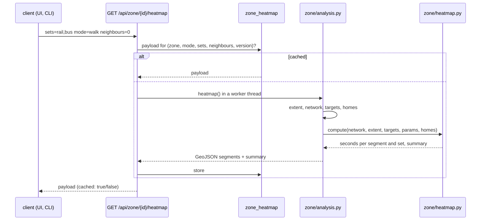
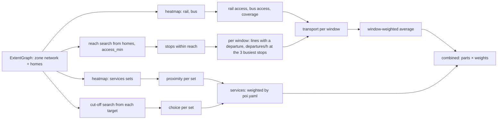

# Architecture: configuration, locations and scoring

Everything the user may want to change lives in YAML, not in code. This page covers how the files are loaded and
validated, the locations model (points, trips, windows), the config hash, the commute matrix and scoring. See the
[introduction](introduction.md) for the other components.

**Personal files.** `locations.yaml`, `profile.yaml`, `search_area.yaml`, `providers.env` and `backend.env` hold the
user's own data. They are gitignored; each has a committed dummy sibling (`*.example.yaml`, `*.env.example`) that is
complete and valid, and `scripts/ensure-env.sh` creates a missing real file from it without overwriting. A missing
personal file makes `load_all` report which example to copy. Tests build their config from the examples. Rule and
checklist: [personal_data.md](../principles/personal_data.md); setup: [`config/README.md`](../../config/README.md).

## Files and validation

| File | Role |
|---|---|
| `profile.yaml` (personal; [example](../../config/profile.example.yaml)) | per listing kind: `hard_filters` (gate) and `preferences` (weighted groups) |
| [`filters_catalog.yaml`](../../config/filters_catalog.yaml) | canonical filter keys, used by `hard_filters` and every site's `filter_map` |
| `locations.yaml` (personal; [example](../../config/locations.example.yaml)) | categories and points with trips and time windows |
| [`time_model.yaml`](../../config/time_model.yaml) | day types, default sampling grid, reliability statistics |
| [`poi.yaml`](../../config/poi.yaml) | nearby-service categories (OSM tags, radius, walking threshold, map icon and colour) |
| [`tags.yaml`](../../config/tags.yaml) | lifecycle statuses (per kind) and feedback reason tags |
| [`providers.yaml`](../../config/providers.yaml) | routing, geocoding, POI providers, mode priority, budget, cache, prefilter, map style |
| [`agent.yaml`](../../config/agent.yaml) | headless agent commands for the Run agent button |
| [`geo.yaml`](../../config/geo.yaml) | geodata region (municipalities) and dataset sources for `data/geo/` |
| `search_area.yaml` (personal; [example](../../config/search_area.example.yaml)) | the search area: weighted pieces, erasers, buffer (edited in Map → Area) |
| [`area_aliases.yaml`](../../config/area_aliases.yaml) | popular area names → zone ids (seeded from OSM place names) |
| [`transit_colours.yaml`](../../config/transit_colours.yaml) | line colours and labels per transit mode (GTFS has no colours) |
| `backend.env`, `providers.env` | process settings and provider keys (personal, gitignored; [`backend.env.example`](../../config/backend.env.example) and [`providers.env.example`](../../config/providers.env.example) committed) |

[`config/loader.py`](../../backend/src/findhome/config/loader.py) `load_all` parses every file, validates it against
[`config/schemas/<name>.schema.json`](../../config/schemas/profile.schema.json), validates every
`sites/*/site.yaml` (folders starting with `_` are templates), then runs cross-file checks: hard-filter keys exist
in the catalog for that kind, point categories exist, trip day types exist in the time model, mode priorities name
known providers, site `filter_map` keys exist in the catalog, site slugs match their folders, search-area piece ids
are unique and their geometries valid, and (when `data/geo/zones.geojson` exists) zone ids in the search area and
the aliases exist. All errors are
collected and returned together. [`config/models.py`](../../backend/src/findhome/config/models.py) gives typed
access after validation; the schemas are the source of truth.

[`config/store.py`](../../backend/src/findhome/config/store.py) keeps the active bundle in the API process and
reloads it when files change. An invalid edit leaves the last valid bundle active and exposes the errors on
`/health` and `/api/config`.

[`config/writer.py`](../../backend/src/findhome/config/writer.py) is the only code that writes config files. It
round-trips YAML with ruamel.yaml (comments and order kept, `null` written explicitly; inserted values are
styled like the hand-written files: small scalar lists and maps in flow style, `HH:MM` quoted, no anchors), validates the whole
config set on a temporary copy, and replaces the file atomically. `apply_ops` takes add / replace / remove
operations on a JSON pointer path; `write_text` replaces a whole file.

## Config hash

`config_hash` is a 16-character SHA-256 over the canonical JSON of the scoring files (profile, locations,
time_model, poi, tags, search_area). Every row in `scores` and `commute_results` stores the hash it was computed with. Reading
always uses the active hash, so changing a weight or a window makes old results invisible (stale) until
`scores recompute` or a new commute run.

## Locations: points, trips, windows

A **point** has an id, a category (defined in the same file with label, default weight, colour, icon), a label,
`address` or `coords`, an optional weight, notes, modes and one or more **trips**. Any number of points can share a
category: several workplaces, several partner homes, generic points.

The Locations editor suggests addresses while typing through `GET /api/geocode/suggest`
([`providers/suggest.py`](../../backend/src/findhome/providers/suggest.py): OpenRouteService autocomplete with
`ORS_API_KEY`, else Photon; never Nominatim, whose policy forbids autocomplete). Picking a suggestion saves both
`address` and `coords`, so the point does not depend on runtime geocoding.

**Geocoding** ([`providers/geocode.py`](../../backend/src/findhome/providers/geocode.py)) resolves points
without `coords` and listings without coordinates through `geocode_cache`. The query sent to Nominatim gets
`, Sverige` only when the address names no country (`sverige` / `sweden`). Hits are cached for
`cache.geocode_ttl_days`, misses for one day. `findhome geocode "<address>" [--refresh]` uses the same cached
path through `GET /api/geocode`.

A **trip** has a `direction` (`to_point` = home → point, `from_point` = point → home, `both`), `day_types`, and
either `windows` or `use_default_grid: true`. A trip may override the point's modes.

A **window** is `arrive_by` (be at the destination between `from` and `to`) or `depart_at` (leave between them),
with a `weight` and a `step_min`. Windows may cross midnight (`18:00` → `03:00`).
[`config/timegrid.py`](../../backend/src/findhome/config/timegrid.py) expands windows into slots counted in
minutes from midnight of the reference day, so `01:00` after midnight is minute 1500. The default grid adds its
`dense` sub-windows (e.g. 07:00-09:00 every 15 minutes).

## Commute matrix

[`domain/commute.py`](../../backend/src/findhome/domain/commute.py) `compute_listing`:

1. `plan_requests` expands enabled points × trips × directions × day types × slots × modes. Points without
   coordinates are reported (`missing_coords`; addresses starting with `TODO` are never geocoded); points farther
   than `prefilter.max_haversine_km_by_category` are skipped (`prefiltered`).
2. Each request picks a provider by `mode_priority` from
   [`providers/registry.py`](../../backend/src/findhome/providers/registry.py): the first enabled provider that
   has its key and supports the mode, else the haversine estimate.
3. Each sample is looked up in `routing_cache`. The key holds provider, mode, rounded origin and destination, and
   for time-dependent providers the day type, slot and arrive/depart kind. Identical keys within one run are
   requested once.
4. Provider calls respect the run budget (`budget.max_routing_calls_per_run`). After three consecutive errors a
   provider is replaced by the haversine estimate for the rest of the run. `dry_run` only counts unique calls and the
   Google cost estimate.
5. Samples are grouped per (point, direction, day type, window, mode) and stored with median, p90 (nearest
   rank), worst and spread (p90 − median) under the active config hash.

Sampled times use a reference date per day type: the next date on the preferred weekday that is not in
`skip_dates`, so timetable answers stay comparable between runs.

Providers: [`haversine.py`](../../backend/src/findhome/providers/haversine.py) (straight line × detour ÷ speed, +5
min wait for transit), [`osm.py`](../../backend/src/findhome/providers/osm.py) (OSRM drive, Nominatim geocoding,
1 req/s), [`resrobot.py`](../../backend/src/findhome/providers/resrobot.py) (transit; spaced at 90 % of `routing.resrobot.plan` or
`max_calls_per_minute`; a 429 or a per-minute `API_QUOTA` answer waits and is retried),
[`google.py`](../../backend/src/findhome/providers/google.py) (Routes API, minimal field mask),
[`ors.py`](../../backend/src/findhome/providers/ors.py) (OpenRouteService walking: directions and matrix).

## Points of interest and the test point

[`poi.yaml`](../../config/poi.yaml) lists categories with OSM tags (`key=value`, `a|b` alternatives, `key~regex`,
`key!=value`, `&` for conditions on one element; grammar in
[`providers/poi.py`](../../backend/src/findhome/providers/poi.py) `tag_filters`), a walking threshold
(`max_walk_min`), and the map blip (`icon`, `color`). `findhome geo fetch poi`
([`geo/build_poi.py`](../../backend/src/findhome/geo/build_poi.py)) fetches each category for the whole region
(one Overpass request per category) into `data/geo/poi/<category>.geojson`;
[`geo/store.py`](../../backend/src/findhome/geo/store.py) `load_poi` keeps an STRtree per category in
EPSG:3006. POIs reach the score through the house analysis and the `services` group (see Scoring).

The **test point** ([`domain/probe.py`](../../backend/src/findhome/domain/probe.py), `POST /api/probe`) answers
for any spot: the area result, the 3 nearest places per category by walking minutes (5 straight-line candidates
per category, one ORS matrix call for all of them, each pair cached in `routing_cache`, haversine × detour as
fallback) and one ResRobot itinerary per enabled point (first trip, its first day type, the middle slot of its
first window), cached by ~100 m origin cell. Saved, named test points (`probes` table, `/api/probes`) are an
**alpha** feature; nothing else depends on them.

## Transit network

`findhome geo fetch transit` ([`geo/build_transit.py`](../../backend/src/findhome/geo/build_transit.py)) writes
`data/geo/transit/lines_<mode>.geojson` (one feature per line, both directions merged), `stations.geojson` and
`meta.json`. Sources follow `geo.yaml` `datasets.transit.order`: SL GTFS when `TRAFIKLAB_GTFS_KEY` is set (dominant
shape per route and direction, parent stations), else OSM route relations. Modes are metro, commuter_rail,
local_rail (Roslagsbanan, Saltsjöbanan), tram (incl. Tvärbanan, Lidingö- and Nockebybanan), train (regional),
bus and ferry; `classify` holds the line-number rules. A station serves the lines that pass within
`station_snap_m` of it (no timetables needed); platforms with the same name and mode are merged. Colours:
`transit_colours.yaml` per line, then OSM `colour`, then the mode default. Nothing here changes scores.

**Itinerary legs on the track.** ResRobot gives a ride as its stops (`passlist=1`), which drawn as straight lines
cut across blocks and water. [`dress_legs()`](../../backend/src/findhome/domain/probe.py#L218) maps each leg to the
saved line ([`TransitIndex.key_for()`](../../backend/src/findhome/geo/store.py#L167): the leg's ref, else without a
trailing letter) and [`leg_path()`](../../backend/src/findhome/geo/store.py#L176) draws it along that line:
- the line's way pieces are one graph (`_line_graph()`); pieces whose ends are within `GAP_M` (40 m) are joined;
- every stop, boarding and alighting included, joins each track within `TRACKS_M` (60 m) of the nearest one. The
  two directions are often separate pieces joined only at the termini, and a stop on the other direction would
  otherwise send the path to the end of the line and back;
- consecutive stops are joined by the shortest way along the track; a piece longer than `DETOUR` × straight
  + 300 m is drawn straight between its two stops; with less than half the pieces followed, the leg keeps its stops.

Walk legs (two points from ResRobot) follow the street network where it is mapped
([`street_path()`](../../backend/src/findhome/zone/house.py#L135), up to `STREET_MAX_M`). The drawn geometry is
stored with the cached itinerary (`DRESSED` version), so street routing runs once per itinerary. `on_track` and
`on_street` say which legs follow the real geometry; the maps leave out a walk leg that does not.

## Connectivity matrix

[`domain/connectivity.py`](../../backend/src/findhome/domain/connectivity.py) answers "how well connected is each zone to my points".
[`plan_origins()`](../../backend/src/findhome/domain/connectivity.py#L48) makes one transit request per origin × enabled point × trip
direction × window (the window's middle slot, the trip's first day type). `providers.yaml` `connectivity.origin`
chooses the origins:

- `stations` (default once `findhome zone centroids` has run): every zone's **connectivity centroids**, each station
  routed once from its own coordinate ([`plan_stations()`](../../backend/src/findhome/domain/connectivity.py#L80)), so the provider always
  finds a stop. Answers go to `centroid_commute`, and the zone values are derived from them.
- `zone`: one point inside each zone ([`plan()`](../../backend/src/findhome/domain/connectivity.py#L74),
  [`zone_origin()`](../../backend/src/findhome/domain/connectivity.py#L36)), written straight to `zone_commute`.

Nothing here changes scores.

**Connectivity centroids** ([`zone/centroids.py`](../../backend/src/findhome/zone/centroids.py), built by
[`build_centroids()`](../../backend/src/findhome/zone/centroid_build.py#L119) into `data/geo/centroids/`). `zone.yaml`
`centroids.strategy` chooses how:

- `stops` (default): [`stop_cover()`](../../backend/src/findhome/zone/centroids.py#L94) places the fewest free circles
  of `range_m` (radius) so that every bus, tram, train, metro and ferry stop of the region lies in one; no stop is left
  out. Candidate centres are every stop and the two centres of the circles through each pair of nearby stops; a greedy
  pass takes the most uncovered stops, then each circle is re-centred on the smallest circle around its stops. A
  circle is `rail` when one of its stops has a rail line, else `bus`. A zone uses every circle within `walk_min` of it.
  With `range_m: 200` that is 1,201 centroids for the 4,576 stops.
- `homes`: per zone and group (rail, bus), [`cover()`](../../backend/src/findhome/zone/centroids.py#L50) picks the
  fewest stations that put `coverage` of the zone's homes within `walk_min`, each adding at least `min_gain`; a group
  with nothing near keeps one reference station ([`select()`](../../backend/src/findhome/zone/centroids.py#L75)).

Every home keeps its walk time to each of its zone's centroids (up to `max_walk_min`).



| Step | Code |
|---|---|
| origin choice, plan, refresh job then derive | [`origin_kind()`](../../backend/src/findhome/api/routers/connectivity.py#L61), [`derive_zones()`](../../backend/src/findhome/api/routers/connectivity.py#L81) |
| the comparison pass (pure) | [`derive()`](../../backend/src/findhome/domain/connectivity_derive.py#L36) |
| rerun the pass on stored answers | `POST /api/connectivity/derive` |

The **comparison pass** runs after every station refresh, also one cut short. For each zone and route, every home
takes its best start: walk to the station + transit from it. The zone value is the home-weighted mean of those bests.
The route is `failed` when no home reaches a station with an answer, and `estimated` when most bests use estimates.
The pattern records where the best trips start (rail or bus station, the winning stations) and what they ride near
the zone (`modes`: the first ride outbound, the last ride on the way back, from the trip's legs, stored as
`zone_mode`). A trip from a bus stop may walk on to the metro, so only `modes` says whether a bus beats a nearby
metro. It also records the walk and transit medians. `GET /api/zone/{id}/centroids` returns them for the zone view.

[`run()`](../../backend/src/findhome/domain/connectivity.py#L225) is a background job in the API (`POST /api/connectivity/refresh`,
`findhome connectivity refresh`; one at a time, cancellable). It uses the transit provider, `routing_cache` and the
reference dates of the commute matrix, stops at `connectivity.max_calls_per_run`, and writes every route as soon as
it is known (to `centroid_commute` or `zone_commute`) under `inputs_hash` (canonical hash of `locations.yaml` + `time_model.yaml`, so
search-area or weight edits keep the matrix). A locations or time-model edit changes the hash, but not the
`routing_cache` keys (provider, coordinates, day type, slot): before the matrix is read and before a refresh,
[`restore()`](../../backend/src/findhome/api/routers/connectivity.py#L94) gives every planned route that has no row
under the new hash its cached answer, or its failed status for a known unroutable point, in bulk and without a call
([`restore_rows()`](../../backend/src/findhome/domain/connectivity.py#L133); also `POST /api/connectivity/restore`).
A renamed point or category therefore keeps the whole map; a moved or added point, or a changed window, leaves only
its own routes missing, and the refresh calls only for those. Storage goes through the
[`ConnectivityStore`](../../backend/src/findhome/db/connectivity_repo.py#L49) protocol
([`PgConnectivityStore`](../../backend/src/findhome/db/connectivity_repo.py#L100) in the API, an in-memory store in tests).

A refresh has a **scope** ([`parse_scope()`](../../backend/src/findhome/domain/connectivity.py#L94)): `missing`, `estimates`, `failed`,
`stale` or `all`; the default is missing + estimates. [`decide()`](../../backend/src/findhome/domain/connectivity.py#L114) chooses per
route, and the cost preview (`GET /api/connectivity/plan`) uses the same function:



| Step | Code |
|---|---|
| per-route decision | [`decide()`](../../backend/src/findhome/domain/connectivity.py#L114) |
| zone end of a request (where `SVC_LOC` applies) | [`zone_side()`](../../backend/src/findhome/domain/connectivity.py#L109) |
| unroutable point: stored once, its other routes fail without a call | [`except LocationNotFound`](../../backend/src/findhome/domain/connectivity.py#L287), table `provider_failure` |
| ResRobot error body → typed error | [`_error()`](../../backend/src/findhome/providers/resrobot.py#L165) |

The job **never falls back to estimates on its own**. An unroutable zone point is the zone's problem, not the
provider's, so it never pauses the job. Three other provider errors in a row
([`consecutive >= MAX_CONSECUTIVE_ERRORS`](../../backend/src/findhome/domain/connectivity.py#L300)) follow
`providers.yaml` `connectivity.on_provider_failure`: `ask` pauses until `POST /api/connectivity/decision` (the
Connectivity mode shows a dialog; its "don't ask again" writes the policy), `continue` keeps calling, `estimate`
fills the rest of the run with tagged straight-line estimates.



| State handling | Code |
|---|---|
| job state, pause and answer | [`JobState`](../../backend/src/findhome/domain/connectivity.py#L158), [`ask()`](../../backend/src/findhome/domain/connectivity.py#L196), [`JobState.decide()`](../../backend/src/findhome/domain/connectivity.py#L189) |
| endpoints (matrix, routes, plan, refresh, decision, cancel) | [`api/routers/connectivity.py`](../../backend/src/findhome/api/routers/connectivity.py#L54) |

Every planned route has a **status**, derived in one place
([`route_status()`](../../backend/src/findhome/domain/connectivity_status.py#L23)): `cached` (answered, younger than
`cache.routing_ttl_days`), `stale` (answered longer ago; still used, refreshed only with the `stale` scope),
`estimated`, `failed` (with its reason), `missing`, `pending` (missing while a refresh runs). `zone_commute.status`
stores ok / estimated / failed and `fetched_at` the provider's answer time; `GET /api/connectivity` returns the
counts, `GET /api/connectivity/routes` the filtered, paged list.

[`aggregate()`](../../backend/src/findhome/domain/connectivity.py#L328) gives per zone the window-weighted minutes per point and the
point-weighted mix (point weights as in the commute score); the matrix endpoint returns it with and without
estimates (`zones`, `zones_real`) and lists the zones with only failed routes.

## Zones and the search area

**Zones** are SCB RegSO 2025 statistical areas (CC0) of the municipalities in `geo.yaml` (263 for the 9 around
Stockholm), grouped by Stockholm's stadsdelsområden from OSM. `findhome geo fetch zones`
([`geo/build_zones.py`](../../backend/src/findhome/geo/build_zones.py)) downloads them, simplifies them and writes
`data/geo/zones.geojson` (gitignored), and seeds `area_aliases.yaml` from OSM place names when it is empty.
[`load_zones()`](../../backend/src/findhome/geo/store.py) repairs invalid outlines (a self-touching ring in the
source data) with [`polygonal()`](../../backend/src/findhome/geo/crs.py), so unions over many zones (a whole-region
search area, the analysed region) do not fail; the area compiler repairs drawn shapes and erasers the same way.
[`geo/store.py`](../../backend/src/findhome/geo/store.py) loads the file once per process (reloaded when it
changes) with an STRtree. Geometry runs in SWEREF 99 TM (EPSG:3006, metres) through
[`geo/crs.py`](../../backend/src/findhome/geo/crs.py); files and the API use WGS84.

The **search area** (`search_area.yaml`) is a list of pieces: `zones` (RegSO ids), `shape` (a GeoJSON polygon
from the brush, lasso, circle or polygon tool) and `eraser` (cuts every other piece), each with a weight 0..1, plus
`buffer_m`. [`geo/area.py`](../../backend/src/findhome/geo/area.py) `compile_area` unions each piece, removes the
erasers and caches the result per content and zones file; `area_eval(lat, lon)` returns inside, the distance to
the nearest piece, the depth inside, the per-piece contributions and the score
`max(weight × falloff)`, where the falloff is 1 inside and falls linearly to 0 at `buffer_m` outside. The Area
mode edits the pieces and saves them through the config writer. Its Zones bubble has **Select all N zones**
(every mapped zone into the zone piece, then the Zones tool, so a click on the map removes an unwanted one) and
**Clear zones**. `POST /api/area/brush` turns a painted stroke
into a polygon (buffered in metres, unioned with or cut from a base piece). Agents read the area with
`findhome area show` and the history digest's Search area section.

## Walking network and timetable data

Two local datasets feed the zone analysis. Both are built by `findhome geo fetch <dataset>` into `data/geo/`
(gitignored) and need no API call at query time.



| Step | Code |
|---|---|
| walk / bike access per way (`geo.yaml` `datasets.network`) | [`access()`](../../backend/src/findhome/geo/build_network.py#L38) |
| split ways at shared nodes into edges | [`edges_from_ways()`](../../backend/src/findhome/geo/build_network.py#L49) |
| fetch per kommun, raw answers reused for `refresh_days` | [`build_network()`](../../backend/src/findhome/geo/build_network.py#L86), [`geo/overpass.py`](../../backend/src/findhome/geo/overpass.py) |
| merged graph of several kommuner, nearest node | [`load_network()`](../../backend/src/findhome/zone/network.py#L78), [`Network`](../../backend/src/findhome/zone/network.py#L25) |
| services per date (`calendar` + `calendar_dates`), reference dates | [`active_services()`](../../backend/src/findhome/geo/build_timetable.py#L51), [`reference_dates()`](../../backend/src/findhome/geo/build_timetable.py#L69) |
| lines per stop, departures per hour (streams `stop_times`) | [`from_gtfs()`](../../backend/src/findhome/geo/build_timetable.py#L82) |
| fallback without a GTFS key: lines per stop only | [`from_osm()`](../../backend/src/findhome/geo/build_timetable.py#L126) |
| query side: stops near a point, lines, departures | [`TimetableIndex`](../../backend/src/findhome/geo/store.py#L283), [`load_timetable()`](../../backend/src/findhome/geo/store.py#L321) |

**Network.** A way is walkable when its `highway` class is in `datasets.network.walk` (or `foot=yes`), and cyclable
when it is in `bike`, or in `bike_if_allowed` with `bicycle=yes|designated`. `foot=no`, `bicycle=no` and
`access=no|private` remove it. Each edge joins two junctions or dead ends and keeps its geometry, so a heatmap can
draw it. Buildings are not obstacles: the ways already go around them. One-way streets are ignored, including for
cycling. Ways crossing a municipal border are in both files and merge by OSM node id.

**Timetable.** The GTFS source reuses the transit layer's `sl.zip` (no second download). The weekday reference date
is the first Tuesday with service from today; Saturday and Sunday likewise. Departures after midnight (`25:10`) fold
into hour 1. Without `TRAFIKLAB_GTFS_KEY` the stops come from the OSM route relations: they have lines, but no
names and no departures (`departures_at()` returns `None`).

## Zone analysis

The zone analysis studies one zone up close. [`config/zone.yaml`](../../config/zone.yaml) holds the walking and
cycling speeds, per-highway speed factors (stairs), the cutoff, the legend bins and the **target sets**: what a
heatmap measures the walk to, as stops by transit mode (timetable) and/or POI categories (`poi.yaml`, checked by the
loader). It is not in the config hash: nothing here changes scores.



| Step | Code |
|---|---|
| focus (zone, optional neighbours) and search area (focus + reach) | [`extent()`](../../backend/src/findhome/zone/extent.py#L29), [`neighbours()`](../../backend/src/findhome/zone/extent.py#L22) |
| target points per set | [`target_points()`](../../backend/src/findhome/zone/targets.py#L17) |
| homes: residential buildings weighted by floors (`geo fetch buildings`) | [`homes_from_elements()`](../../backend/src/findhome/geo/build_buildings.py#L44), [`load_homes()`](../../backend/src/findhome/zone/homes.py#L13) |
| one Dijkstra per set from a virtual source, cutoff, segment times, summary | [`compute()`](../../backend/src/findhome/zone/heatmap.py#L115) |
| cache key: datasets' meta, zone.yaml, POI file times | [`version()`](../../backend/src/findhome/zone/analysis.py#L60) |
| endpoints: zone at a point, facts, lines, targets, heatmap | [`api/routers/zone.py`](../../backend/src/findhome/api/routers/zone.py#L33) |
| lines at the zone's stops (and the neighbours') with departures per hour | [`lines()`](../../backend/src/findhome/zone/analysis.py#L184) |

[`compute()`](../../backend/src/findhome/zone/heatmap.py#L115) works on the network inside the search area. Every target snaps to its nearest
node (at most `snap_max_m`), and the snap walk is the weight of its edge from the virtual source. Edge time is
`length / (speed × factor)`. A segment's time is the mean of its two end nodes, and is missing when an end is
beyond the cutoff. The summary per set (and `any`, the nearest of all sets) is weighted by homes inside the focus.
Each home snaps to the network and adds its snap walk: median, p90, share within 5 and 10 minutes, share reached.
Without the buildings dataset, every network node inside the focus counts once (`homes_source: network`).
`findhome zone heatmap <zone id> --sets rail,bus` prints the summary.

### Zone indices

Every zone has three indices from 0 to 100:
- **transport**: walking access to rail and bus, coverage, lines and departures; per time window and as a
  window-weighted average (the main value);
- **services**: everyday services within walking distance, without transit;
- **combined**: the weighted mean of named parts (`zone.yaml` `combined.parts`, today transport 0.5 and
  services 0.5), per window and averaged.

Each component maps a measured value linearly from its `zero` to its `full` threshold, so a zone's value does not
depend on the other zones. The map colours zones by percentile among the computed zones.

**Services.** Per service set (`indices.services.sets`) there are two parts:
- **proximity**: the home-weighted median walk to the nearest target, from `zero` to `full` minutes;
- **choice**: the home-weighted median number of targets within `choice.within_min`, from 0 to `choice.full`.

They mix as `proximity × (1 − choice.weight) + choice × choice.weight`. A set with nothing within the cut-off has
proximity 0. Sets weigh the highest `poi.yaml` weight among their categories (the gym set takes `gym` and `sats`),
so `poi.yaml` is part of the inputs version.



| Part | Measured as | Code |
|---|---|---|
| `rail_access`, `bus_access` | home-weighted median walk (minutes) to the set | [`measure()`](../../backend/src/findhome/zone/measure.py#L63) |
| `coverage` | share of homes within 5 min of any stop | [`measure()`](../../backend/src/findhome/zone/measure.py#L63) |
| `lines`, `frequency` | per window, at the stops within `access_min` of a home; rail lines count 3 | [`reachable_stops()`](../../backend/src/findhome/zone/measure.py#L18), [`window_counts()`](../../backend/src/findhome/zone/measure.py#L32) |
| services proximity, choice | median walk per set; median count within `choice.within_min` | [`choice_median()`](../../backend/src/findhome/zone/measure.py#L54), [`counts_within()`](../../backend/src/findhome/zone/heatmap.py#L106) |
| set score, services index | the mix above, then the weighted mean of the sets | [`service_set_score()`](../../backend/src/findhome/zone/indices.py#L71), [`services_score()`](../../backend/src/findhome/zone/indices.py#L87), [`set_weights()`](../../backend/src/findhome/zone/analysis.py#L201) |
| combined | weighted mean of the parts with a value | [`combined()`](../../backend/src/findhome/zone/indices.py#L103) |
| scoring and weights | missing components are left out and weights renormalise | [`score()`](../../backend/src/findhome/zone/indices.py#L28), [`indices()`](../../backend/src/findhome/zone/indices.py#L115) |

Each index comes with a **derivation**: rows of measured input → score 0..1 × weight. The UI shows it under
"How is this calculated?". The payload also has `services_detail` (walk, choice, weight and score per set) and
**POI density** per services set: the count inside the zone, per 1,000 home units (buildings weighted by floors,
`density.per_homes`) and per km² ([`density()`](../../backend/src/findhome/zone/analysis.py#L212)).

Without GTFS departures, `frequency` is missing and `lines` counts every line at the reachable stops.
`GET /api/zone/region` returns the analysed area (the union of all zones, simplified to ~20 m) and a mask
of everything outside it, for the maps that grey out what the app does not analyse.
`GET /api/zone/{id}/indices` computes a zone once per inputs version (a few seconds) and stores it in `zone_index`.
`GET /api/zone/indices?window=` returns every stored zone's transport, services and combined values and its density
values, each with a percentile ([`all_indices()`](../../backend/src/findhome/api/routers/zone.py#L39),
[`percentiles()`](../../backend/src/findhome/zone/analysis.py#L265)). The window applies to transport and combined. `findhome zone indices --all` fills the
cache; it makes no API calls.

### House analysis

A listing is measured from its **exact address** with the same engines and formulas as its zone, so the house and
the zone compare line by line. The datasets are local and nothing calls an API.

```mermaid
flowchart TD
  A[listing lat/lon] --> X[house extent: the zone under the point,<br/>a circle of the walking reach]
  X --> EG[ExtentGraph, no homes]
  T[targets per set: zone.yaml house.sets] --> D
  EG --> D[one Dijkstra from the address<br/>times + node paths, cut-off house.cutoff_min]
  D --> W[per set: nearest target, minutes, metres,<br/>path geometry, count within choice.within_min]
  D --> ST[stops within access_min → lines, departures per window]
  W --> IX[indices(): transport without coverage,<br/>services, combined]
  ST --> IX
  D --> SW[walk to each centroid station of the zone]
  IX --> C[(listing_location)]
  W --> C
  SW --> C
```

| Step | Code |
|---|---|
| extent around the address | [`house_extent()`](../../backend/src/findhome/zone/house.py#L64) |
| walks, paths, counts and the nearby targets for the map (`nearby`) | [`walk_paths()`](../../backend/src/findhome/zone/house.py#L82) (edge geometry from `Network.edges[idx]`, reversed when stored the other way) |
| house indices, stops, station walks | [`house_analysis()`](../../backend/src/findhome/zone/house.py#L196), [`station_walks()`](../../backend/src/findhome/zone/house.py#L170) |
| cache version: zone inputs, poi.yaml, centroids, coordinates | [`version()`](../../backend/src/findhome/zone/house.py#L185) |

`GET /api/listings/{id}/location` ([`location()`](../../backend/src/findhome/api/routers/house.py#L115)) serves the cached payload
([`house_payload()`](../../backend/src/findhome/api/routers/house.py#L40); computed in a few seconds when missing) and adds what depends on stored rows:
- **station estimate** per point ([`estimates()`](../../backend/src/findhome/zone/house.py#L278)): for each trip window, the cheapest
  `walk(home → station) + centroid_commute(station → point)`; then the window-weighted mean. Without station rows,
  the zone's `zone_commute` value is used; without that, "not computed";
- the zone's indices and percentiles (`zone_index`, computed when missing);
- **insight lines** ([`insights()`](../../backend/src/findhome/zone/house.py#L418)): each set's walk against the zone median, and each point's minutes (the
  listing's own commute when computed, else the estimate) against the zone and as "better than N % of zones".

`POST /api/listings/{id}/transit` ([`transit()`](../../backend/src/findhome/api/routers/house.py#L175)) is the only call that uses ResRobot. It is triggered
by the two buttons of the Transit routes bubble: `which=points` for your points
([`point_destinations()`](../../backend/src/findhome/domain/probe.py#L135)), `which=services` for the nearest target of each service set, reached on a
weekday at `house.services_depart` (`all`, the default, does both). Itineraries go through [`trips_to()`](../../backend/src/findhome/domain/probe.py#L163) and are cached in `routing_cache` per ~100 m
cell, like the test point's. With `dry=true` it returns only the number of calls not yet cached
([`uncached_trips()`](../../backend/src/findhome/domain/probe.py#L157)). `findhome listings location --all` warms the cache for every listing.

### Listing statistics per zone

`GET /api/zone/stats` ([`listing_stats()`](../../backend/src/findhome/api/routers/zone.py#L75)) places each
listing that passes the filters in its zone. The filters are pipeline statuses; seen on the site (`active` = seen
within `active_days`, `gone`, `all`); passing or rejected by the hard filters; posting date (Qasa
`attributes.publishedAt`); first-seen date; and rent, size and rooms ranges. They are built by
[`where_sql()`](../../backend/src/findhome/domain/listing_stats.py#L35).
[`zone_stats()`](../../backend/src/findhome/domain/listing_stats.py#L69) returns per zone `n`, `per_km2` and,
from `min_n` listings (default 3), the median, p25 and p75 of rent, rent per m², size and rooms. The response also
lists the counted listings' points for the density heatmap. There is no price history table: price over time
comes from filtering on posting dates.

## Scoring

[`domain/scoring.py`](../../backend/src/findhome/domain/scoring.py) `score_listing`:

- Hard filters from the listing kind's profile gate the listing. Any failure gives `total = null` and lists the
  reasons in `rejected_by`. `pet_status_exclude` defaults to `["no"]`. A sleeping alcove adds one room only when
  `accept_sovalkov` is true. `max_commute_min_by_category` uses the best median of that category's points.
- Each enabled preference group returns a 0..1 score or `None` when its data is missing (for example cost while
  `max_rent_sek` and `ideal_rent_sek` are unset). The total is the weighted mean of the groups that returned a
  score. Groups: cost, space, commute (point weight × window weight, linear between `good_min` and `bad_min`,
  reduced when the spread exceeds `reliability_spread_penalty_min`), cat_suitability, building_comfort,
  contract_availability, area (the area function's score; its breakdown keeps the contributions), transport and
  services ([`_transport()`](../../backend/src/findhome/domain/scoring.py#L187),
  [`_services()`](../../backend/src/findhome/domain/scoring.py#L204)), and
  neighbourhood ([`_neighbourhood()`](../../backend/src/findhome/domain/scoring.py#L157)).
- **transport** is the home's transport score / 100, **services** the home's services score / 100, both from the
  house analysis. The home transport score blends access with **reach**, the transit minutes to your points
  ([`house_scores()`](../../backend/src/findhome/zone/house.py#L367)):
  `transport = (1 − w) · access + w · reach`, with `zone.yaml` `house.reach` (`weight 0.6`, `good_min 20`,
  `bad_min 60`). Per point, [`pick_minutes()`](../../backend/src/findhome/zone/house.py#L333) takes the first source
  that has minutes: the listing's commute (`commute_results`), a cached house itinerary (`routing_cache`
  `resrobot-trip|…`), then the Connectivity estimates (walk to a station + `centroid_commute`, else the zone's
  `zone_commute` row). The last two mark the score **estimated**: `breakdown.transport.estimated`, and an orange dot
  next to the value in the UI. [`house_scores_for()`](../../backend/src/findhome/api/routers/house.py#L94) computes
  them from caches only and stores them in `listing_location.payload.scores`, on `GET .../location`, after
  `POST .../transit` and on every `scores recompute`. `house.reach` is in `NOT_HASHED`
  ([`zone/analysis.py`](../../backend/src/findhome/zone/analysis.py)): editing it needs a recompute, not a new analysis.
- **No double counting.** While the transport group is on and the home has reach minutes, the commute group returns
  `None` ("counted in the transport group"); while transport or services is on, neighbourhood returns `None`. The
  hard filter `max_commute_min_by_category` still reads `commute_results`.
- **neighbourhood** (off by default) combines three 0-100 parts: the home's services score, the home's transport
  score and the zone's services index, by default `house_services 0.5, house_transport 0.3, zone_services 0.2`;
  missing parts renormalise. `scores recompute` reads only cached values
  ([`_location()`](../../backend/src/findhome/api/routers/scoring.py#L58)). A listing whose house analysis is not
  computed yet gets `None` for these groups (run `findhome listings location --all`); a listing outside every zone
  gets `None` with "outside the analysed zones", so these groups do not count in its mean. Breakdowns carry the
  derivation rows (`detail`; per-point rows are `sub` rows, shown but not added).
- With a search area defined, a listing whose area score is 0 (beyond the buffer) is rejected with
  `outside_search_area`, and the text filters `areas_include` / `areas_exclude` are not used. A listing without
  coordinates is not rejected: the area group is `None` (`area_unknown`). `scores recompute` geocodes up to 60
  listings without coordinates per run from `address_raw` (cached) before scoring.
- A disabled listing kind (`buy` today) is rejected with `kind_disabled.<kind>`.

## Where the code lives

| Concern | File |
|---|---|
| Load, validate, hash | [`config/loader.py`](../../backend/src/findhome/config/loader.py) |
| Write config | [`config/writer.py`](../../backend/src/findhome/config/writer.py) |
| Windows and grids | [`config/timegrid.py`](../../backend/src/findhome/config/timegrid.py) |
| Commute matrix | [`domain/commute.py`](../../backend/src/findhome/domain/commute.py) |
| Scoring | [`domain/scoring.py`](../../backend/src/findhome/domain/scoring.py) |
| Zones, search area, area function | [`geo/`](../../backend/src/findhome/geo/area.py), [`api/routers/geo.py`](../../backend/src/findhome/api/routers/geo.py) |
| Walking network, timetable, buildings | [`geo/build_network.py`](../../backend/src/findhome/geo/build_network.py), [`geo/build_timetable.py`](../../backend/src/findhome/geo/build_timetable.py), [`geo/build_buildings.py`](../../backend/src/findhome/geo/build_buildings.py) |
| Zone analysis (heatmaps) | [`zone/`](../../backend/src/findhome/zone/heatmap.py), [`config/zone.yaml`](../../config/zone.yaml) |
| Area editor (UI) | [`pages/map/area-mode.ts`](../../frontend/src/app/pages/map/area-mode.ts) |
| Locations editor (UI) | [`pages/locations.ts`](../../frontend/src/app/pages/locations.ts) |
| Tests | [`tests/config/test_config.py`](../../backend/tests/config/test_config.py), [`tests/unit/test_commute_plan.py`](../../backend/tests/unit/test_commute_plan.py), [`tests/unit/test_scoring.py`](../../backend/tests/unit/test_scoring.py), [`tests/unit/test_area.py`](../../backend/tests/unit/test_area.py) |
