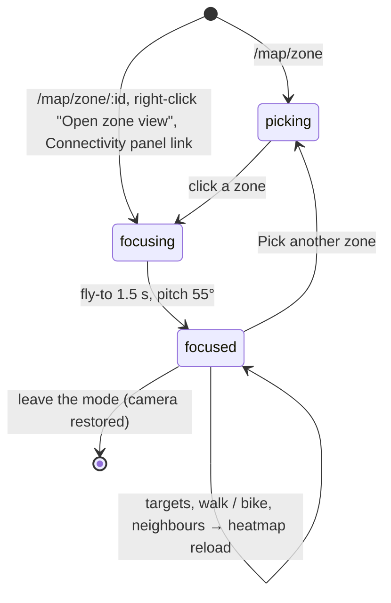
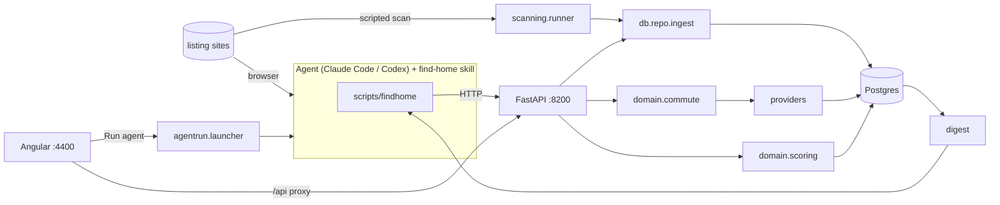
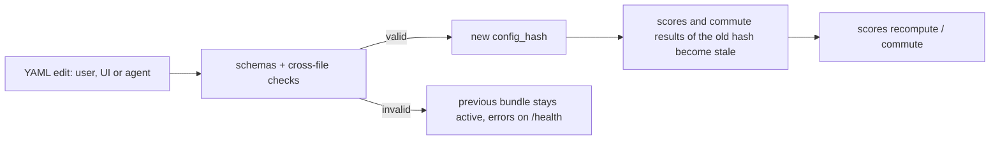

# Architecture: introduction

A short tour of the components and how data moves between them. See the [overview](../overview.md) for the
directory map.

## Components

**Infrastructure.** [`docker-compose.yml`](../../docker-compose.yml) runs Postgres 16 on host port 5434 and pgAdmin
on 5052 with the server preloaded from [`infra/pgadmin/`](../../infra/pgadmin/servers.json). The API and the
Angular dev server run on the host, started by [`.vscode/launch.json`](../../.vscode/launch.json) and
[`.vscode/tasks.json`](../../.vscode/tasks.json). There is one app debug configuration, `FH: Full Stack`, which
launches FastAPI under debugpy. Its `preLaunchTask`, `FH: Dev Prereqs`, runs in sequence: free app ports,
[`scripts/ensure-env.sh`](../../scripts/ensure-env.sh) to create a missing `backend/.venv`, `frontend/node_modules`
or `config/*.env`, [`scripts/infra-up.sh`](../../scripts/infra-up.sh), migrate, then `FH: ng serve`. Angular runs as
a background task; its readiness matcher releases the pre-launch chain when the local URL is printed.
The infrastructure script stops all project containers before running
`docker compose up -d --wait --wait-timeout 90`, which recreates containers whose configuration changed.
Both services have health checks; pgAdmin must answer `/misc/ping` before launch continues. A startup failure
prints service status and recent logs, then stops the containers.
The launch's `postDebugTask`, `FH: Dev Stop`, frees the app ports and runs `FH: Infra Stop`
(`docker compose stop --timeout 30`). A debug restart uses the same stop/start sequence.

Postgres data is bind-mounted from the local `data/postgres/` folder into `/var/lib/postgresql/data`.
The folder and local backups under `data/backups/` are gitignored. Removing containers or Compose volumes
does not delete these database files. A fresh folder is initialised by the Postgres image; an existing cluster
is reused. Keep this folder when cleaning local runtime data.
[`scripts/smoke-check.sh`](../../scripts/smoke-check.sh) checks both Postgres and pgAdmin health.

**API.** [`api/main.py`](../../backend/src/findhome/api/main.py) builds the FastAPI app, binds to 127.0.0.1:8200,
opens an async psycopg pool ([`core/db.py`](../../backend/src/findhome/core/db.py)) without waiting for the
database, loads the config bundle and starts two watchers: one reloads the config, one imports JSON files dropped
into `inbox/` ([agent_contract.md](agent_contract.md)). The API starts even when Postgres is
down: it logs the database URL (password hidden) and whether it is reachable, `/health` reports `db_error`, and
any request needing the database returns 503 with the cause while the pool keeps retrying. Routers live in [`api/routers/`](../../backend/src/findhome/api/routers/listings.py).
Each request gets one connection, committed when the request succeeds.

**Data model.** [`migrations/001_init.sql`](../../backend/migrations/001_init.sql) defines `listings` (one row per
real flat, rent and buy columns), `listing_sources` (one row per site item, with its own content hash),
`listing_status_events`, `feedback`, `evaluations`, `scores` and `commute_results` (both keyed by `config_hash`),
the provider caches (`routing_cache`, `geocode_cache`, `poi_cache`) and `sites`, `scan_runs`, `agent_runs`.
[`002_probes.sql`](../../backend/migrations/002_probes.sql) adds `probes` (alpha: saved test points);
[`003_zone_commute.sql`](../../backend/migrations/003_zone_commute.sql) adds `zone_commute` (the Connectivity matrix);
[`004_connectivity_status.sql`](../../backend/migrations/004_connectivity_status.sql) adds its route status and
`provider_failure` (zone points a provider cannot route).
[`005_zone_cache.sql`](../../backend/migrations/005_zone_cache.sql) adds `zone_heatmap` (zone analysis cache).
[`006_zone_index.sql`](../../backend/migrations/006_zone_index.sql) adds `zone_index` (zone indices).
[`007_centroid_commute.sql`](../../backend/migrations/007_centroid_commute.sql) adds `centroid_commute` (station commutes) and
`zone_pattern` (where each zone's best trips start).
[`009_listing_location.sql`](../../backend/migrations/009_listing_location.sql) adds `listing_location` (house analysis cache).
[`db/migrate.py`](../../backend/src/findhome/db/migrate.py) applies the SQL files in order and refuses edited ones.

**Config.** YAML under [`config/`](../../config/README.md) and [`sites/`](../../sites/README.md), described in
[config_and_locations.md](config_and_locations.md).

**Ingest and dedupe.** [`db/repo.py`](../../backend/src/findhome/db/repo.py) `ingest` matches an item first by
(site, external id), then across sites by the dedupe key from
[`domain/normalize.py`](../../backend/src/findhome/domain/normalize.py) (normalised street and number, floor,
rounded size, 500 SEK price band, plus a fuzzy address check). Change detection uses the source's own content
hash, so two sites listing the same flat do not overwrite each other on every scan. A known pet status is never
downgraded to `unknown`.

**Scanning.** [`scanning/runner.py`](../../backend/src/findhome/scanning/runner.py) scans one site: status check,
robots.txt, filters resolved through the site's `filter_map` ([`scanning/filters.py`](../../backend/src/findhome/scanning/filters.py)),
pages fetched with the site's delay, items parsed by
[`scanning/generic.py`](../../backend/src/findhome/scanning/generic.py) (HTML selectors or a JSON API with a field
map) or by an optional `sites/<slug>/scanner.py` (for example [`sites/qasa/scanner.py`](../../sites/qasa/scanner.py),
which reads the JSON embedded in Qasa's result pages; Qasa answers scripted requests with 429, so that site
runs as `agent_browser`). A scanner may also implement `enrich`: the runner calls it
for listings not seen before, up to `fetch.details.max_per_run`, and hashes the list-page view so later scans of
the same listing stay `unchanged`. Then the items are ingested. Raw pages are saved under `data/raw/`. Only
`active` sites are scanned; a dry run works on any site and stores nothing.
[`scanning/probe.py`](../../backend/src/findhome/scanning/probe.py) inspects a new site and recommends a fetch method.

**Commute and scoring.** [`domain/commute.py`](../../backend/src/findhome/domain/commute.py) and
[`domain/scoring.py`](../../backend/src/findhome/domain/scoring.py), described in
[config_and_locations.md](config_and_locations.md).

**Digests.** [`digest/history.py`](../../backend/src/findhome/digest/history.py) and
[`digest/listing.py`](../../backend/src/findhome/digest/listing.py) render compact text for agents and for the UI's
copy button. See [agent_contract.md](agent_contract.md).

**Agent runs.** [`agentrun/launcher.py`](../../backend/src/findhome/agentrun/launcher.py) starts a command from
`config/agent.yaml` as a subprocess (no shell), in a run folder prepared by
[`agentrun/rundir.py`](../../backend/src/findhome/agentrun/rundir.py), streams its output to `log.jsonl` and records
it in `agent_runs`. One run per profile at a time; a timeout kills it.

**CLI.** [`cli/main.py`](../../backend/src/findhome/cli/main.py) is a Typer app. Most commands call the API through
[`cli/client.py`](../../backend/src/findhome/cli/client.py); `db`, `config validate|hash|show|schema` and
`run new` work locally. [`scripts/findhome`](../../scripts/findhome) runs it from the repo root.

**Frontend.** Angular standalone components with signals in
[`frontend/src/app/`](../../frontend/src/app/app.routes.ts). One file per page (candidates, detail, locations,
sites, runs, settings) and a folder for the map. [`services/api.service.ts`](../../frontend/src/app/services/api.service.ts) wraps the API;
[`proxy.conf.json`](../../frontend/proxy.conf.json) sends `/api` and `/health` to :8200 (there is no BFF).
Settings edits whole YAML files in CodeMirror; Locations edits points through JSON-patch operations.

**Photos.** [`fh-gallery`](../../frontend/src/app/components/gallery.ts) shows a listing's `photo_urls` and
`floorplan_urls` (Photos / Floor plans tabs, thumbnails, a full-screen viewer with arrow keys, Esc, swipe and
double-click for 1:1). It loads the images lazily from the site's own URLs; images that fail to load are dropped
from the count. The detail page shows it at the top; the map's listing panel shows a three-thumbnail strip
(`compact`), fetching the listing on selection because map features carry no photos. Listings with exactly 6
photos and no `attributes.photo_count` come from scans that kept only 6, and the gallery says the next browser
scan fills them in.

The shell ([`app.html`](../../frontend/src/app/app.html)) has three boxes, like the Telia debug UI: box 1 holds
the navigation bubble (pages, with the map modes as child entries) and the bubbles of the active page; box 2 is
the routed page; box 3 is an optional right panel. A page publishes its bubbles and panel as `TemplateRef`s
through [`LayoutService`](../../frontend/src/app/services/layout.service.ts) `register`, which removes them when
the page is destroyed. Box widths and collapsed bubbles persist in localStorage; drag handles resize the boxes.

**House page.** The detail page ([`detail.ts`](../../frontend/src/app/pages/detail.ts)) loads the listing and its
house analysis (`GET /api/listings/{id}/location`) side by side. Under the gallery it shows the bubbles of
[`house-bubbles.ts`](../../frontend/src/app/house/house-bubbles.ts), clustered by meaning:
- **This home** (first, accented): the home's transport, services and combined scores, each with an ⓘ and its
  derivation. Then one row per set (grocery, pharmacy, gym, park, vet, rail, bus): the walk minutes coloured
  green / yellow / red by `zone.yaml` `walk_colours`, the metres, and the count within the choice window;
- **Its zone**: the same rows with the zone's medians, the zone's indices with their percentile, and links to the
  3D view (`/map/zone/<id>?listing=<short id>`, `&fs=1` for full screen);
- **Travel to your points**: per point the free station estimate, or the listing's computed commute, with the
  comparison line ("better than N % of zones"). **Compute transit routes** asks for the exact itineraries
  (`POST .../transit`). Its call count comes from the dry run (no API call) and is shown on the button and in
  its tooltip.

The results live in [`HouseTravelStore`](../../frontend/src/app/house/house-travel.store.ts), per listing, so
the 3D house view reuses them. A service row shows "or N min by transit" when transit beats walking to the same
target. Set colours come from [`set-colours.ts`](../../frontend/src/app/set-colours.ts) (shared with the zone view).

**Explanations.** Every text that explains a value lives in one registry,
[`help.ts`](../../frontend/src/app/help.ts) (`HELP`, keyed by dotted ids: `bubble.<id>`, `panel.<title>`,
`score.<group>`, `zone.<index>`). Each entry has a title, a short text, an optional formula and the config files
and keys behind the value.
- [`fh-info`](../../frontend/src/app/components/info.ts) is the ⓘ button. It opens a popover with the entry; an
  unknown id renders nothing and warns in development.
- A bubble shows its ⓘ in the header when `bubble.<id>` exists, or when `Bubble.info` names another entry. The
  right panel does the same with `panel.<title>`.
- [`fh-explain`](../../frontend/src/app/components/explain.ts) (inline "How is this calculated?") and
  `fh-explain-dialog` (opened from the popover) add the entry's long text and a `Derivation`: rows of
  input → score 0..1 × weight, with the total.
- Each new computed value in the UI gets an entry, so the user can see how it is derived and which config key to
  change.

The map ([`pages/map/`](../../frontend/src/app/pages/map/map-shell.ts)) is one MapLibre instance owned by
`MapShell` and shared through [`MapStateService`](../../frontend/src/app/pages/map/map-state.service.ts) with
the modes, which are child routes (`/map/explore`, `/map/area`, `/map/connectivity`, `/map/zone`). Modes add named layer
groups (`addGroup`), toggle them (`setVisible`, persisted) and read the shared `selection`. The base style is
`map.style_url` (light) or `map.style_url_dark` from `config/providers.yaml`; switching the colour mode reloads
the style and re-applies every group. A style that cannot load falls back to a blank background. In dark mode
[`dark-style.ts`](../../frontend/src/app/pages/map/dark-style.ts) recolours the style's water layers after each style
load, because the dark base style paints water barely darker than land.

Every marker is a round **blip** (category colour, white glyph, dark outline, glow) drawn on a canvas by
[`components/map-icons.ts`](../../frontend/src/app/components/map-icons.ts) and added on demand through
MapLibre's `styleimagemissing` (`blip:<glyph>:<rrggbb>`), so blips survive style reloads.
The zone view's heatmap targets are drawn by the same module, as defined in `TARGET_ICONS`
([`zone.service.ts`](../../frontend/src/app/pages/map/zone.service.ts)). Rail, bus and ferry are standing **3D pins**
(`pin3d:<glyph>:<bg>:<fg>`): a shaded badge on a stem with a ground shadow. Parks, groceries, pharmacies, gyms and vets
are standalone **3D objects** (`obj3d:<object>`): a tree, a grocery bag (sticker outline), an extruded green pharmacy cross, an
orange kettlebell (sticker outline), and a black cat with a light halo, so it shows on the dark style. Every target except bus stops and parks
(too many to highlight) also has a coloured glow lying on the ground under it (`halo`). All of them are anchored at the bottom,
stand upright when the map is tilted (`icon-pitch-alignment: viewport`), and are moved above every other layer, so
buildings and the heatmap never cover them. The Heatmap targets bubble has **All targets** and **Rail + bus**
buttons and an **Icon size** slider (0.6× to 1.8×, kept per browser) that scales the icons and their glow.
[`PoiLayersService`](../../frontend/src/app/pages/map/poi-layers.service.ts) adds one layer per POI category, loaded
the first time it is switched on. The **test point** (right-click → Set test point here, or the Test point button) lives in
[`ProbeService`](../../frontend/src/app/pages/map/probe.service.ts): it survives mode switches, calls
`/api/probe`, and draws the pin, straight lines to the nearest places and the legs of the selected itinerary;
[`probe-panel.ts`](../../frontend/src/app/pages/map/probe-panel.ts) shows it in the inspector of every mode, plus
the alpha saved test points and their side-by-side compare.
[`TransitLayersService`](../../frontend/src/app/pages/map/transit-layers.service.ts) draws one line layer per transit
mode (data loaded when first shown; buses from zoom 12) and the stations as blips; the inspector shows a line's
stations in order or the lines serving a station.
[`ConnectivityService`](../../frontend/src/app/pages/map/connectivity.service.ts) holds the zone × point matrix:
the Connectivity mode ([`connectivity-mode.ts`](../../frontend/src/app/pages/map/connectivity-mode.ts)) fills the zones
by minutes for one point or the weighted mix (grey: only failed routes, or only estimates while "exclude estimates"
is on), or by the transport index percentile (average or one time window). Its Matrix bubble shows the route counts per status and the refresh actions with their cost in calls
(Refresh, Retry failed, Update stale); [`connectivity-dialogs.ts`](../../frontend/src/app/pages/map/connectivity-dialogs.ts)
holds the pause decision dialog and the route list (filter by status, point, zone; a row flies to the zone). Explore
can show a light tint of
the same colours; hovering a zone shows its minutes over the map; the test point shows its zone's matrix value
next to its own itinerary.

**Explore heatmaps.** Explore's **Colour zones by** bubble
([`explore-heat.ts`](../../frontend/src/app/pages/map/explore-heat.ts)) colours every zone by one value:
- the zone indices (transport, services, combined);
- the amount of a service set (per 1,000 homes, per km² or the count, from `zone_index` density);
- commute minutes to one of your points or the weighted mix (the Connectivity matrix);
- listing statistics (count, per km², median rent per m², rent, size, rooms) from `GET /api/zone/stats`.

The **Listing filters** bubble chooses which listings count. The chosen view (`?view=`) and the filters
(`f_<key>`) are kept in the URL. [`ZoneFillService`](../../frontend/src/app/pages/map/zone-fill.service.ts) draws
the choropleth. Its **Heatmap settings** (remembered per browser) are:
- opacity;
- colour ramp (colour-blind-safe sequential ramps, or diverging), with an option to reverse it;
- classes (quantile, equal intervals, percentile rank) and the number of steps;
- display: flat fill, 3D height by value, or a point-density heatmap for listings;
- zone outlines.

Zones without a value, or with fewer than the minimum listings, are drawn as no data. Hovering a zone shows its
value and rank.

**Score tooltip.** [`fh-score-tip`](../../frontend/src/app/components/score-tip.ts) shows a listing's total. On
hover it lists every score group (score, weight, contribution, reason) and the hard filters that rejected the
listing; a click opens the explanation dialog. It is used in the candidates table, the map's listing panel and
the detail page.

**Zone mode** (`/map/zone`, `/map/zone/:id`, [`zone-mode.ts`](../../frontend/src/app/pages/map/zone-mode.ts#L116)) studies one zone.
Without an id it is a picker: every zone is outlined, hover highlights one, a click opens it.
[`ZoneService`](../../frontend/src/app/pages/map/zone.service.ts#L21) owns the state and the layer groups:

| Step | Code |
|---|---|
| picker: outline, hover, click | [`installPicker()`](../../frontend/src/app/pages/map/zone.service.ts#L49) |
| load facts and lines, then heatmap and targets | [`select()`](../../frontend/src/app/pages/map/zone.service.ts#L83) |
| neon outline (three blurred lines), dimmed outside, 3D buildings at distance 0 from the zone | [`drawFocus()`](../../frontend/src/app/pages/map/zone.service.ts#L167) |
| streets coloured by minutes (`zone.yaml` `bins_min`), grey beyond the cutoff | [`drawHeat()`](../../frontend/src/app/pages/map/zone.service.ts#L201) |
| camera saved on the first focus, `flyTo` with tilt and bearing | [`flyTo()`](../../frontend/src/app/pages/map/zone.service.ts#L261) |

The right panel shows, in order:
- the three zone indices (transport, services, combined: value, percentile, an ⓘ with the derivation), a one-line
  insight, and two collapsed sections: transport components and services per set (walk, count within reach,
  score), each with "How is this calculated?";
- "Where the best trips start": the zone's connectivity centroids and, per route, the rail vs bus share of the ride
  near the zone. The Zone bubble's **Show centroids** switch (off by default, remembered like other layers) draws
  each centroid with its `centroids.range_m` circle, a polygon in metres so it keeps its size when tilted;
- KPI tiles (median walk per target set, share of homes within 5 and 10 minutes, lines at the zone's stops);
- collapsed sections: metro lines, bus lines, other transit (stops served and the peak departures per hour at the
  zone's stops), services in the zone, and nearby zones' extra lines.

**House in 3D.** `/map/zone/<zone id>?listing=<short id>` (from the house page; `&fs=1` asks for full screen)
loads the house analysis and focuses the zone on the house: the camera flies to the address, tilted
([`ZoneService.select()`](../../frontend/src/app/pages/map/zone.service.ts) with a focus point). Then
[`HouseLayerService`](../../frontend/src/app/pages/map/house-layer.service.ts) adds the `house` layers:
- the building under the address, found with `queryRenderedFeatures` on the 3D building layer once tiles are
  idle and extruded in the accent colour (a 12 m box when no footprint is found), a glow and a home pin;
- the walking path to the nearest target of each set in the set's colour, labelled with the minutes in
  green / yellow / red;
- the transit legs of "Compute transit routes" in their line colours, walking legs dotted.

The layers stay above the zone's own layers, which load after them: `layersToRaise()` on `styledata` moves them
only when needed. The right panel shows "This home" and "Travel to your points" (the same components and the same
`HouseTravelStore` as the house page) above the zone panel, with a Walk / Transit / Both switch. The Zone bubble's
⛶ toggles full screen for the whole app.

The map's **right-click menu** ([`ContextMenuService`](../../frontend/src/app/pages/map/context-menu.service.ts#L16),
[`map-context-menu.ts`](../../frontend/src/app/pages/map/map-context-menu.ts)) opens at the click and shows the zone under it
(`GET /api/zone/at`). The shell registers "Set test point here" and "Open zone view"; modes can
[`register()`](../../frontend/src/app/pages/map/context-menu.service.ts#L21) more entries while they are active.

## Main flows

## Where the code lives

| Concern | File |
|---|---|
| App start, health, error mapping | [`api/main.py`](../../backend/src/findhome/api/main.py) |
| Listings, status, feedback | [`api/routers/listings.py`](../../backend/src/findhome/api/routers/listings.py) |
| Ingest endpoints | [`api/routers/ingest.py`](../../backend/src/findhome/api/routers/ingest.py) |
| Commute and score endpoints | [`api/routers/scoring.py`](../../backend/src/findhome/api/routers/scoring.py) |
| Config endpoints | [`api/routers/config.py`](../../backend/src/findhome/api/routers/config.py) |
| Sites and scans | [`api/routers/sites.py`](../../backend/src/findhome/api/routers/sites.py) |
| Runs and agent launch | [`api/routers/runs.py`](../../backend/src/findhome/api/routers/runs.py) |
| Map GeoJSON | [`api/routers/map.py`](../../backend/src/findhome/api/routers/map.py) |
| Zones, search area, brush | [`api/routers/geo.py`](../../backend/src/findhome/api/routers/geo.py) |
| POIs, test point, saved test points | [`api/routers/probe.py`](../../backend/src/findhome/api/routers/probe.py) |
| Connectivity matrix and refresh | [`api/routers/connectivity.py`](../../backend/src/findhome/api/routers/connectivity.py) |
| Zone analysis: facts, targets, heatmaps | [`api/routers/zone.py`](../../backend/src/findhome/api/routers/zone.py), [`zone/`](../../backend/src/findhome/zone/analysis.py) |
| SQL | [`db/repo.py`](../../backend/src/findhome/db/repo.py) |
