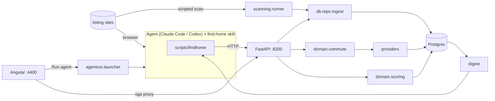
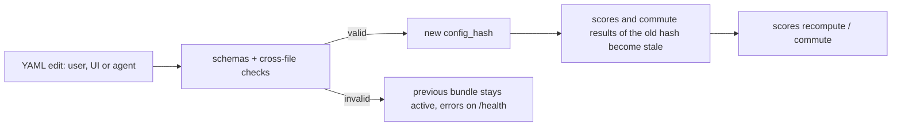

# Architecture: introduction

A short tour of the components and how data moves between them. See the [overview](../overview.md) for the
directory map.

## Components

**Infrastructure.** [`docker-compose.yml`](../../docker-compose.yml) runs Postgres 16 on host port 5434 and pgAdmin
on 5052 with the server preloaded from [`infra/pgadmin/`](../../infra/pgadmin/servers.json). The API and the
Angular dev server run on the host, started by [`.vscode/launch.json`](../../.vscode/launch.json) and
[`.vscode/tasks.json`](../../.vscode/tasks.json): the compound `FH: Full Stack` first runs `FH: Dev Prereqs`, a
sequence of tasks that all terminate (free ports, [`scripts/ensure-env.sh`](../../scripts/ensure-env.sh) to create
a missing `backend/.venv`, `frontend/node_modules` or `config/*.env`, `docker compose up --wait`, migrate). It then
launches `FH: Backend (FastAPI)` under debugpy and `FH: Frontend (ng serve)` as a Node launch, together. No
long-running server is part of the pre-launch chain, so the launch never depends on matching a server's output.

**API.** [`api/main.py`](../../backend/src/findhome/api/main.py) builds the FastAPI app, binds to 127.0.0.1:8200,
opens an async psycopg pool ([`core/db.py`](../../backend/src/findhome/core/db.py)) without waiting for the
database, loads the config bundle and starts a file watcher that reloads it. The API starts even when Postgres is
down: it logs the database URL (password hidden) and whether it is reachable, `/health` reports `db_error`, and
any request needing the database returns 503 with the cause while the pool keeps retrying. Routers live in [`api/routers/`](../../backend/src/findhome/api/routers/listings.py).
Each request gets one connection, committed when the request succeeds.

**Data model.** [`migrations/001_init.sql`](../../backend/migrations/001_init.sql) defines `listings` (one row per
real flat, rent and buy columns), `listing_sources` (one row per site item, with its own content hash),
`listing_status_events`, `feedback`, `evaluations`, `scores` and `commute_results` (both keyed by `config_hash`),
the provider caches (`routing_cache`, `geocode_cache`, `poi_cache`) and `sites`, `scan_runs`, `agent_runs`.
[`db/migrate.py`](../../backend/src/findhome/db/migrate.py) applies the SQL files in order and refuses edited ones.

**Config.** YAML under [`config/`](../../config/profile.yaml) and [`sites/`](../../sites/README.md), described in
[config_and_locations.md](config_and_locations.md).

**Ingest and dedupe.** [`db/repo.py`](../../backend/src/findhome/db/repo.py) `ingest` matches an item first by
(site, external id), then across sites by the dedupe key from
[`domain/normalize.py`](../../backend/src/findhome/domain/normalize.py) (normalised street and number, floor,
rounded size, 500 SEK price band, plus a fuzzy address check). Change detection uses the source's own content
hash, so two sites listing the same flat do not overwrite each other on every scan. A known pet status is never
downgraded to `unknown`.

**Scanning.** [`scanning/runner.py`](../../backend/src/findhome/scanning/runner.py) scans one site: status check,
robots.txt, filters resolved through the site's `filter_map` ([`scanning/filters.py`](../../backend/src/findhome/scanning/filters.py)),
pages fetched with the site's delay, items parsed by
[`scanning/generic.py`](../../backend/src/findhome/scanning/generic.py) (HTML selectors or a JSON API with a field
map) or by an optional `sites/<slug>/scanner.py` (for example [`sites/qasa/scanner.py`](../../sites/qasa/scanner.py),
which reads the JSON embedded in Qasa's result pages). A scanner may also implement `enrich`: the runner calls it
for listings not seen before, up to `fetch.details.max_per_run`, and hashes the list-page view so later scans of
the same listing stay `unchanged`. Then the items are ingested. Raw pages are saved under `data/raw/`. Only
`active` sites are scanned; a dry run works on any site and stores nothing.
[`scanning/probe.py`](../../backend/src/findhome/scanning/probe.py) inspects a new site and recommends a fetch method.

**Commute and scoring.** [`domain/commute.py`](../../backend/src/findhome/domain/commute.py) and
[`domain/scoring.py`](../../backend/src/findhome/domain/scoring.py), described in
[config_and_locations.md](config_and_locations.md).

**Digests.** [`digest/history.py`](../../backend/src/findhome/digest/history.py) and
[`digest/listing.py`](../../backend/src/findhome/digest/listing.py) render compact text for agents and for the UI's
copy button. See [agent_contract.md](agent_contract.md).

**Agent runs.** [`agentrun/launcher.py`](../../backend/src/findhome/agentrun/launcher.py) starts a command from
`config/agent.yaml` as a subprocess (no shell), in a run folder prepared by
[`agentrun/rundir.py`](../../backend/src/findhome/agentrun/rundir.py), streams its output to `log.jsonl` and records
it in `agent_runs`. One run per profile at a time; a timeout kills it.

**CLI.** [`cli/main.py`](../../backend/src/findhome/cli/main.py) is a Typer app. Most commands call the API through
[`cli/client.py`](../../backend/src/findhome/cli/client.py); `db`, `config validate|hash|show|schema` and
`run new` work locally. [`scripts/findhome`](../../scripts/findhome) runs it from the repo root.

**Frontend.** Angular standalone components with signals in
[`frontend/src/app/`](../../frontend/src/app/app.routes.ts). One file per page (candidates, detail, map, locations,
sites, runs, settings). [`services/api.service.ts`](../../frontend/src/app/services/api.service.ts) wraps the API;
[`proxy.conf.json`](../../frontend/proxy.conf.json) sends `/api` and `/health` to :8200 (there is no BFF). The map
uses MapLibre GL with the style from `config/providers.yaml` and falls back to a blank background when the style
cannot load. Settings edits whole YAML files in CodeMirror; Locations edits points through JSON-patch operations.

## Main flows

## Where the code lives

| Concern | File |
|---|---|
| App start, health, error mapping | [`api/main.py`](../../backend/src/findhome/api/main.py) |
| Listings, status, feedback | [`api/routers/listings.py`](../../backend/src/findhome/api/routers/listings.py) |
| Ingest endpoints | [`api/routers/ingest.py`](../../backend/src/findhome/api/routers/ingest.py) |
| Commute and score endpoints | [`api/routers/scoring.py`](../../backend/src/findhome/api/routers/scoring.py) |
| Config endpoints | [`api/routers/config.py`](../../backend/src/findhome/api/routers/config.py) |
| Sites and scans | [`api/routers/sites.py`](../../backend/src/findhome/api/routers/sites.py) |
| Runs and agent launch | [`api/routers/runs.py`](../../backend/src/findhome/api/routers/runs.py) |
| Map GeoJSON | [`api/routers/map.py`](../../backend/src/findhome/api/routers/map.py) |
| SQL | [`db/repo.py`](../../backend/src/findhome/db/repo.py) |
