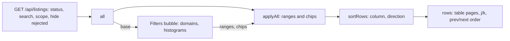
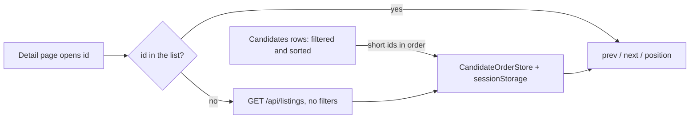
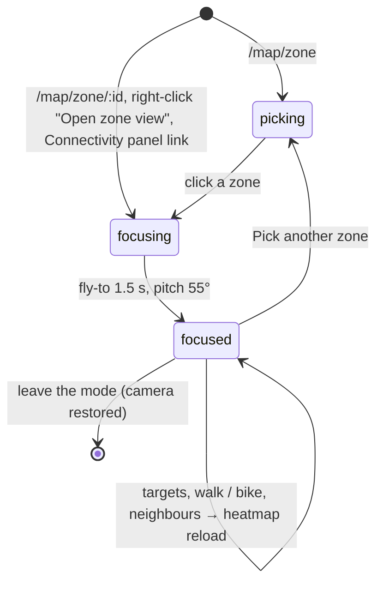
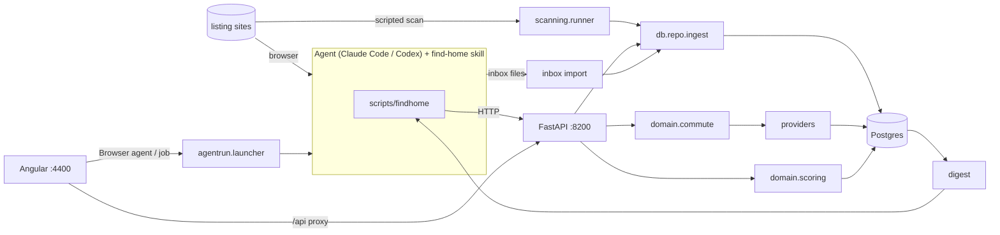
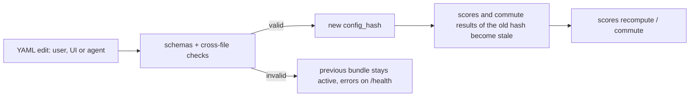

# Architecture: introduction

A short tour of the components and how data moves between them. See the [overview](../overview.md) for the
directory map.

## Components

**Infrastructure.** [`docker-compose.yml`](../../docker-compose.yml) runs Postgres 16 on host port 5434 and pgAdmin
on 5052 with the server preloaded from [`infra/pgadmin/`](../../infra/pgadmin/servers.json). The API and the
Angular dev server run on the host, started by [`.vscode/launch.json`](../../.vscode/launch.json) and
[`.vscode/tasks.json`](../../.vscode/tasks.json). There is one app debug configuration, `FH: Full Stack`, which
launches FastAPI under debugpy. Its `preLaunchTask`, `FH: Dev Prereqs`, runs in sequence: free app ports,
[`scripts/ensure-env.sh`](../../scripts/ensure-env.sh) to create a missing `backend/.venv`, `frontend/node_modules`
or `config/*.env`, [`scripts/infra-up.sh`](../../scripts/infra-up.sh), migrate, then `FH: ng serve`. Angular runs as
a background task; its readiness matcher releases the pre-launch chain when the local URL is printed.
The infrastructure script stops all project containers before running
`docker compose up -d --wait --wait-timeout 90`, which recreates containers whose configuration changed.
Both services have health checks; pgAdmin must answer `/misc/ping` before launch continues. A startup failure
prints service status and recent logs, then stops the containers.
The launch's `postDebugTask`, `FH: Dev Stop`, frees the app ports and runs `FH: Infra Stop`
(`docker compose stop --timeout 30`). A debug restart uses the same stop/start sequence.

Postgres data is bind-mounted from the local `data/postgres/` folder into `/var/lib/postgresql/data`.
The folder and local backups under `data/backups/` are gitignored. Removing containers or Compose volumes
does not delete these database files. A fresh folder is initialised by the Postgres image; an existing cluster
is reused. Keep this folder when cleaning local runtime data.
[`scripts/smoke-check.sh`](../../scripts/smoke-check.sh) checks both Postgres and pgAdmin health.

**API.** [`api/main.py`](../../backend/src/findhome/api/main.py) builds the FastAPI app, binds to 127.0.0.1:8200,
opens an async psycopg pool ([`core/db.py`](../../backend/src/findhome/core/db.py)) without waiting for the
database, loads the config bundle and starts two watchers: one reloads the config, one imports JSON files dropped
into `inbox/` ([agent_contract.md](agent_contract.md)). The API starts even when Postgres is
down: it logs the database URL (password hidden) and whether it is reachable, `/health` reports `db_error`, and
any request needing the database returns 503 with the cause while the pool keeps retrying. Routers live in [`api/routers/`](../../backend/src/findhome/api/routers/listings.py).
Each request gets one connection, committed when the request succeeds.

**Data model.** [`migrations/001_init.sql`](../../backend/migrations/001_init.sql) defines `listings` (one row per
real flat, rent and buy columns), `listing_sources` (one row per site item, with its own content hash),
`listing_status_events`, `feedback`, `evaluations`, `scores` and `commute_results` (both keyed by `config_hash`),
the provider caches (`routing_cache`, `geocode_cache`, `poi_cache`) and `sites`, `scan_runs`, `agent_runs`.
[`002_probes.sql`](../../backend/migrations/002_probes.sql) adds `probes` (the saved test points of a removed map
feature; unused);
[`003_zone_commute.sql`](../../backend/migrations/003_zone_commute.sql) adds `zone_commute` (the Connectivity matrix);
[`004_connectivity_status.sql`](../../backend/migrations/004_connectivity_status.sql) adds its route status and
`provider_failure` (zone points a provider cannot route).
[`005_zone_cache.sql`](../../backend/migrations/005_zone_cache.sql) adds `zone_heatmap` (zone analysis cache).
[`006_zone_index.sql`](../../backend/migrations/006_zone_index.sql) adds `zone_index` (zone indices).
[`007_centroid_commute.sql`](../../backend/migrations/007_centroid_commute.sql) adds `centroid_commute` (station commutes) and
`zone_pattern` (where each zone's best trips start).
[`009_listing_location.sql`](../../backend/migrations/009_listing_location.sql) adds `listing_location` (house analysis cache).
[`010_run_records.sql`](../../backend/migrations/010_run_records.sql) extends `scan_runs` and `agent_runs` into run
records for every scan and agent session; [`011_listing_origin.sql`](../../backend/migrations/011_listing_origin.sql)
adds `listings.origin_site`; [`012_pets.sql`](../../backend/migrations/012_pets.sql) adds the `conflict` pet status,
`pet_source` and `pet_checked_at`; [`013_jobs.sql`](../../backend/migrations/013_jobs.sql) adds `jobs`, `job_runs`
and `job_items`; [`014_agent_outcome.sql`](../../backend/migrations/014_agent_outcome.sql) the agent's own verdict;
[`015_agent_run_process.sql`](../../backend/migrations/015_agent_run_process.sql) the run's process (pid, session
name), its liveness and the late files parked after Cancel;
[`016_agent_usage.sql`](../../backend/migrations/016_agent_usage.sql) the token usage of runs and job items;
[`017_listing_details_job.sql`](../../backend/migrations/017_listing_details_job.sql) the details jobs and their item
outcomes; [`018_ad_status.sql`](../../backend/migrations/018_ad_status.sql) the ad status per source
(`listing_sources.ad_status`, `source_status_events`) and the status jobs ([jobs.md](jobs.md#ad-status));
[`019_status_due.sql`](../../backend/migrations/019_status_due.sql) the status job's default subset;
[`020_ui_settings.sql`](../../backend/migrations/020_ui_settings.sql) UI preferences kept in the database (the
Candidates columns and views).
[`db/migrate.py`](../../backend/src/findhome/db/migrate.py) applies the SQL files in order and refuses edited ones.

**Config.** YAML under [`config/`](../../config/README.md) and [`sites/`](../../sites/README.md), described in
[config_and_locations.md](config_and_locations.md).

**Ingest and dedupe.** [`db/repo.py`](../../backend/src/findhome/db/repo.py) `ingest` matches an item first by
(site, external id), then across sites by the dedupe key from
[`domain/normalize.py`](../../backend/src/findhome/domain/normalize.py) (normalised street and number, floor,
rounded size, 500 SEK price band, plus a fuzzy address check). Change detection uses the source's own content
hash, so two sites listing the same flat do not overwrite each other on every scan. Each listing records its
`origin_site`, the site it was first published on: an aggregator's `platforms` map turns `attributes.platform`
into a site slug (Qasa carries HomeQ and Blocket Bostad homes), otherwise the site it was found on. An update
merges `attributes` key by key, so a list-only scan keeps what a listing-page read stored; the keys with a fixed
shape are checked at ingest ([agent_contract.md](agent_contract.md#writing-only-through-the-api)). The pet status
is decided at ingest by source precedence ([pets.md](pets.md)). Ingest with a scan run id links each source to it
([agent_contract.md](agent_contract.md#runs)).

**Sites.** Each `sites/<slug>/site.yaml` says what may scan the site and why not:
`scan.script` (a scripted scanner) and `scan.browser` (the browser agent in your Chrome), each with `enabled` and
a `reason` the UI shows; `role: origin` marks a site that is never scanned and only names where listings found on
an aggregator were first published (Blocket Bostad, HomeQ); `risk_note` records a decision to scan despite
robots.txt or terms. [`SiteConfig.script_scan()`](../../backend/src/findhome/config/models.py) and `browser_scan()`
answer both questions for the engine, the API and the launcher. Registry rules: [`sites/README.md`](../../sites/README.md).

**Scanning.** [`scanning/runner.py`](../../backend/src/findhome/scanning/runner.py) scans one site: status check,
the site's capability check (a scripted scan refused or disabled stops here, before any run row or request, even
when the site keeps a `scanner.py`), robots.txt, filters resolved through the site's `filter_map`
([`scanning/filters.py`](../../backend/src/findhome/scanning/filters.py)), pages fetched with the site's delay,
items parsed by [`scanning/generic.py`](../../backend/src/findhome/scanning/generic.py) (HTML selectors or a JSON
API with a field map) or by an optional `sites/<slug>/scanner.py` (for example
[`sites/bostadsformedlingen/scanner.py`](../../sites/bostadsformedlingen/scanner.py), one request for the whole
region's feed). `local_filter.search_area_buffer_m` drops items farther than that from the search area. A scanner
may also implement `enrich`, which reads a listing's own page
([`enrich_details()`](../../backend/src/findhome/scanning/runner.py#L93)). With `fetch.details.only_passing`, the
runner calls it for every listing that passes the profile's hard filters on the list's values
([`passes_hard_filters()`](../../backend/src/findhome/scanning/runner.py#L71), commute left out) and is new, has no
page read (`attributes.details_checked_at`) or one older than `refresh_days`; without it, for listings not seen
before. Pages are read with the site's delay, up to `max_per_run`. The list-page view is hashed, so later list-only
scans of the same listing stay `unchanged`, while a page read is always stored. Then the items are ingested into a
scan run, and new and changed listings are scored at once
([`score_listings()`](../../backend/src/findhome/rescore.py)). Raw pages are saved under `data/raw/`. Only `active` sites are scanned; a dry run works on any
scriptable site and stores nothing. Browser-only sites (Qasa: 429 to scripts) are scanned by the browser agent
([agent_contract.md](agent_contract.md#runs)).
[`scanning/probe.py`](../../backend/src/findhome/scanning/probe.py) inspects a new site and recommends a fetch method.

**Commute and scoring.** [`domain/commute.py`](../../backend/src/findhome/domain/commute.py) and
[`domain/scoring.py`](../../backend/src/findhome/domain/scoring.py), described in
[config_and_locations.md](config_and_locations.md).

**Digests.** [`digest/history.py`](../../backend/src/findhome/digest/history.py) and
[`digest/listing.py`](../../backend/src/findhome/digest/listing.py) render compact text for agents and for the UI's
copy button. See [agent_contract.md](agent_contract.md).

**Agent runs.** [`agentrun/launcher.py`](../../backend/src/findhome/agentrun/launcher.py) registers a run, then
starts a profile from `config/agent.yaml` headless (no shell; output to `log.jsonl`, the final result event
stored) or returns a VS Code link that opens a prefilled Claude Code tab. Run folders come from
[`agentrun/rundir.py`](../../backend/src/findhome/agentrun/rundir.py); run records from
[`db/runs_repo.py`](../../backend/src/findhome/db/runs_repo.py). One run per profile and site at a time; a timeout
kills it. See [agent_contract.md](agent_contract.md#runs).

**Jobs.** [`jobs/`](../../backend/src/findhome/jobs/service.py) runs named analyses over a subset of listings
(pet wording rules in the app, pet policy check by the agent), each execution with a reviewable, undoable result
per listing. See [jobs.md](jobs.md).

**CLI.** [`cli/main.py`](../../backend/src/findhome/cli/main.py) is a Typer app. Most commands call the API through
[`cli/client.py`](../../backend/src/findhome/cli/client.py); `db`, `config validate|hash|show|schema` and
`run new` work locally. [`scripts/findhome`](../../scripts/findhome) runs it from the repo root.

**Frontend.** Angular standalone components with signals in
[`frontend/src/app/`](../../frontend/src/app/app.routes.ts). One file per page (candidates, detail, locations,
sites, runs, jobs, job, settings) and a folder for the map. [`services/api.service.ts`](../../frontend/src/app/services/api.service.ts) wraps the API;
[`proxy.conf.json`](../../frontend/proxy.conf.json) sends `/api` and `/health` to :8200 (there is no BFF).
Settings edits whole YAML files in CodeMirror; Locations edits points through JSON-patch operations.

**Listing issues.** A missing value is shown, never silently empty.
[`listing_issues()`](../../backend/src/findhome/domain/issues.py) computes them from the listing row on every request
(never stored, so they are true after any scan, job or edit): `move_in_missing`, `photos_missing`,
`floorplan_missing`, `description_missing`, `address_partial`, `coords_missing` / `coords_approximate`,
`rent_missing` / `size_missing` / `rooms_missing`, `page_translated` (the last page read stopped on a translated
page) and `contract_fixed_term` (the contract ends on a set date, `contract_end`). Each has a class: `not_in_source`
(the ad does not give it: its page was read, `details_checked_at`, or it gives words like "Nu"), `check_extraction`
(its page was never read, or every ad has it) or `attention` (nothing is missing, but it matters: the fixed term,
an orange tag), with a hint and, for some, a short `detail` shown apart from the label as a badge that never breaks (the fixed term's "ends 31 May 2027"). In the ⚠ tooltip each issue is a row with its class tag on the right. List rows carry `issue_codes`, the listing its full `issues`. The ad status, pets and
the other contract terms are not issues: they have their own badges ([jobs.md](jobs.md#ad-status), [pets.md](pets.md)).
The Candidates **Contract** column shows only the type, with an orange dot on a fixed term; hovering it opens
[`fh-contract-cell`](../../frontend/src/app/components/contract-cell.ts)'s tooltip: from → to and the length, and the
terms the ad states (extension yes or no, guaranteed, notice) with its wording.

**Candidates list.** [`candidates.ts`](../../frontend/src/app/pages/candidates.ts) is the triage table (keys in
its header). The server applies the status, the search, the scope chips, **Hide rejected** (a red badge: filled
while rejected homes show, outlined while they are hidden) and **Hide closed** (amber, the same way: homes whose ad
is closed on every site). While rejected homes are hidden, **Show move-in misses** (cyan, the same way) brings back
the homes rejected only by the move-in window (`move_in_to`, `move_in_from_slack`; `GET /api/listings?move_in_misses=true`),
their date in red. The id is a violet pill (`.fh-id-badge`); hovering or focusing **it** opens the home card, so the
other cells keep their own tooltips. The **Issues** column shows a yellow "⚠ n" badge; hovering it opens the tape tooltip
([`fh-issue-tip`](../../frontend/src/app/components/issue-tip.ts): a yellow panel in an animated yellow-black border,
still under reduced motion) with each issue, its class and hint. A clock at the end of a row says the ad's status
was not confirmed in `agent.yaml` `ad_status.stale_after_days` (sent with the list as `stale_after_days`). Hovering
it opens [`fh-stale-tip`](../../frontend/src/app/components/stale-tip.ts): the days since the last confirmation (or
"Never confirmed" and how long ago the home was found) on a bar with the limit in the middle; the ad on each site
(status pill, when and how it was last checked, first and last seen by a scan: `ad_sources.first_seen` /
`last_seen`); and the history, newest first (found on each site, ad status changes, your status changes), fetched
from the listing on the first hover and kept for the session. The page then applies the ranges of the **Filters**
bubble (ranges and chips) and the sort ([`rows`](../../frontend/src/app/pages/candidates.ts#L200)). Every column header but Id sorts:
the first click puts the better end first (score high, rent low, move-in early), the second reverses, and homes
without the value stay last. The default is score, high first.

The **Columns** bubble ([`fh-candidate-columns`](../../frontend/src/app/pages/candidate-columns.ts), under Filters)
chooses the columns and their order: the default ones, plus building and flat (floor, lift, balcony, built, furnished,
alcove), contract and dates (contract from / to, guaranteed and notice months, short-term, Bostadsförmedlingen's apply
by, the ad's move-in wording, deposit), ad and data (ad status per site, last confirmed, **last check** — when and how the status was last checked on any site,
by a scan or the status job, with each site's rule on hover —, found on, first seen,
changed, photos, plan) and score parts (each preference group, 0–100, and the zone). Every column sorts (`COLUMNS`
gives each one its sort value). The shown columns are autosaved, and named views saved, in the app database
(`ui_settings`, [`020_ui_settings.sql`](../../backend/migrations/020_ui_settings.sql),
`GET|PUT /api/ui-settings/{key}`), so they survive clearing the browser; Reset brings back the default layout.

The Filters bubble ([`fh-candidate-filters`](../../frontend/src/app/pages/candidate-filters.ts#L316), registered in
box 1) has one two-ended slider per value: score, rent, rent per m², move-in date, rooms, size, transport and
services. A slider spans the 2nd to 98th percentile of the homes' values
([`domainOf()`](../../frontend/src/app/pages/candidate-filters.ts#L76)). An end left at the edge is open, so outliers
stay in and the label shows ≤ / +. Homes without the value stay in unless you untick "no value". Move in has a
**your window** shortcut (`hard_filters.move_in_from` → `move_in_to`). On hover a slider unfolds its distribution
([`histogram()`](../../frontend/src/app/pages/candidate-filters.ts#L91)): the bars count the homes that pass every
*other* filter, and their bright part is the share inside this one. A long range gets bars of a whole number of
steps (rent bars of 1 000 kr); a short one, one bar per value (rooms). Hovering a bar shows its values and how many
homes it holds ([`showTip()`](../../frontend/src/app/pages/candidate-filters.ts#L366)).

Above the sliders, chips filter by **Website** (the site a home was first published on or found on), **Pets**,
**Contract** and **Issues** (one chip per issue, and "No issues") ([`CAT_FIELDS`](../../frontend/src/app/pages/candidate-filters.ts#L55)). Chosen chips of one group are
alternatives (any of them); groups and sliders combine. A chip is outlined until chosen, then filled with its
colour and glowing, like the Hide rejected badge; its count is the homes it would keep with the other filters. After Hide rejected changes, every chart opens
for a moment ([`flash()`](../../frontend/src/app/pages/candidate-filters.ts#L168)) and animates to the new homes.
[`CandidateFiltersStore`](../../frontend/src/app/pages/candidate-filters.ts#L140) keeps the ranges, sort and Hide
rejected while you open homes and come back.

| Step | Code |
|---|---|
| Ranges and chips | [`applyAll()`](../../frontend/src/app/pages/candidate-filters.ts#L65), [`applyFilters()`](../../frontend/src/app/pages/candidate-filters.ts#L46) |
| Sort | [`sortRows()`](../../frontend/src/app/pages/candidate-filters.ts#L127) |
| Hide rejected reload and chart flash | [`toggleRejected()`](../../frontend/src/app/pages/candidates.ts#L246) |

**Sites, Runs and Jobs.** [`sites.ts`](../../frontend/src/app/pages/sites.ts) shows one fixed-size
[`site-card`](../../frontend/src/app/pages/site-card.ts) per site (scannable, to onboard, then a collapsed
origin-only section): status and role chips, one row per scan method with the reason when it is off, counts that
open Candidates filtered by site or origin, the last scan, and the actions (scripted scan, dry run, browser agent
with a pages stepper, onboarding). Long text and errors stay behind a click
([`fh-popover`](../../frontend/src/app/components/popover.ts)), so cards never grow.
[`runs.ts`](../../frontend/src/app/pages/runs.ts) is the run timeline with filters and a drawer
([`run-drawer.ts`](../../frontend/src/app/pages/run-drawer.ts): handover, counts, cost, permission denials, live log,
listings of a scan run); `?agent=`, `?scan=` and `?job=` open a run directly. [`jobs.ts`](../../frontend/src/app/pages/jobs.ts)
lists the jobs; [`job.ts`](../../frontend/src/app/pages/job.ts) shows a job's executions and items (before → after,
evidence, undo) with the settings panel ([`job-settings.ts`](../../frontend/src/app/pages/job-settings.ts): subset,
live match count, N, launcher). Agent launches go through
[`fh-launch-button`](../../frontend/src/app/components/launch-button.ts) (CLI, or VS Code: opens the prefilled tab
and copies the prompt). Pet badges ([`fh-pet-badge`](../../frontend/src/app/components/pet-badge.ts)) show who set
the status (U / A / S / K) and the evidence; the detail page lets you set your own answer.

**Photos.** [`fh-gallery`](../../frontend/src/app/components/gallery.ts) shows a listing's `photo_urls` and
`floorplan_urls` (Photos / Floor plans tabs, thumbnails, a full-screen viewer with arrow keys, Esc, swipe and
double-click for 1:1). It loads the images lazily from the site's own URLs; photos that fail to load are dropped
from the count, while a plan that fails becomes a link card.

**Floor plans.** Sites link plans as images, as PDFs (often without `.pdf` in the URL) or as interactive viewer
pages. [`classify_floorplan()`](../../backend/src/findhome/scanning/floorplans.py) gives each link its kind once,
from one HEAD request's content type (the extension when HEAD is refused), and renders a PDF's first page to
`data/floorplans/<sha1>.png`, served by `GET /api/floorplans/<sha1>.png`. The result is kept in
`attributes.floorplans` (`{url, kind, preview, unit}`), and a link already there is never fetched again. The gallery
shows an image as it is, a PDF by its preview with a "PDF ↗" link to the original (a link card when there is no
preview), and a viewer page as an "Interactive floor plan ↗" card. The detail page shows it at the top, foldable
([`band`](../../frontend/src/app/components/gallery.ts#L164)): folded (the default), one band of thumbnails; a
thumbnail or the ▸ toggle unfolds it to the main image on that photo. There, only ⛶ opens the viewer; the map's
listing panel shows a three-thumbnail strip (`compact`), fetching the listing on selection because map features carry no photos. Listings with exactly 6
photos and no `attributes.photo_count` come from scans that kept only 6, and the gallery says the next browser
scan fills them in.

The shell ([`app.html`](../../frontend/src/app/app.html)) labels the app **find_home**, with **Skill App** under the
name. The sidebar and README share SVG wordmarks: [`brand.svg`](../../frontend/public/brand.svg) uses the dark
theme's silver and violet; [`brand-light.svg`](../../frontend/public/brand-light.svg) uses the light theme's dark
text and purple. The app chooses its current theme; the README's `<picture>` follows the reader's colour scheme.
Both keep the house mark from [`favicon.svg`](../../frontend/public/favicon.svg), used for the browser tab.
Public UI screenshots live in [`docs/screenshots/`](../../docs/screenshots/README.md);
they show public listing and site data, with personal map points, commute overlays and search areas hidden.

The shell has three boxes, like the Telia debug UI: box 1 holds
the navigation bubble (pages, with the map modes as child entries) and the bubbles of the active page; box 2 is
the routed page; box 3 is an optional right panel. A page publishes its bubbles and panel as `TemplateRef`s
through [`LayoutService`](../../frontend/src/app/services/layout.service.ts) `register`, which removes them when
the page is destroyed. Box widths and collapsed bubbles persist in localStorage; drag handles resize the boxes.
In the Pages bubble each page has its own colour and a line icon ([`fh-nav-icon`](../../frontend/src/app/components/nav-icon.ts)),
shown on the right of its row in a round badge: outlined at rest, filled and glowing for the current page; the key
of its shortcut is in the tooltip. The list sits in a bright gradient frame and the map modes in a smaller one under
Map (the `bright-frame` mixin in [`app.scss`](../../frontend/src/app/app.scss)), joined to the Map row by a short
glowing stem only while a map page is open. Collapsed, box 1 is a rail of the
same badges.

**House page.** The detail page ([`detail.ts`](../../frontend/src/app/pages/detail.ts)) shows a ⚠ next to the id
when the listing has issues (the same tape tooltip), loads the listing and its
house analysis (`GET /api/listings/{id}/location`) side by side. Its main column, top to bottom: the photo band;
the description card (title, address, the key facts as labelled bubbles coloured like the candidates table, ✓ / ✕ / ?
chips for lift and balcony, the ad's text folded to a one-line peek until **Description** is clicked); **Issues** (one row per issue with its class and hint, and **Complete
details**, which runs the details job on this listing only: the agent one for browser sites, the in-app one for
Bostadsförmedlingen); **Contract and conditions** (contract terms with the ad's wording on hover, requirements,
what the rent includes, amenities; display-only, never scored, hidden when the ad gives none); **On the map**; **This home** and **Its zone** side by side; the **Commute** table;
the latest agent evaluation (pros, cons and questions for the landlord as lists). The side column holds **Where**,
**Score** (folded to its total until clicked; each group as a bar coloured by its score), **Pets** (your answer as
chips), **Feedback** (polarity and tags as chips, then the saved feedback), **Routes** (beside the house map), the agent digest (folded, with a copy
chip) and **Sources & timeline** (the status changes as a timeline). Every card uses the `.fh-hcard` look; choices are
bright badges (`.fh-chipf`: outlined until chosen, then filled and glowing) and the main action of a card is a
glowing pill (`.fh-btn-glow`, the others `.fh-btn-ghost`). Navigation buttons (previous and next home with the
neighbour's id in pink, back to the candidates, the pager of the candidates list) are white pills with the arrow in a
glowing round badge (`.fh-btn-nav`). All of these live in [`styles.scss`](../../frontend/src/styles.scss). The cards of
[`house-bubbles.ts`](../../frontend/src/app/house/house-bubbles.ts):
- **This home** (accented): the home's transport, services and combined scores, each with an ⓘ and its
  derivation. Then one row per set (grocery, pharmacy, gym, park, vet, rail, bus): the walk minutes coloured
  green / yellow / red by `zone.yaml` `walk_colours`, the metres, and the count within the choice window;
- **Its zone**: the same rows with the zone's medians, and the zone's indices with their percentile;
- **On the map** ([`house-map.ts`](../../frontend/src/app/house/house-map.ts)): a MapLibre map of its own
  (same style and theme as the main map), centred on the home.
  - The boundary (`GET /api/area/region`: the saved search area of Map → Area, or the analysed zones while none is
    defined, with a world-minus-area mask) is outlined; everything outside it is grey. Every zone keeps a thin outline.
  - Inside the mapped zones: every target within reach (`walks[set].nearby`, nearest first, capped per set) as
    the zone view's 3D pin or object (`TARGET_ICONS`), with the nearest one of each set larger and glowing. The
    walking path to that nearest target carries its minutes in green / yellow / red. Icons show from zoom 13;
    chips hide a category.
  - Your points are pinned. Computed itineraries are drawn from `HouseTravelStore` along the real lines and
    streets, those of the Routes tab only (`HouseTravelStore.tab`: your points' or the nearby services'; a service
    too near for transit is not drawn, its walk is). Hovering a route, on the map or in a bubble row,
    sets `HouseTravelStore.hover`: [`routeHighlightLayers()`](../../frontend/src/app/pages/map/house-layer.service.ts)
    draw that trip on top with a shade, a glow and a white core, and the other routes dim. **Lines** toggles every
    line of a mode (`GET /api/geo/transit/lines_<mode>`, loaded on first use), under the routes.
    **Home, your points and routes** zooms out to all of them; the 3D house view has the same button.
  - Outside every zone (the analysis answers 409 "outside every zone"): the home's position only.
  - **Full-screen zone view** requests full screen inside the click (browsers refuse it later), then opens
    `/map/zone/<id>?listing=<short id>`;
- **Routes** ([`HouseRoutes`](../../frontend/src/app/house/house-bubbles.ts)), two tabs, each with its own button and
  its own paths on the maps (the tab is `HouseTravelStore.tab`, read through `draw()` by the house map and the zone
  view; computing one kind switches to its tab):
  - **Your points**: per point the free station estimate, or the listing's computed commute, with the comparison
    line ("better than N % of zones"), and the exact itinerary with its legs once **Compute routes to your points**
    ran (`POST .../transit?which=points`);
  - **Nearby services**: **Compute routes to nearby services** (`which=services`), then the itinerary to the nearest
    target of each set, with the walk it beats or not.

  Each button carries its call count from the dry run (no API call); the rows are hoverable.

**Previous and next home.** The bar on top of the detail page steps through the candidates list in the order you
last saw it, with its filters, ranges and sort (also `j` / `k`). A home that is not in that list (opened from the map or by URL)
falls back to the unfiltered list.

| Step | Code |
|---|---|
| Candidates records its order | [`constructor()` effect](../../frontend/src/app/pages/candidates.ts#L242) |
| The store | [`CandidateOrderStore.set()`](../../frontend/src/app/services/candidate-order.store.ts#L17) |
| Fallback to the unfiltered list | [`ensure()`](../../frontend/src/app/services/candidate-order.store.ts#L23) |
| Neighbours and position | [`around()`](../../frontend/src/app/services/candidate-order.store.ts#L33), [`nav`](../../frontend/src/app/pages/detail.ts#L280) |
| `j` / `k` keys | [`onKey()`](../../frontend/src/app/pages/detail.ts#L339) |

The results live in [`HouseTravelStore`](../../frontend/src/app/house/house-travel.store.ts), per listing, so
the 3D house view reuses them. A service row shows "or N min by transit" when transit beats walking to the same
target. Set colours come from [`set-colours.ts`](../../frontend/src/app/set-colours.ts) (shared with the zone view).

**Explanations.** Every text that explains a value lives in one registry,
[`help.ts`](../../frontend/src/app/help.ts) (`HELP`, keyed by dotted ids: `bubble.<id>`, `panel.<title>`,
`score.<group>`, `zone.<index>`). Each entry has a title, a short text, an optional formula and the config files
and keys behind the value.
- [`fh-info`](../../frontend/src/app/components/info.ts) is the ⓘ button. It opens a popover with the entry, below
  the button or, when there is more room there, [above it](../../frontend/src/app/components/info.ts#L52), scrolling
  within the screen; any scroll of the page closes it. An unknown id renders nothing and warns in development.
- A bubble shows its ⓘ in the header when `bubble.<id>` exists, or when `Bubble.info` names another entry. The
  right panel does the same with `panel.<title>`.
- [`fh-explain`](../../frontend/src/app/components/explain.ts) (inline "How is this calculated?") and
  `fh-explain-dialog` (opened from the popover) add the entry's long text and a `Derivation`: rows of
  input → score 0..1 × weight, with the total.
- Each new computed value in the UI gets an entry, so the user can see how it is derived and which config key to
  change.

The map ([`pages/map/`](../../frontend/src/app/pages/map/map-shell.ts)) is one MapLibre instance owned by
`MapShell` and shared through [`MapStateService`](../../frontend/src/app/pages/map/map-state.service.ts) with
the modes, which are child routes (`/map/explore`, `/map/area`, `/map/connectivity`, `/map/zone`). Modes add named layer
groups (`addGroup`), toggle them (`setVisible`, persisted) and read the shared `selection`. The shell's **Layers
sheet** ([`layers-drawer.ts`](../../frontend/src/app/pages/map/layers-drawer.ts)) shows in every mode: one row of
toggle chips per group (Map: listings, rejected, your points, commute tint; Places; Transit, with the lines and
stations), each in its layer's colour and filled while shown. A glowing **Layers** pill over the map's bottom edge
(counting the layers on) opens it: the sheet, as wide as the map, rounded and a small gap below it, slides up and the
map's bottom edge with it, while the pill fades out; a click on the map, the fold button or Escape slides both back
and the pill fades in. The sheet sits under the map in the page flow and grows from 0 (`grid-template-rows` 0fr → 1fr),
so the map shrinks rather than being covered; `MapShell.resize()` redraws in the same frame (no blank canvas while
the box animates) and, while the sheet moves (`MapStateService.anchorBottomUntil`), keeps the map's bottom edge in
place, so the content slides with the sheet and closing returns to the same view. Open or folded is remembered in
the browser (`fh-map-layers-open`). The base style is
`map.style_url` (light) or `map.style_url_dark` from `config/providers.yaml`; switching the colour mode reloads
the style and re-applies every group. A style that cannot load falls back to a blank background. In dark mode
[`dark-style.ts`](../../frontend/src/app/pages/map/dark-style.ts) recolours the style's water layers after each style
load, because the dark base style paints water barely darker than land.

Every marker is a round **blip** (category colour, white glyph, dark outline, glow) drawn on a canvas by
[`components/map-icons.ts`](../../frontend/src/app/components/map-icons.ts) and added on demand through
MapLibre's `styleimagemissing` (`blip:<glyph>:<rrggbb>`), so blips survive style reloads.
The zone view's heatmap targets are drawn by the same module, as defined in `TARGET_ICONS`
([`zone.service.ts`](../../frontend/src/app/pages/map/zone.service.ts)). Rail, bus and ferry are standing **3D pins**
(`pin3d:<glyph>:<bg>:<fg>`): a shaded badge on a stem with a ground shadow. Parks, groceries, pharmacies, gyms and vets
are standalone **3D objects** (`obj3d:<object>`): a tree, a grocery bag (sticker outline), an extruded green pharmacy cross, an
orange kettlebell (sticker outline), and a black cat with a light halo, so it shows on the dark style. Every target except bus stops and parks
(too many to highlight) also has a coloured glow lying on the ground under it (`halo`). All of them are anchored at the bottom,
stand upright when the map is tilted (`icon-pitch-alignment: viewport`), and are moved above every other layer, so
buildings and the heatmap never cover them. The Heatmap targets bubble has **All targets** and **Rail + bus**
buttons and an **Icon size** slider (0.6× to 1.8×, kept per browser) that scales the icons and their glow.
[`PoiLayersService`](../../frontend/src/app/pages/map/poi-layers.service.ts) adds one layer per POI category, loaded
the first time it is switched on.
**Houses on the map** are a house shape in the score colour (lighter roof, white outline, dark rim, a door, a soft
shadow: `installHouse()` in [`map-icons.ts`](../../frontend/src/app/components/map-icons.ts), image `house:<hex>`)
centred on its spot, its size by the score (0.35× at 0.3 up to 1.6× at 0.9, unscored 0.6×; the best drawn on
top); a home still to look at (status `new`, its ad open: `GLOWS` in [`map-shell.ts`](../../frontend/src/app/pages/map/map-shell.ts)) sits inside a soft light of the same colour and scale (`listings-halo`) that reaches all round it and slowly pulses
([`pulseHalo()`](../../frontend/src/app/pages/map/map-shell.ts): a 2.8 s breath, about 12 redraws a second, paused while
the tab is hidden, still under reduced motion); layers that tint zones go below the light; larger as you zoom in; rejected homes are red dots (the Rejected listings layer). In **Explore** the houses are the homes the
**Listing filters** bubble keeps: the Candidates Filters bubble and its store
([`CandidateFiltersStore`](../../frontend/src/app/pages/candidate-filters.ts)), so a filter set on one page holds on the
other, plus Hide closed. Hovering a house shows the Candidates hover card
([`fh-listing-card`](../../frontend/src/app/components/listing-card.ts): a header with the id, the title on one line, the
issue count and the score; four figure tiles, rent, size, move-in and Access (transport and services as two equal rows, the
numbers right-aligned with a fixed slot for the estimate LED), coloured like the table; one row of badges, pets, floor, lift, balcony; then a two-column table whose values never wrap, the full text
on hover: pets quote, ad status and when it was checked, contract, origin, seen, and best-for or the rejection reasons
as chips) next to the pointer; clicking it pins the card
in the Inspector with the photos, the score and Open listing. Leaving Explore puts every home back on the map.
[`TransitLayersService`](../../frontend/src/app/pages/map/transit-layers.service.ts) draws one line layer per transit
mode (data loaded when first shown; buses from zoom 12) and the stations as blips; the inspector shows a line's
stations in order or the lines serving a station.
[`ConnectivityService`](../../frontend/src/app/pages/map/connectivity.service.ts) holds the zone × point matrix:
the Connectivity mode ([`connectivity-mode.ts`](../../frontend/src/app/pages/map/connectivity-mode.ts)) fills the zones
by minutes for one point or the weighted mix (grey: only failed routes, or only estimates while "exclude estimates"
is on), or by the transport index percentile (average or one time window). Its Matrix bubble shows the route counts per status and the refresh actions with their cost in calls
(Refresh, Retry failed, Update stale); [`connectivity-dialogs.ts`](../../frontend/src/app/pages/map/connectivity-dialogs.ts)
holds the pause decision dialog and the route list (filter by status, point, zone; a row flies to the zone). Explore
can show a light tint of
the same colours; hovering a zone shows its minutes over the map.

**Explore heatmaps.** Explore's **Colour zones by** bubble
([`explore-heat.ts`](../../frontend/src/app/pages/map/explore-heat.ts)) colours every zone by one value:
- the zone indices (transport, services, combined);
- the amount of a service set (per 1,000 homes, per km² or the count, from `zone_index` density);
- commute minutes to one of your points or the weighted mix (the Connectivity matrix);
- listing statistics (count, per km², median rent per m², rent, size, rooms) from `GET /api/zone/stats`.

The **Listing filters** bubble chooses which listings count. The chosen view (`?view=`) and the filters
(`f_<key>`) are kept in the URL. [`ZoneFillService`](../../frontend/src/app/pages/map/zone-fill.service.ts) draws
the choropleth. Its **Heatmap settings** (remembered per browser) are:
- opacity;
- colour ramp (colour-blind-safe sequential ramps, or diverging), with an option to reverse it;
- classes (quantile, equal intervals, percentile rank) and the number of steps;
- display: flat fill, 3D height by value, or a point-density heatmap for listings;
- zone outlines.

Zones without a value, or with fewer than the minimum listings, are drawn as no data. Hovering a zone shows its
value and rank.

**Score tooltip.** [`fh-score-tip`](../../frontend/src/app/components/score-tip.ts) shows a listing's total. On
hover it lists every score group (score, weight, contribution, reason) and the hard filters that rejected the
listing; a click opens the explanation dialog. It is used in the candidates table, the map's listing panel and
the detail page.

**Where the home is.** [`fh-zone-minimap`](../../frontend/src/app/components/zone-minimap.ts) is a small
locator, not interactive unless `interactive`: half of the boundary in view (its fitted zoom plus `AREA_ZOOM_IN`, then panned only
as far as needed to keep the pin inside), the home's zone filled orange, the area outside the boundary grey
(the `GET /api/area/region` mask: the saved search area, or the analysed zones while none is defined), a standing pin
on the home, your points (`GET /api/map/points`) in their category icon and colour, and the zone's name; outside the
boundary, the pin in the grey. Zones, boundary, points and map style are fetched once per session
([`ZoneGeoStore`](../../frontend/src/app/services/zone-geo.store.ts)); saving the area in Map → Area fetches the
boundary again ([`reloadRegion()`](../../frontend/src/app/services/zone-geo.store.ts#L15)), so every open map redraws it. The listing page has it as the **Where**
card at the top of its side column, interactive: drag, wheel and +/− zoom, and ⟲ back to the first view
([`frame()`](../../frontend/src/app/components/zone-minimap.ts#L163)). The candidates table reuses one instance in its hover card (after
250 ms on a row), with the photo, rent and rent per m², rooms and size, building, pets, contract, status and the
two score groups that add most. Each listing carries `zone_id` / `zone_name` (`GET /api/listings`, by point in
polygon on the zones) and `house_transport` / `house_services`, the home's own 0-100 scores from its cached house
analysis (`listing_location`; empty until the listing is opened or `findhome listings location --all` runs, and
outside the zones). Transport includes the reach to your points (`payload.scores`); `house_estimated` says some of
its minutes are Connectivity estimates. The table shows them as the Transport and Services columns.

**Estimates.** An orange dot (`.fh-est-dot`) sits next to a value that uses estimated minutes: the main score
(`fh-score-tip`, when a breakdown group has `estimated`), the Transport column, and the This home tiles (with an
"estimate" badge). The ⓘ dialog lists the per-point minutes and their source, and help entries carry an
`engineer` list (data sources and their order, tables, cache keys, where values are stored) shown under "For the
developer".

**Value colours.** Rooms, m², rent and rent per m² are coloured in the candidates table, its hover card and the
listing page. `GET /api/listings/scale`
([`value_scale()`](../../backend/src/findhome/domain/value_scale.py#L53)) returns the sorted values of the listings
still in the running (scored, not rejected by a hard filter, not rejected or archived by you) and your targets:
`hard_filters.max_rent_sek` / `min_size_m2` / `min_rooms_rok` as limits, `cost.ideal_rent_sek` (else 0.75 × the
max, as the cost group) and `space.ideal_size_m2` as ideals.
[`rateValue()`](../../frontend/src/app/value-scale.ts) averages the percentile (better than N %) with the place
between limit and ideal; past the limit is red. Green from 0.67, amber from 0.33. The tooltip of a value says why.
The move-in date (the candidates table's **Move in** column, its hover card and the listing page) is coloured
against your window, `hard_filters.move_in_from` → `move_in_to`, which the same response carries as `move_in`:
[`rateMoveIn()`](../../frontend/src/app/value-scale.ts#L57) gives green inside, amber before (not rejected),
red after (rejected by `move_in_to`), and no colour when no window is set.

**Zone mode** (`/map/zone`, `/map/zone/:id`, [`zone-mode.ts`](../../frontend/src/app/pages/map/zone-mode.ts#L116)) studies one zone.
Without an id it is a picker: every zone is outlined, hover highlights one, a click opens it.
[`ZoneService`](../../frontend/src/app/pages/map/zone.service.ts#L21) owns the state and the layer groups:

| Step | Code |
|---|---|
| picker: outline, hover, click | [`installPicker()`](../../frontend/src/app/pages/map/zone.service.ts#L49) |
| load facts and lines, then heatmap and targets | [`select()`](../../frontend/src/app/pages/map/zone.service.ts#L83) |
| neon outline (three blurred lines), dimmed outside, 3D buildings at distance 0 from the zone | [`drawFocus()`](../../frontend/src/app/pages/map/zone.service.ts#L167) |
| streets coloured by minutes (`zone.yaml` `bins_min`), grey beyond the cutoff, under the 3D buildings (a building in front hides the streets behind it, which show faintly through its 0.72 opacity, so the depth reads) | [`drawHeat()`](../../frontend/src/app/pages/map/zone.service.ts#L201) |
| camera saved on the first focus, `flyTo` with tilt and bearing | [`flyTo()`](../../frontend/src/app/pages/map/zone.service.ts#L261) |

The right panel shows, in order:
- the three zone indices (transport, services, combined: value, percentile, an ⓘ with the derivation), a one-line
  insight, and two collapsed sections: transport components and services per set (walk, count within reach,
  score), each with "How is this calculated?";
- "Where the best trips start": the zone's connectivity centroids and, per route, the rail vs bus share of the ride
  near the zone. The Zone bubble's **Show centroids** switch (off by default, remembered like other layers) draws
  each centroid with its `centroids.range_m` circle, a polygon in metres so it keeps its size when tilted;
- KPI tiles (median walk per target set, share of homes within 5 and 10 minutes, lines at the zone's stops);
- collapsed sections: metro lines, bus lines, other transit (stops served and the peak departures per hour at the
  zone's stops), services in the zone, and nearby zones' extra lines.

**House in 3D.** `/map/zone/<zone id>?listing=<short id>` (from the house page's map bubble)
loads the house analysis and focuses the zone on the house: the camera flies to the address, tilted
([`ZoneService.select()`](../../frontend/src/app/pages/map/zone.service.ts) with a focus point). Then
[`HouseLayerService`](../../frontend/src/app/pages/map/house-layer.service.ts) adds the `house` layers:
- the building under the address, found with `queryRenderedFeatures` on the 3D building layer once tiles are
  idle and extruded in the accent colour (a 12 m box when no footprint is found); the home itself as the same house
  marker as every listing, larger and bright violet (`houseId('#c44dff')`), inside a wide violet light with a brighter
  core. Meanwhile its own listing marker is left out (`MapStateService.focusListing`, applied by the shell as a layer
  filter, `listingFilters()`), so it is drawn once;
- the walking path to the nearest target of each set in the set's colour, labelled with the minutes in
  green / yellow / red; the paths lie on the ground under the 3D buildings like the heatmap's streets (above them),
  their labels on top;
- the transit legs of the computed routes in their line colours along the track, walking legs dotted along the
  streets, those of the Routes tab only, the hovered one on top and glowing.

**The homes stay on top in every mode.** [`layer-order.ts`](../../frontend/src/app/pages/map/layer-order.ts) lists the
topmost layers, bottom to top: the homes (rejected dots, the houses' light, the houses), then the focused home's
layers above. [`MapStateService.raiseTop()`](../../frontend/src/app/pages/map/map-state.service.ts) moves them to the top
(only when they are not already there) after each group is added and each style load, and tucks the zone view's ground lines (the heatmap's streets, then the home's walking paths: `UNDER_BUILDINGS`) just under its 3D buildings; a mode that moves its own
layers up (the zone view's service pins) calls it after. So no heatmap, zone fill, 3D building, pin, area shape or
line covers a home. Explore's pinned card has **⌖ Zone view**, which opens this view on the home. The right panel
shows "This home" and "Routes" (the same components and the same `HouseTravelStore` as the house page) above the zone panel, with a Walk / Transit / Both switch. The Zone bubble's
⛶ toggles full screen for the whole app.

The map's **right-click menu** ([`ContextMenuService`](../../frontend/src/app/pages/map/context-menu.service.ts#L16),
[`map-context-menu.ts`](../../frontend/src/app/pages/map/map-context-menu.ts)) opens at the click and shows the zone under it
(`GET /api/zone/at`). The shell registers "Open zone view"; modes can
[`register()`](../../frontend/src/app/pages/map/context-menu.service.ts#L21) more entries while they are active.

## Main flows

## Where the code lives

| Concern | File |
|---|---|
| App start, health, error mapping | [`api/main.py`](../../backend/src/findhome/api/main.py) |
| Listings, status, feedback | [`api/routers/listings.py`](../../backend/src/findhome/api/routers/listings.py) |
| Ingest endpoints | [`api/routers/ingest.py`](../../backend/src/findhome/api/routers/ingest.py) |
| Commute and score endpoints | [`api/routers/scoring.py`](../../backend/src/findhome/api/routers/scoring.py) |
| Config endpoints | [`api/routers/config.py`](../../backend/src/findhome/api/routers/config.py) |
| Sites and scans | [`api/routers/sites.py`](../../backend/src/findhome/api/routers/sites.py) |
| Runs and agent launch | [`api/routers/runs.py`](../../backend/src/findhome/api/routers/runs.py) |
| Jobs | [`api/routers/jobs.py`](../../backend/src/findhome/api/routers/jobs.py) |
| Map GeoJSON | [`api/routers/map.py`](../../backend/src/findhome/api/routers/map.py) |
| Zones, search area, brush | [`api/routers/geo.py`](../../backend/src/findhome/api/routers/geo.py) |
| POIs on the map | [`api/routers/probe.py`](../../backend/src/findhome/api/routers/probe.py) |
| Connectivity matrix and refresh | [`api/routers/connectivity.py`](../../backend/src/findhome/api/routers/connectivity.py) |
| Zone analysis: facts, targets, heatmaps | [`api/routers/zone.py`](../../backend/src/findhome/api/routers/zone.py), [`zone/`](../../backend/src/findhome/zone/analysis.py) |
| SQL | [`db/repo.py`](../../backend/src/findhome/db/repo.py) |
