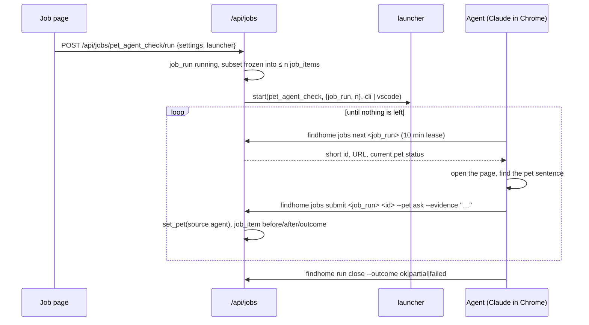

# Architecture: jobs

A **job** is a named, reusable analysis over a chosen subset of listings. The Jobs page lists one row per job;
each time a job runs it creates an **execution** with one reviewable result per listing (before, after, the quoted
evidence, the outcome) that can be undone. Two job types exist, both about pet policies; new types register in
[`jobs/registry.py`](../../backend/src/findhome/jobs/registry.py) without schema changes.

| Job | Kind | What it does |
|---|---|---|
| `pet_keywords` | in-app | re-runs the pet wording rules ([config_and_locations.md](pets.md)) on the subset, e.g. after `config/pet_rules.yaml` changed; never above the agent, the site or you, never resolves a conflict |
| `pet_agent_check` | agent | the agent opens each listing in your Chrome, finds the exact pet sentence and records yes / no / ask with the quote (unknown when the page says nothing); results apply at once |

## Tables

| Table | Holds |
|---|---|
| `jobs` | `key`, `type`, `label`, `settings` (`subset`, `n` per execution, `launcher`), `enabled`; seeded by [`013_jobs.sql`](../../backend/migrations/013_jobs.sql) |
| `job_runs` | one execution: `status` running / ok / partial / error / cancelled, the frozen `settings`, `counts` by outcome, `agent_run_id` |
| `job_items` | one listing of one execution: `state` queued / leased / done / undone / skipped, `before`, `after`, `evidence`, `page_url`, `outcome` changed / unchanged / conflict / skipped / error, `note` |

## The subset

One filter for every job type ([`subset_sql()`](../../backend/src/findhome/jobs/subset.py)): `sites`,
`origin_sites`, `pet_status`, `pet_source`, `status` (default: not rejected or archived), `new_since`,
`passes_hard_filters`, `short_ids`, `exclude_checked_within_days` (uses `listings.pet_checked_at`, so a listing
the agent or you checked recently is skipped) and `order` (`score_desc`, `newest`, `oldest`). The first `n`
matches are frozen into `job_items` when the execution starts ([`create_run()`](../../backend/src/findhome/jobs/service.py#L86));
`POST /api/jobs/{key}/preview` counts the matches before you start.

## An agent execution

| Step | Code |
|---|---|
| Start, launch the agent | [`POST /api/jobs/{key}/run`](../../backend/src/findhome/api/routers/jobs.py) |
| Next listing, with a lease | [`next_item()`](../../backend/src/findhome/jobs/service.py#L194) |
| Record the answer through the pet precedence | [`submit()`](../../backend/src/findhome/jobs/service.py#L220), [`set_pet()`](../../backend/src/findhome/db/repo.py) |
| Close executions whose agent ended early | [`finalize_agent_runs()`](../../backend/src/findhome/jobs/service.py#L144) |
| Undo one item | [`undo()`](../../backend/src/findhome/jobs/service.py#L246) |
| Prompt and profile | [`pet_agent_check.md`](../../.agents/skills/find-home/prompts/pet_agent_check.md), `pet_agent_check` in `config/agent.yaml` |

`submit` requires a quote for yes, no and ask. An answer that ranks below the listing's current source (your own
answer) is recorded as `unchanged` with a note. Undo puts back the `before` value only when nobody changed the
listing's pet status since the job; otherwise it is refused and the listing is changed on its own page.

The execution ends when `jobs next` finds nothing left (`ok`), when you cancel it, or when its agent run ends
first (`partial` with listings left, `error` when the agent failed). The agent run appears on the Runs page with
the job run nested under it.

## Where the code lives

| Concern | File |
|---|---|
| Types | [`jobs/registry.py`](../../backend/src/findhome/jobs/registry.py) |
| Subset filter | [`jobs/subset.py`](../../backend/src/findhome/jobs/subset.py) |
| Executions, agent protocol, undo | [`jobs/service.py`](../../backend/src/findhome/jobs/service.py) |
| API | [`api/routers/jobs.py`](../../backend/src/findhome/api/routers/jobs.py) |
| CLI | `findhome jobs list|next|submit` in [`cli/main.py`](../../backend/src/findhome/cli/main.py) |
| Tests | [`tests/db/test_jobs.py`](../../backend/tests/db/test_jobs.py) |
