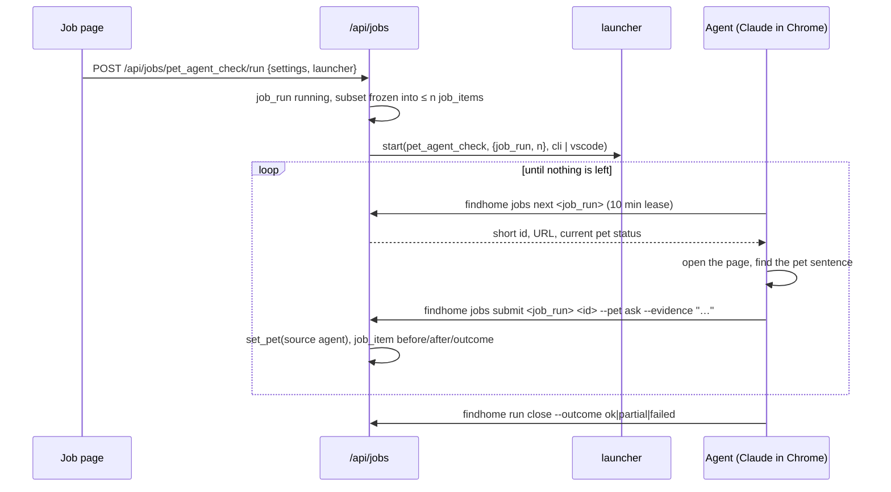

# Architecture: jobs

A **job** is a named, reusable analysis over a chosen subset of listings. The Jobs page lists one row per job;
each time a job runs it creates an **execution** with one reviewable result per listing (before, after, the quoted
evidence, the outcome) that can be undone. Types register in
[`jobs/registry.py`](../../backend/src/findhome/jobs/registry.py) and get a seeded `jobs` row.

| Job | Kind | What it does |
|---|---|---|
| `pet_keywords` | in-app | re-runs the pet wording rules ([config_and_locations.md](pets.md)) on the subset, e.g. after `config/pet_rules.yaml` changed; never above the agent, the site or you, never resolves a conflict |
| `pet_agent_check` | agent | the agent opens each listing in your Chrome, finds the exact pet sentence and records yes / no / ask with the quote (unknown when the page says nothing); results apply at once |
| `listing_details` | agent | browser sites: the agent opens each listing's own page; the site's `detail_extract.js` hands the page's data to the app, and the agent adds only what is still missing from the free text, each value with its quote (below) |
| `listing_details_script` | in-app | scripted sites (Bostadsförmedlingen): reads each listing's page again with the scanner's `enrich`, in the background, 3 s apart, no tokens |

## Tables

| Table | Holds |
|---|---|
| `jobs` | `key`, `type`, `label`, `settings` (`subset`, `n` per execution, `launcher`, `model`, `chain_after_scan`), `enabled`; seeded by [`013_jobs.sql`](../../backend/migrations/013_jobs.sql) and [`017_listing_details_job.sql`](../../backend/migrations/017_listing_details_job.sql) |
| `job_runs` | one execution: `status` running / ok / partial / error / cancelled, the frozen `settings`, `counts` by outcome, `agent_run_id` |
| `job_items` | one listing of one execution: `state` queued / leased / done / undone / skipped, `before`, `after`, `evidence`, `page_url`, `outcome` changed / unchanged / conflict / skipped / error / gone / unread / translated, `note`, `usage` (the tokens the agent spent on it) |

## The subset

One filter for every job type ([`subset_sql()`](../../backend/src/findhome/jobs/subset.py)): `sites`,
`origin_sites`, `pet_status`, `pet_source`, `status` (default: not rejected or archived), `new_since`,
`passes_hard_filters`, `short_ids`, `exclude_checked_within_days` (uses `listings.pet_checked_at`, so a listing
the agent or you checked recently is skipped), `missing_fields` (no move-in, no photos, no description, no street
number, or a page never read), `exclude_details_checked_within_days` (`attributes.details_checked_at`), `agent_run`
(the listings a browser scan run saw) and `order` (`score_desc`, `newest`, `oldest`). The first `n`
matches are frozen into `job_items` when the execution starts ([`create_run()`](../../backend/src/findhome/jobs/service.py#L88));
`POST /api/jobs/{key}/preview` counts the matches before you start.

## An agent execution

| Step | Code |
|---|---|
| Start, launch the agent | [`POST /api/jobs/{key}/run`](../../backend/src/findhome/api/routers/jobs.py) |
| Next listing, with a lease | [`next_item()`](../../backend/src/findhome/jobs/service.py#L196) |
| Record the answer through the pet precedence | [`submit()`](../../backend/src/findhome/jobs/service.py#L231), [`set_pet()`](../../backend/src/findhome/db/repo.py) |
| Close executions whose agent ended early | [`finalize_agent_runs()`](../../backend/src/findhome/jobs/service.py#L146) |
| Undo one item | [`undo()`](../../backend/src/findhome/jobs/service.py#L269) |
| Prompt and profile | [`pet_agent_check.md`](../../.agents/skills/find-home/prompts/pet_agent_check.md), `pet_agent_check` in `config/agent.yaml` |

`submit` requires a quote for yes, no and ask. An answer that ranks below the listing's current source (your own
answer) is recorded as `unchanged` with a note. Undo puts back the `before` value only when nobody changed the
listing's pet status since the job; otherwise it is refused and the listing is changed on its own page.

The execution ends when `jobs next` finds nothing left (`ok`), when you cancel it (which also stops its agent run's
process, exactly as the run drawer's Cancel does, and refuses that run's later `jobs next` and `jobs submit` with
409), or when its agent run ends
first (`partial` with listings left, `error` when the agent failed). The agent run appears on the Runs page with
the job run nested under it.

## The details jobs

A browser site's listing page is read by its `sites/<site>/detail_extract.js`, which the agent runs on the open page
with `window.FH_POST = {api, site, run, job_run}`. The script posts its result to `POST /api/inbox/raw` (kind
`detail`; only from the site's own origin and for an open agent run, see
[agent_contract.md](agent_contract.md#file-inbox-agents-without-api-access)), so the page's data never passes
through the agent's context. [`raw_detail()`](../../backend/src/findhome/jobs/details.py#L153) maps it with the site's
`detail_to_listing`, writes only the values the page had (a missing value never overwrites a stored one), merges
`attributes`, sets `details_checked_at`, and records the item: `changed` / `unchanged` with before and after,
`gone` (the ad is gone), `unread` (the page state could not be read) or `translated` (the run stops). The answer to
the agent names the fields still missing. For those, the agent reads the page's free text and sends each value with its
quote (`findhome jobs submit <job_run> <id> --fields-file f.json`,
[`submit_details()`](../../backend/src/findhome/jobs/details.py#L195)): move-in and contract dates, contract terms,
deposit, max tenants, other costs, floor, furnishing, sleeping alcove, pets (through the pet precedence, source
agent). A value without a quote is refused. `--gone` records a missing ad; `findhome jobs post-detail` posts a page's
data from the CLI when the site's security policy blocked the script's own post. Undo
([`undo_details()`](../../backend/src/findhome/jobs/details.py#L237)) puts back the fields an item changed, only while
the listing still holds the values it wrote.

**The chain.** When a `browser_scan` run's process ends `ok` or `partial`, the launcher starts `listing_details` on
the passing listings that run saw (`chain_after_scan`, on by default;
[`chain_after_run()`](../../backend/src/findhome/jobs/details.py#L319)): one agent uses your Chrome at a time, and a
details run already open covers it later. Nothing starts when no listing matches.

**Scripted sites.** `listing_details_script` runs in the API process in the background
([`run_details_script()`](../../backend/src/findhome/jobs/details.py#L271)): each item's page is read by the site's
scanner, the run closes `ok` when every item is done, and the touched listings are scored.

## Where the code lives

| Concern | File |
|---|---|
| Types | [`jobs/registry.py`](../../backend/src/findhome/jobs/registry.py) |
| Subset filter | [`jobs/subset.py`](../../backend/src/findhome/jobs/subset.py) |
| Executions, agent protocol, undo | [`jobs/service.py`](../../backend/src/findhome/jobs/service.py) |
| Details jobs: page posts, free-text values, undo, the chain | [`jobs/details.py`](../../backend/src/findhome/jobs/details.py) |
| API | [`api/routers/jobs.py`](../../backend/src/findhome/api/routers/jobs.py) |
| CLI | `findhome jobs list|next|submit` in [`cli/main.py`](../../backend/src/findhome/cli/main.py) |
| Tests | [`tests/db/test_jobs.py`](../../backend/tests/db/test_jobs.py) |
