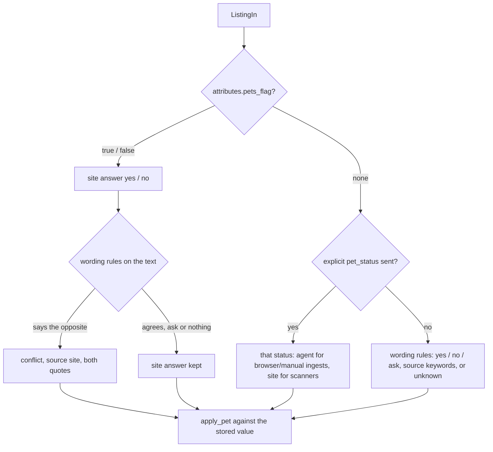

# Architecture: pets

The search is for a tenant with two cats, so a listing's pet policy is decided carefully: from explicit wording
only, with the quoted evidence kept, and by a fixed precedence of who may decide.

## Statuses and sources

`listings.pet_status` is `yes`, `no`, `ask`, `unknown` or `conflict`; `pet_evidence` quotes what it is based on;
`pet_source` says who decided it; `pet_checked_at` is the last time the agent or you checked it.

| Source (rank) | Writes through | Example |
|---|---|---|
| `user` (4) | `POST /api/listings/{id}/pet`, the `no_pets` feedback tag | "landlord confirmed by phone" |
| `agent` (3) | evaluations with `pet_status` + `pet_evidence`, `findhome jobs submit` | "'Husdjur efter överenskommelse.'" |
| `site` (2) | the site's structured flag, `attributes.pets_flag` (Qasa `petsAllowed=true`, a "Husdjur ok" badge) | "Qasa house rules: pets allowed" |
| `keywords` (1) | the wording rules on title, description and `attributes.pets_text` | "Inga husdjur." |

[`apply_pet()`](../../backend/src/findhome/pets/apply.py#L13) is the single rule: a candidate replaces the current
value only when its source ranks at least as high; `unknown` never replaces a known value; the same answer again
changes nothing ([`set_pet()`](../../backend/src/findhome/db/repo.py)). So keywords never override a site flag, a
site never overrides the agent, and nothing overrides you.

## At ingest

| Step | Code |
|---|---|
| Candidate for an arriving listing | [`ingest_candidate()`](../../backend/src/findhome/pets/apply.py#L25) |
| Insert, update and cross-site duplicate all apply it | [`ingest()`](../../backend/src/findhome/db/repo.py) |
| Scanners hand over the site's flag, not a status | [`sites/qasa/scanner.py`](../../sites/qasa/scanner.py), [`generic.py`](../../backend/src/findhome/scanning/generic.py) (`pets` selector → `attributes.pets_text`) |

A `conflict` (the site's flag and its own text disagree, or two explicit phrases do) keeps its source `site`, so
keywords cannot resolve it; the agent (pet job) or you do. Its score is `pet_status_score.conflict` (default 0.4,
like `unknown`), and `pet_status_exclude` may list it.

## The wording rules

[`config/pet_rules.yaml`](../../config/pet_rules.yaml) (committed, schema
[`pet_rules.schema.json`](../../config/schemas/pet_rules.schema.json)) holds one pack per language (`sv`, `en`)
with `no`, `ask` and `yes` patterns and `exceptions`. [`detect()`](../../backend/src/findhome/pets/detect.py#L31)
lower-cases the text and folds å/ä/ö (one character per character, so offsets quote the original), blanks the
exceptions ("inga problem med husdjur", "husdjur ej tillåtna i tvättstugan"), then decides: `no` and `yes` both
present → `conflict`; else `no`, then `ask` (also with `yes`), then `yes`; nothing explicit → `unknown`. The
evidence is the sentence around the match. Ambiguous wording (allergy-adapted flats, "enligt överenskommelse",
"pets negotiable") is `ask`, never `no`. A bare word ("djur", "pets") never decides. Adding a language or a city
means adding a pack, not code; the corpus test keeps false positives at zero.

## Where the code lives

| Concern | File |
|---|---|
| Rules, normalisation | [`pets/rules.py`](../../backend/src/findhome/pets/rules.py) |
| Detection | [`pets/detect.py`](../../backend/src/findhome/pets/detect.py) |
| Precedence, ingest candidate | [`pets/apply.py`](../../backend/src/findhome/pets/apply.py) |
| Storage | [`012_pets.sql`](../../backend/migrations/012_pets.sql) |
| Re-checking subsets | [jobs.md](jobs.md) (`pet_keywords`, `pet_agent_check`) |
| Tests | [`tests/unit/test_pets.py`](../../backend/tests/unit/test_pets.py) (corpus), [`tests/db/test_pets_db.py`](../../backend/tests/db/test_pets_db.py) |
