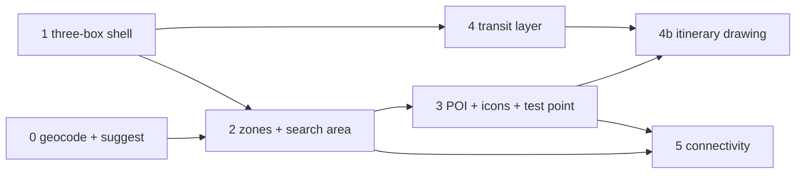

# Master Plan: Enhance the map (explorer, search area, transit and POI layers)

## Overview

Turn the Map page from a single static map into an exploration and search-area tool, inside an app-wide
three-box layout modelled on the Telia debug UI.

- **Layout (all pages):** a left box with a navigation bubble (pages with child entries) plus collapsible
  bubbles the active page contributes; the routed page in the centre; an optional right box (the map's
  inspector). Boxes are resizable and collapsible, remembered per browser.
- **Map modes** as child routes: **Explore** (listings, transit, POIs, a small connectivity overlay),
  **Area** (search-area editor), **Connectivity** (zones coloured by commute time to your points). A **test
  point** works in every mode; saved, named test points are an alpha feature.
- **Search area:** one area of weighted pieces: toggled SCB **RegSO 2025** zones (263 in the 9 municipalities
  around Stockholm), brush / circle / lasso shapes and erasers. `area_score = max(weight × linear falloff)`;
  reject beyond the buffer, `area_unknown` without coordinates; a new `area` preference group. The area is a
  config file inside the config hash. Agents get the zone list and stay inside it.
- **Data and services:** static geodata under `data/geo/` built by scripts (RegSO, OSM stadsdelsområden, SL GTFS,
  OSM POIs); geometry with shapely + pyproj (EPSG:3006); ResRobot for itineraries and the zone matrix;
  OpenRouteService for walking minutes and address suggestions; all calls cached in Postgres.
- **Look:** GTA-style round icon badges for every marker (SATS = dumbbell on SATS red), dark steel/violet theme.

Out of scope: `neighbourhood` scoring from POIs (stays disabled, backlog `poi-layer`), PostGIS, regions outside
the 9 municipalities, per-site area alias tables, isochrone engines (r5py/OTP).

Planning record: [QA_planning.md](QA_planning.md) (decisions in its Summary),
[notes/04_data_sources.md](notes/04_data_sources.md) + [notes/05_research_review.md](notes/05_research_review.md)
(sources, verified counts), [notes/02_geocode_bug.md](notes/02_geocode_bug.md).

## Sub-Plans

| #  | Sub-Plan | Description | Dependencies |
|----|----------|-------------|--------------|
| 0  | [subplan_00_geocode_and_address_suggest](plans/subplan_00_geocode_and_address_suggest.md) | Fix the "Sweden" suffix bug and miss caching; address suggestions in Locations that save address + coords | None |
| 1  | [subplan_01_three_box_shell](plans/subplan_01_three_box_shell.md) | App-wide 3-box layout, nav and page bubbles, map moved in, mode child routes, layers bubble, dark map style | None |
| 2  | [subplan_02_zones_and_search_area](plans/subplan_02_zones_and_search_area.md) | RegSO zones data, `search_area.yaml`, area function, `area` scoring, Area mode editor, agent hand-off | #1 (UI), backend part independent |
| 3  | [subplan_03_poi_icons_test_point](plans/subplan_03_poi_icons_test_point.md) | Region POI fetch, icon system (SATS), ORS walking, test point inspector, alpha saved probes | #1, #2 (area score in inspector) |
| 4  | [subplan_04_transit_layer](plans/subplan_04_transit_layer.md) | SL GTFS → GeoJSON lines/stops, colours, transit layers and inspector entries, itinerary drawing | #1; itinerary drawing needs #3 |
| 5  | [subplan_05_connectivity_mode](plans/subplan_05_connectivity_mode.md) | Zone × point commute matrix via ResRobot, Connectivity choropleth, overlay in Explore | #2 (zones), #3 (test point) |

## Implementation Order

- **0 and 1 in parallel** (backend-only vs frontend-only). 0 first if one person: the work points need reliable
  coordinates for everything after.
- **2** next: its backend half (data script, area function, scoring) can start alongside 1; the editor needs 1.
- **3**, then **4** (lines and stops can start after 1; drawing itineraries on GTFS shapes waits for 3), then **5**.
- Each sub-plan ships on its own: tests green, `scripts/smoke-check.sh` passes, guide updated in the same commit
  (guide skill), `tasks/BACKLOG.md` updated (`poi-layer` and `map-3d` partly covered).

## Interconnections

- **Shared geodata store:** `backend/src/findhome/geo/` (new package) loads `data/geo/*` once per process:
  zones (2), POIs (3), transit (4). Fetch/build scripts live in `scripts/geo/` and are run by
  `findhome geo fetch <dataset>`; `data/` stays gitignored; attribution strings in `config/geo.yaml`.
- **Config:** new `config/geo.yaml` (region, datasets, attribution; 2), `config/search_area.yaml` (pieces, buffer;
  2, in `SCORING_FILES`), `config/area_aliases.yaml` (2), `config/transit_colours.yaml` (4); `poi.yaml` and
  `locations.yaml` categories gain `icon`/`color` (3). Every new file gets a JSON Schema and loader checks.
- **Caches:** `routing_cache` reused for ORS walking (3), ResRobot itineraries (3/4) and the zone matrix (5);
  `geocode_cache` fixed in 0. New table only for alpha probes (3), in its own migration.
- **Frontend contracts:** `LayoutService` (1) is used by every map mode (2-5) to register left bubbles and the
  right panel. `MapStateService` (1) holds the MapLibre instance, layer visibility, the test point (3) and the
  hovered/selected feature, so modes switch without rebuilding the map. Icon sprites (3) are reused by 4 and 5.
- **Files touched by several sub-plans:** [map page](../../frontend/src/app/pages/map.ts) (split in 1, extended in
  2-5), [api.service.ts](../../frontend/src/app/services/api.service.ts), [models.ts](../../frontend/src/app/models.ts),
  [config/loader.py](../../backend/src/findhome/config/loader.py), [config/models.py](../../backend/src/findhome/config/models.py),
  [providers/registry.py](../../backend/src/findhome/providers/registry.py), [api/routers/map.py](../../backend/src/findhome/api/routers/map.py),
  guide pages [introduction](../../guide/architecture/introduction.md) and
  [config_and_locations](../../guide/architecture/config_and_locations.md).
- **Keys** (in `config/providers.env`, examples in `providers.env.example`): `TRAFIKLAB_GTFS_KEY` (4),
  `ORS_API_KEY` (0 suggestions, 3 walking); `TRAFIKLAB_RESROBOT_KEY` exists.
