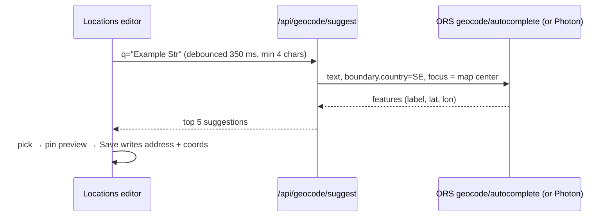

## Plan: Geocode fix and address suggestions

Two defects make points silently disappear from the map: [providers/geocode.py](../../../backend/src/findhome/providers/geocode.py)
appends `", Sverige"` unless the query contains `stockholm` or `sverige` (so "…, Sweden" becomes "…, Sweden,
Sverige" and Nominatim finds nothing), and a miss is cached for the full 365-day TTL. The same function geocodes
listing addresses ([api/routers/scoring.py](../../../backend/src/findhome/api/routers/scoring.py) `compute`), so
listings are affected too. Fix both minimally, make the CLI check use the same path, and add address suggestions
to the Locations editor so points are saved with coordinates and never depend on runtime geocoding. Suggestions
cannot use Nominatim (its usage policy forbids autocomplete); use OpenRouteService's geocoder (Pelias) with the
ORS key that sub-plan 3 needs anyway, Photon as a no-key fallback. Details: [notes/02_geocode_bug.md](../notes/02_geocode_bug.md).

### Design

```python
# providers/geocode.py
_COUNTRY = re.compile(r"\b(sverige|sweden)\b")
query_sent = query if _COUNTRY.search(key) else f"{query}, Sverige"
miss_ttl = timedelta(days=1)            # a miss is retried tomorrow, a hit keeps ttl_days
```



### Steps
1. Change `geocode()` in [providers/geocode.py](../../../backend/src/findhome/providers/geocode.py): country check matches `sverige|sweden` (word boundary); store misses with `expires_at = now() + 1 day`.
2. Make `findhome geocode` in [cli/main.py](../../../backend/src/findhome/cli/main.py) call the cached `geocode()` path (local DB connection) and print whether the answer came from cache; add `--refresh` to delete the cache row first.
3. Add unit tests in `backend/tests/unit/test_geocode.py`: suffix rule for "Sweden"/"Sverige"/"Stockholm"/plain, miss TTL of one day, cached NULL returned without a provider call (fake geocoder).
4. Add an `AddressSuggester` provider in `backend/src/findhome/providers/suggest.py` with ORS `/geocode/autocomplete` (key `ORS_API_KEY`, `boundary.country=SE`, `focus.point` = map centre) and Photon fallback; configure under `geocoding.suggest` in [providers.yaml](../../../config/providers.yaml) and its schema.
5. Expose `GET /api/geocode/suggest?q=` (new router or [api/routers/map.py](../../../backend/src/findhome/api/routers/map.py)): min 4 characters, 5 results, short in-memory LRU cache; 503 with a clear message when no suggester is configured.
6. In [pages/locations.ts](../../../frontend/src/app/pages/locations.ts) turn the Address input into a suggestion dropdown (debounced 350 ms); picking one sets `address` and `coords`, shows a small static MapLibre preview with the pin; editing the address text by hand clears `coords` only after confirmation.
7. Add `ORS_API_KEY=` to `config/providers.env.example` and document the key and Nominatim restriction in [docs/providers.md](../../../docs/providers.md).
8. Update the guide: geocoding behaviour and suggestions in [config_and_locations.md](../../../guide/architecture/config_and_locations.md); run the link check.
