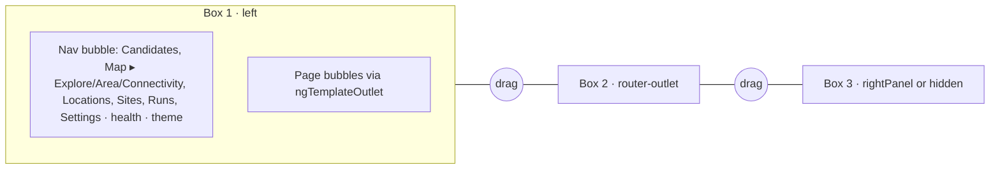
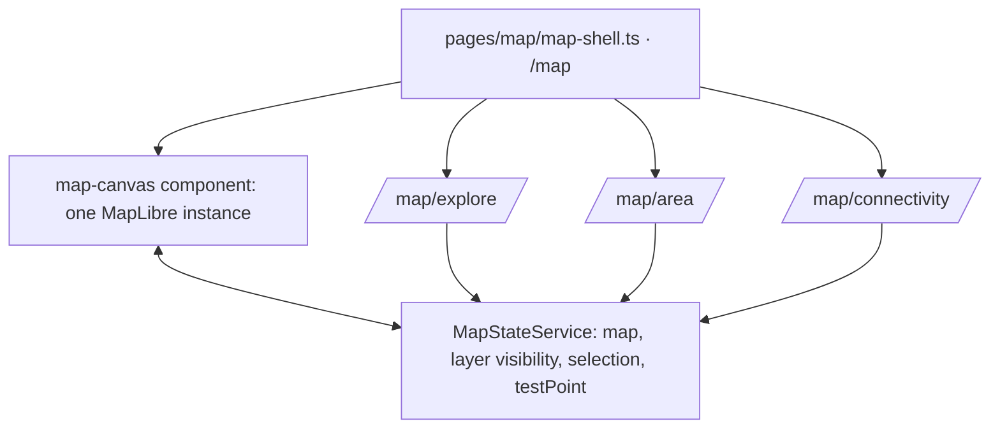

## Plan: Three-box app shell and map modes

Replace the fixed 190 px sidebar ([app.html](../../../frontend/src/app/app.html), [app.scss](../../../frontend/src/app/app.scss))
with the Telia debug UI layout: three flex columns with drag handles. **Box 1** holds a navigation bubble (pages
with child entries) and the bubbles the active page contributes; **box 2** is the routed page; **box 3** is an
optional right panel a page can open (the map inspector). Bubbles are collapsible, boxes resizable and
collapsible, all remembered in localStorage. Then split the Map page so the MapLibre instance lives in a service
and the three modes are child routes sharing it. This step adds no new data; it moves existing layers (listings,
rejected, your points, 3D buildings) into a Layers bubble and adds dark map styles.

### Reference
Debug UI: `~/Projects/telia_env/gcpai-se-co-debug-ui/ui/frontend/src/app/app.component.html` (flex per box,
`.resize-handle` with `(mousedown)` start, optional box 3, `box3Mode`), bubbles = `_settings-card.scss`.

### Phase A: shell

```ts
// services/layout.service.ts
@Injectable({ providedIn: 'root' })
export class LayoutService {
  readonly leftBubbles = signal<Bubble[]>([]);          // {id, title, tpl: TemplateRef, order}
  readonly rightPanel = signal<TemplateRef<unknown> | null>(null);
  readonly widths = signal({ left: 300, right: 380 });  // px, persisted
  readonly collapsed = signal<Record<string, boolean>>({});
  register(owner: DestroyRef, b: Bubble[], right?: TemplateRef<unknown>) { /* set, and clear on destroy */ }
}
```



### Phase B: map split



Mode components hold no map of their own: they add/remove their layers and handlers through `MapStateService`
on init/destroy and register their bubbles and right panel through `LayoutService`.

### Steps
1. Add `LayoutService` (`frontend/src/app/services/layout.service.ts`) with left bubbles, right panel, widths, collapsed state and localStorage persistence (key `fh-layout`), and a `BubbleComponent` (`components/bubble.ts`): title row with chevron, content projection, steel/violet card style.
2. Rewrite [app.html](../../../frontend/src/app/app.html)/[app.scss](../../../frontend/src/app/app.scss)/[app.ts](../../../frontend/src/app/app.ts): three flex boxes with two drag handles (pointer events, min/max widths, double-click resets); nav bubble with child entries (`nav` gains `children`); health and theme toggle at the bottom of the nav bubble; box 3 shown only when `rightPanel()` is set; drawer behaviour under 900 px.
3. Move [pages/map.ts](../../../frontend/src/app/pages/map.ts) into `pages/map/`: `map-shell.ts` (route `/map`, redirect to `explore`, hosts the canvas and a compact mode switch), `map-canvas.ts` (creates MapLibre once, style fallback kept), `MapStateService` (instance, `ready` signal, layer registry with visibility, selection, `testPoint` signal).
4. Add child routes in [app.routes.ts](../../../frontend/src/app/app.routes.ts): `map/explore`, `map/area`, `map/connectivity` (Area and Connectivity show an empty state until sub-plans 2 and 5).
5. Explore mode: register the existing layers in a **Layers** bubble (checkbox per layer, opacity slider), a **Legend** bubble, and the listing popup as a right-panel listing card instead of a MapLibre popup.
6. Dark map style: add `map.style_url_dark` to [providers.yaml](../../../config/providers.yaml) + schema (OpenFreeMap `dark` or `fiord`); `map-canvas` swaps style on theme change and re-adds app layers on `style.load`.
7. Keep other pages working unchanged in box 2 (they register no bubbles); check Candidates keyboard shortcuts still work with focus in box 1.
8. Tests: `LayoutService` persistence and register/unregister on destroy, route redirects; update the guide (frontend section of [introduction.md](../../../guide/architecture/introduction.md)) and the overview directory map.
