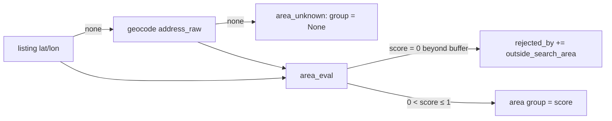

## Plan: Zones, search area and area scoring

Give the app geometry. A build script downloads SCB **RegSO 2025** (CC0; 263 zones in the 9 municipalities) and
Stockholm's stadsdelsområden from OSM (only to group zones), writes `data/geo/zones.geojson`, and a new
`findhome.geo` package loads it with shapely/pyproj (EPSG:3006 for metres). The search area is a config file of
weighted **pieces** (zone sets, brush/circle/lasso polygons, erasers) with a buffer. `area_eval(lat, lon)`
returns inside/outside, distance to the border, the per-piece contributions and the score
`max_i(w_i × falloff(d_i))`. Scoring gets a hard filter `outside_search_area`, a soft state `area_unknown`, and a
preference group `area`. The Area mode edits the pieces with Terra Draw and a server-side brush. Agents get the
zone list so scans stay inside the area. Verified data facts: [notes/05_research_review.md](../notes/05_research_review.md).

### Data and config

```yaml
# config/geo.yaml (new)
region:
  kommuner: {"0180": Stockholm, "0184": Solna, "0183": Sundbyberg, "0186": Lidingö, "0162": Danderyd,
             "0163": Sollentuna, "0123": Järfälla, "0126": Huddinge, "0182": Nacka}
datasets:
  zones: {source: scb_regso_2025, file: data/geo/zones.geojson}
attribution: ["Statistical areas: Source: Statistics Sweden (SCB)", "© OpenStreetMap contributors"]
```

```yaml
# config/search_area.yaml (new, in SCORING_FILES → config hash)
buffer_m: 1500
pieces:
  - {id: core, label: Core, weight: 1.0, kind: zones, zones: ["0184R003", "0180R041"]}
  - {id: maybe-north, label: Maybe, weight: 0.6, kind: shape, source: lasso, geometry: {type: Polygon, coordinates: [...]}}
  - {id: no-motorway, kind: eraser, geometry: {type: Polygon, coordinates: [...]}}
```

`zones.geojson` feature properties: `zone_id` (regsokod), `name` (regsonamn), `kommun_code`, `kommun`,
`district` (Stockholm stadsdelsområde or kommun name), `area_km2`, `centroid` [lon, lat]. Aliases in
`config/area_aliases.yaml`: `Hornstull: [zone ids]`, seeded from OSM `place` nodes inside each zone.

### Area function

```python
# backend/src/findhome/geo/area.py
@dataclass
class AreaResult:
    inside: bool; distance_m: float; score: float | None
    best_piece: str | None; contributions: list[dict]   # {piece, weight, distance_m, value}

def area_eval(area: CompiledArea, lat: float, lon: float) -> AreaResult:
    p = to_3006(lon, lat)
    contribs = []
    for piece in area.pieces:                               # polygons already minus erasers
        d = 0.0 if piece.geom.covers(p) else piece.geom.exterior_distance(p)
        contribs.append({"piece": piece.id, "weight": piece.weight, "distance_m": d,
                         "value": piece.weight * max(0.0, 1 - d / area.buffer_m)})
    best = max(contribs, key=lambda c: c["value"])
    return AreaResult(best["distance_m"] == 0, min(c["distance_m"] for c in contribs), best["value"], ...)
```

`CompiledArea` is built once per config hash: zone pieces = union of their zone polygons; shape pieces from
GeoJSON; every piece minus the union of erasers; all in EPSG:3006 with an `STRtree`.



### Steps
1. Add `shapely` and `pyproj` to [pyproject.toml](../../../backend/pyproject.toml); create `backend/src/findhome/geo/` with `crs.py` (cached `Transformer` 4326↔3006), `store.py` (load `data/geo/*.geojson` once per process, reload on file change), `area.py` (`compile_area`, `area_eval`, `AreaResult`).
2. Add `scripts/geo/build_zones.py` and `findhome geo fetch zones`: SCB WFS `stat:RegSO_2025` filtered by `kommunkod`, OSM adm9 relations for Stockholm (Overpass, one request) for the `district` grouping, area/centroid computed in 3006, written as WGS84 GeoJSON; seed `config/area_aliases.yaml` from OSM place nodes. Check RegSO CRS with the first download.
3. Add `config/geo.yaml`, `config/search_area.yaml`, `config/area_aliases.yaml` with JSON Schemas; in [config/loader.py](../../../backend/src/findhome/config/loader.py) add `search_area` to `SCORING_FILES`, models in [config/models.py](../../../backend/src/findhome/config/models.py), cross-checks (zone ids exist in the zones file, piece ids unique, weights 0..1, valid polygons).
4. Scoring in [domain/scoring.py](../../../backend/src/findhome/domain/scoring.py): when the area has pieces, `hard_filter_failures` adds `outside_search_area` (score 0) and skips the text `areas_include`/`areas_exclude`; new group `_area` returns the score or `None`; store the `AreaResult` in the score breakdown (`why` = best piece and distance). Add `area: {enabled: true, weight: 3}` to [profile.yaml](../../../config/profile.yaml) and its schema.
5. Geocode listings without coordinates during `scores recompute` (budgeted, cached, same `geocode()` as sub-plan 0) so the area filter does not depend on a commute run; listing ingest keeps site coordinates when present.
6. API: `GET /api/geo/zones` (GeoJSON, cached by ETag), `GET /api/area` (pieces + compiled outline + stats), `POST /api/area/eval` (points → `AreaResult`), `POST /api/area/brush` (stroke LineString + radius_m + mode add/erase → polygon via `buffer(cap_style=round)` + `unary_union`), `PATCH /api/config/search_area` via the existing writer; counts of listings inside / within buffer / outside.
7. Area mode UI (`pages/map/area-mode.ts`): left bubbles **Zones** (tree kommun → district → zone, search, tri-state checkboxes, weight per selection), **Pieces** (list with weight slider, rename, delete, visibility) and **Tools** (Terra Draw `freehand`, `circle`, `polygon`, `select`; brush and eraser with radius slider; live stroke preview as a metre-scaled line layer, server polygon swapped in on pointer-up); right panel: area km², zones count, listings inside/near/outside, and per-piece contributions for the selected listing; Save → PATCH + "Recompute scores".
8. Map layers: zones (thin outline, name labels from z12), selected zones fill by weight (violet ramp), shape pieces, erasers hatched, buffer ring dashed; listing markers in Explore get an outline style for "near" (inside buffer, outside area).
9. Agents: `findhome area show` (zones with weight, aliases, bbox, centre) in [cli/main.py](../../../backend/src/findhome/cli/main.py), an "Area" section in [digest/history.py](../../../backend/src/findhome/digest/history.py), and one rule in the find-home skill's `run_scan.md` / `browser_scan.md`: search the listed zones or the smallest wider area the site offers, never outside the bounding box.
10. Tests: `area_eval` inside/edge/buffer/beyond, overlaps (max wins), eraser cut, zone union, brush buffer area; scoring with and without an area; config cross-checks; update [config_and_locations.md](../../../guide/architecture/config_and_locations.md) (search area, area group), the overview directory map (`geo/`, `scripts/geo/`) and the agent contract page.
