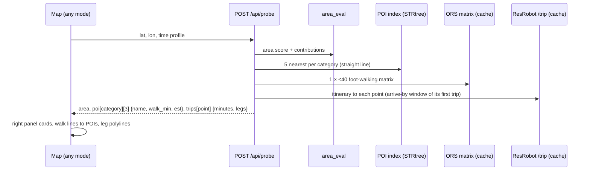

## Plan: POIs, icons, walking times and the test point

Make the map explorable. POIs come from OSM in one region-wide Overpass fetch per category (weekly, cached as
`data/geo/poi/<category>.geojson`), replacing the unused per-listing query in
[providers/poi.py](../../../backend/src/findhome/providers/poi.py). A new `sats` category tracks your gym. Every
marker gets a GTA-style **blip**: round badge in the category colour, white glyph, dark outline, soft glow
(SATS = dumbbell on SATS red, no logo). The **test point** can be dropped in any mode: the right panel shows its
area score (sub-plan 2), the nearest POIs per category with walking minutes from one OpenRouteService matrix
call (cached in `routing_cache`, straight-line fallback), and the transit itinerary to each of your points
(ResRobot `/trip`). Saved, named test points with side-by-side compare are an **alpha** feature in an isolated
table. POIs stay visual + inspector only; `neighbourhood` scoring is out of scope.

### Config

```yaml
# config/poi.yaml (extended: icon + color per category, region fetch)
fetch: {mode: region, refresh_days: 7}
categories:
  sats: {label: SATS, osm_tags: ["leisure=fitness_centre&brand=SATS"], icon: dumbbell, color: "#e3000b",
         radius_m: 1500, max_walk_min: 15, weight: 1.0, provider: overpass}
  grocery: {label: Groceries, osm_tags: ["shop=supermarket|convenience|greengrocer"], icon: cart, color: "#2ea44f", ...}
  vet: {label: Vet, osm_tags: ["amenity=veterinary"], icon: paw, color: "#f0a95a", ...}
```

`locations.yaml` categories already have `icon`/`color`; listings use a `home` blip coloured by score.

### Icon pipeline

```ts
// components/map-icons.ts: one SVG template, rendered to ImageData per (glyph, colour), added once per style load
function blip(glyph: string, color: string, size = 40): string {
  return `<svg ... ><circle r="17" fill="${color}" stroke="#101014" stroke-width="3"/>
          <g fill="#fff" transform="...">${GLYPHS[glyph]}</g></svg>`;   // glow via a blurred circle under it
}
map.addImage(`blip-${glyph}-${color}`, await svgToImage(blip(glyph, color)), { pixelRatio: 2 });
```

Glyphs: an open icon set (Tabler Icons, MIT) copied as SVG paths into `frontend/src/assets/icons/` with its
licence file; mapping glyph name → path in `GLYPHS`.

### Test point flow



### Steps
1. Extend [poi.yaml](../../../config/poi.yaml) + schema + `PoiCategory` in [config/models.py](../../../backend/src/findhome/config/models.py) with `icon`, `color`, top-level `fetch`; add the `sats` category; check the SATS tagging on the first fetch (fallback `name~"^SATS"`).
2. Add `scripts/geo/fetch_poi.py` / `findhome geo fetch poi`: one Overpass request per category over the region bbox (User-Agent, 30 s back-off on 429), output `data/geo/poi/<category>.geojson`; `findhome.geo.store` builds an `STRtree` per category in EPSG:3006.
3. Add an ORS walking provider (`providers/ors.py`): `matrix(origin, destinations)` with `foot-walking`, results cached per pair in `routing_cache` (provider `ors`, mode `walk`, origin/dest rounded to 4 decimals, `routing_ttl_days`); quotas 500 matrix/day and 40/min respected; fallback to haversine × 1.3 marked `est: true`.
4. Add a ResRobot `trip()` method in [providers/resrobot.py](../../../backend/src/findhome/providers/resrobot.py) returning legs (mode, line, from/to stops with coords, times, `passlist`), cached in `routing_cache` by origin cell + point + day type + slot.
5. API: `GET /api/geo/poi?categories=` (GeoJSON) and `POST /api/probe` composing area (sub-plan 2), POIs and trips as in the diagram; response capped and timed (POIs and trips fetched concurrently).
6. Frontend icon pipeline (`components/map-icons.ts`) and symbol layers per POI category (cluster at low zoom, icons from z13), your points as large category blips, listings as score-coloured `home` blips; Layers bubble gets a POI section with one toggle per category and a Legend with the blips.
7. Test point tool: a pin button in the map toolbar and a long-press/right-click on the map; `MapStateService.testPoint` survives mode switches; right panel cards: area score with per-piece bars, POIs per category (name, walk minutes, "est." badge), trips per point (total minutes, leg chips walk/metro/bus with line colours from sub-plan 4 when available); map draws walk lines to the chosen POIs and straight leg lines until sub-plan 4 provides shapes.
8. Alpha saved test points: migration `002_probes.sql` (`probes`: id, name, lat, lon, note, created_at), `/api/probes` CRUD, a **Test points (alpha)** bubble (save, rename, delete), compare view of 2-3 probes side by side in the right panel; tests; guide updates ([introduction.md](../../../guide/architecture/introduction.md) POI + probe flow, [config_and_locations.md](../../../guide/architecture/config_and_locations.md) poi.yaml fields, `ORS_API_KEY` in [docs/providers.md](../../../docs/providers.md)); mark `poi-layer` in [BACKLOG.md](../../BACKLOG.md) as partly done.
