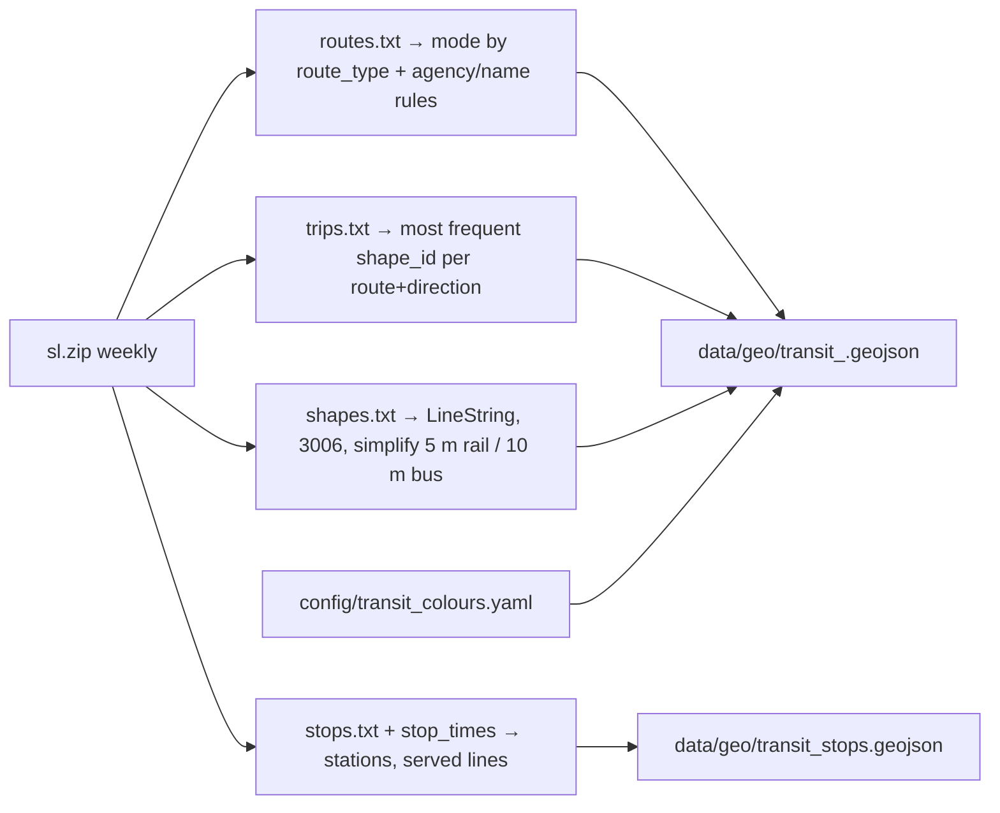

## Plan: Transit lines and stops layer

Show SL's network on the map from **Trafiklab GTFS Regional SL** (CC0, free key `TRAFIKLAB_GTFS_KEY`, 46 MB zip,
614 routes, `shapes.txt` included; Bronze quota 50 downloads/month, so fetch weekly). A build script turns the
feed into simplified GeoJSON per mode plus stations, coloured from a small config file because the feed has no
`route_color`. Explore gets toggles per mode (metro, pendeltåg, tram/light rail, local rail, bus, ferry) with
bus lines zoom-gated; clicking a line or station opens it in the right panel. Test-point itineraries (sub-plan 3)
are redrawn along the real shapes. Source details: [notes/04_data_sources.md](../notes/04_data_sources.md) §C.

### Build pipeline



```yaml
# config/transit_colours.yaml (hex values sampled from SL's network map; UNVERIFIED until checked)
metro: {T10: "#0089ca", T11: "#0089ca", T13: "#d71d24", T14: "#d71d24", T17: "#148541", T18: "#148541", T19: "#148541"}
commuter_rail: {default: "#ec619f"}
tram: {"30": "#f39200", "31": "#f39200", "7": "#878787", "12": "#878787", "21": "#878787"}
local_rail: {"25": "#00a5ac", "26": "#00a5ac", "27": "#a05fa5", "28": "#a05fa5", "29": "#a05fa5"}
bus: {default: "#7a7a88"}
ferry: {default: "#3ab4d8"}
```

### Steps
1. Add `TRAFIKLAB_GTFS_KEY` to `config/providers.env.example` and a `transit` dataset entry in `config/geo.yaml` (URL template, refresh_days 7); `findhome geo fetch transit` downloads `sl.zip` to `data/geo/raw/` only when older than the refresh window.
2. Write `scripts/geo/build_transit.py`: read `routes.txt`, `trips.txt`, `shapes.txt`, `stops.txt`, `stop_times.txt` (pandas or csv streaming), assign modes (route_type 401 metro, 100/109 rail, 900 tram/light rail, 700 bus, 1000 ferry, plus name rules for Roslagsbanan, Saltsjöbanan, Lidingöbanan, Nockebybanan, Tvärbanan), pick the dominant shape per route+direction, merge directions, simplify in EPSG:3006, clip to the region bbox.
3. Stations: parent stops (`location_type=1`) with served lines and modes; entrances (`location_type=2`) if the feed has them, else OSM `railway=subway_entrance` in a later iteration; first run logs which `route_type`s and entrance types actually occur.
4. Add `config/transit_colours.yaml` + schema (mode → line → hex, with `default` per mode); verify hex values against SL's official map before marking them verified.
5. API: `GET /api/geo/transit/{mode}` and `GET /api/geo/transit/stops` (GeoJSON, ETag); `GET /api/geo/transit/line/{route_id}` (stops in order, frequency per hour on a reference weekday from `stop_times`).
6. Explore layers: one line layer per mode (casing + coloured line, width by zoom; buses from z13, dashed), station blips with the metro "T" glyph and pendeltåg "J" glyph (icon pipeline from sub-plan 3), labels from z14; Layers bubble section **Transit** with toggles per mode.
7. Inspector: clicking a line shows name, mode, colour chip, stops list and peak frequency; clicking a station shows lines served and walking minutes from the test point if set. Test-point itinerary legs are drawn by slicing the route shape between boarding and alighting stops (nearest vertices), walking legs as ORS routes or straight lines.
8. Tests: build script on a tiny fixture feed (2 routes, 1 shape each), mode assignment rules, colour fallback; guide: datasets and transit layer in [introduction.md](../../../guide/architecture/introduction.md), key in [docs/providers.md](../../../docs/providers.md), attribution "Trafiklab.se / Samtrafiken (CC0)" in `config/geo.yaml`.
