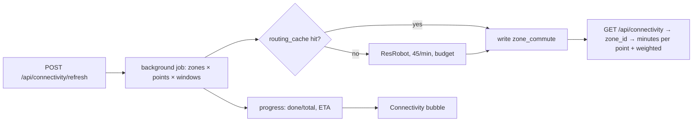

## Plan: Connectivity mode

Colour every zone by how well it connects to your points. For each of the 263 RegSO zones, take an origin near
its population centre and ask ResRobot for the trip to each enabled point at one representative slot per trip
window (first `arrive_by` / `depart_at` slot of each window, the point's day types), reusing
[domain/commute.py](../../../backend/src/findhome/domain/commute.py) request planning, provider selection, budget
and `routing_cache`. About 263 × 4 points × ~2 windows ≈ 2,100 calls per full refresh (~7% of the 30k/month
ResRobot quota; ~47 min at 45 calls/min), run in the background, resumable, refreshed monthly or when
`locations.yaml` changes. Results are stored per config hash. Connectivity mode shows a choropleth with a point
selector and a combined "weighted commute" view; Explore gets a small overlay (legend chip + hover tooltip with
the zone's minutes). The test point shows its zone's numbers next to its own itinerary.

### Data model

```sql
-- migration 003_zone_commute.sql
CREATE TABLE zone_commute (
  config_hash text NOT NULL, zone_id text NOT NULL, point_id text NOT NULL,
  direction text NOT NULL, day_type text NOT NULL, window_label text NOT NULL,
  provider text NOT NULL, minutes numeric(6,1), computed_at timestamptz NOT NULL DEFAULT now(),
  PRIMARY KEY (config_hash, zone_id, point_id, direction, day_type, window_label)
);
```

Weighted commute per zone = Σ(point weight × window weight × minutes) / Σ weights, the same weights the
`commute` score group uses, so the map and the scores agree.

### Run



### Steps
1. Origin per zone: extend `scripts/geo/build_zones.py` with `origin` = population-weighted centre (DeSO 2025 population via SCB API, CC0, aggregated to RegSO) snapped to the nearest stop within 600 m when the centre falls in water or forest; fallback to the zone centroid.
2. Add `domain/connectivity.py`: build requests from zones × enabled points × trips with one slot per window (reuse `plan_requests` pieces from [domain/commute.py](../../../backend/src/findhome/domain/commute.py)), haversine prefilter skip, run with a dedicated budget (`connectivity.max_calls_per_run` in [providers.yaml](../../../config/providers.yaml)), write `zone_commute`.
3. Migration `003_zone_commute.sql`; background job in the API process (asyncio task, one at a time, resumable because cached pairs are skipped), `POST /api/connectivity/refresh`, `GET /api/connectivity/status`, `GET /api/connectivity?point=&window=` (per-zone minutes and weighted value), CLI `findhome connectivity refresh|status`.
4. Connectivity mode (`pages/map/connectivity-mode.ts`): left bubbles **View** (point selector incl. "weighted all", window selector, colour scale 10-60 min, opacity) and **Refresh** (status, ETA, button, last run, stale warning when the config hash changed); zones as fill layer with a 6-step green→red ramp; your points as blips; right panel on zone click: minutes per point and window, best/worst, link to listings inside.
5. Explore overlay: optional thin zone outline tinted by weighted minutes (off by default) and a hover tooltip "Hagalund · 14′ work · 22′ partner"; the legend chip toggles it.
6. Test point integration: right panel shows the containing zone's matrix values next to the probe's own ResRobot itinerary, flagging differences above 10 minutes (origin choice matters).
7. Tests: request planning count for a small fixture (3 zones × 2 points × 2 windows), weighted mean matches the `commute` group weighting, job resume skips cached pairs; guide: connectivity flow in [introduction.md](../../../guide/architecture/introduction.md) and [config_and_locations.md](../../../guide/architecture/config_and_locations.md); mark the "commute heat layers" part of `map-3d` in [BACKLOG.md](../../BACKLOG.md) as done.
