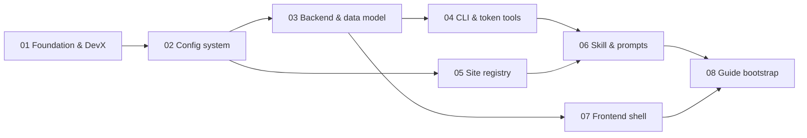

# Master Plan: find_home init-project

## Overview

Set up the find_home project: a Stockholm home search for one person and two cats. Renting comes first (any contract type, at least 1 bedroom, pets allowed or flagged `ask`), and buying will follow soon. The project has three layers that stay strictly separate:

1. **The app.** Standalone, with no LLM code. Angular talks directly to FastAPI, which uses Postgres; Postgres and pgAdmin run in Docker. The app runs deterministic crawlers, stores and dedupes listings, computes commute and points-of-interest metrics, scores candidates, shows a 2D/3D map, edits configs and records your feedback. A "Run agent" button only spawns an external headless command.
2. **Open configs.** YAML and Markdown files under `config/` and `sites/`, validated by JSON Schemas, committed to a local/private git repo. You, the app and the agent all edit them. Secrets live in gitignored `*.env` files.
3. **Skill plus agent.** Claude Code or Codex runs locally. The canonical skill sits in `.agents/skills/find-home/`, symlinked into `.claude/skills/`. It drives the agent to scan what scripts cannot, onboard and repair sites, and evaluate with scratchpads, starting from a compact history digest. Every write goes through the `findhome` CLI to the local API.

Init delivers a **walking skeleton that runs**:
- `docker compose up` brings up Postgres and pgAdmin, healthy.
- F5 starts FastAPI under the debugger, with `ng serve` started by a task.
- Migrations create the full base schema.
- The CLI commands exist: haversine and digest work, the others are stubs with real interfaces.
- The Angular shell has all pages, and a MapLibre map shows the configured locations.
- The skill, the prompts and the four unverified rent-site stubs are written.
- A guide is bootstrapped once everything above is in place.

No listing research and no real site scanning happen in init. Decisions and their reasons are in [QA_planning.md](QA_planning.md). Reference findings are in [notes/](notes/).

**Fixed conventions (all sub-plans):**
- Ports: Postgres `5434`, pgAdmin `5052`, FastAPI `8200`, Angular `4400`. These don't clash with Interactions_analytics or the Debug UI.
- VS Code labels are prefixed `FH:`.
- The Python package is `findhome` (Poetry, in-project `.venv`, Python ^3.11), and the CLI entry point is also `findhome`.
- Language is English, with Swedish terms kept for listing fields (rok, avgift, andrahand).
- `telia_env` is read-only reference material.

## Sub-Plans

| #  | Sub-Plan | Description | Dependencies |
|----|----------|-------------|--------------|
| 1  | [subplan_01_repo_foundation_devx](plans/subplan_01_repo_foundation_devx.md) | Git repo, folder layout, compose (Postgres + pgAdmin), VS Code launch/tasks, helper scripts, tasks/ convention and backlog | None |
| 2  | [subplan_02_config_system](plans/subplan_02_config_system.md) | YAML configs + JSON Schemas (profile per kind, filter catalog, locations with trips, time model, POI, tags, agent, providers), loader, config hash, comment-preserving writer | #1 |
| 3  | [subplan_03_backend_data_model](plans/subplan_03_backend_data_model.md) | FastAPI app, SQL migrations (rent/buy listing model, sources, runs, routing/POI cache, scores, feedback), REST API incl. ingest/digest/config, provider adapters, agent-run launcher | #1, #2 |
| 4  | [subplan_04_cli_token_tools](plans/subplan_04_cli_token_tools.md) | `findhome` CLI and the token-saving tools: scan+normalize+dedupe, listing digest, history digest, commute matrix with cache, site onboarding probe, run scratchpads | #2, #3 |
| 5  | [subplan_05_site_registry](plans/subplan_05_site_registry.md) | `sites/` template, 4 unverified rent stubs, filter-catalog mapping, add-a-site workflow | #2 |
| 6  | [subplan_06_skill_and_agent_prompts](plans/subplan_06_skill_and_agent_prompts.md) | `find-home` skill (SKILL.md, prompts, references), Claude/Codex wiring, run protocol | #4, #5 |
| 7  | [subplan_07_frontend_shell](plans/subplan_07_frontend_shell.md) | Angular shell, pages, MapLibre 2D/3D map with locations, config editor, runs page with "Run agent" | #3 |
| 8  | [subplan_08_guide_bootstrap](plans/subplan_08_guide_bootstrap.md) | Install the guide skill, bootstrap `guide/` from the running skeleton, propose principles and issues, wire into AGENTS.md/CLAUDE.md | #1-#7 |

## Implementation Order

- Run 01, then 02, in strict order: everything depends on the layout and the config contracts.
- 03 and 05 can run in parallel after 02.
- 04 and 07 can run in parallel after 03.
- 06 needs the CLI commands (04) and the site template (05), because the prompts reference them by name.
- 08 runs last, because a guide must describe code that exists. It ends with the smoke check from 01 passing.
- Commit after each sub-plan (local repo, no remote) so the guide bootstrap has a clean history to read.

## Interconnections

- **JSON Schemas are the shared contract.** The schemas in `config/schemas/` (02) are used by the backend loader (03), the CLI `config validate` (04), the Angular config editor (07, schema-driven forms or at least validation feedback), and the agent prompts (06 tell the agent to validate before saving).
- **The ingest payload is the agent-app contract.** `ListingIn` and `EvaluationIn` pydantic models (03) are exported as JSON Schema to `config/schemas/ingest/` and documented in the skill's `references/data_contract.md` (06). The CLI (04) is a thin client of the same endpoints.
- **The history digest feeds back into the next run.** The `/api/digest/history` endpoint (03) and `findhome digest history` (04) produce the file the skill loads first in every run (06). Feedback tags come from `config/tags.yaml` (02) and are edited in the UI (07).
- **Locations and trips use one model everywhere.** Defined once in `locations.yaml` + `time_model.yaml` (02), consumed by the commute matrix (03/04), drawn on the map with category colours (07), and described in the guide (08).
- **Provider adapters are shared.** Routing (`haversine`, `osm`, `resrobot`, `google`) and POI (`overpass`, `google_places`) adapters live in the backend (03). The CLI calls them through the API (04). Enable flags and keys come from `config/providers.yaml` + `config/providers.env` (02). Google costs and key setup are documented in `docs/google-apis.md` (01, seeded from [notes/google_apis_costs_and_key.md](notes/google_apis_costs_and_key.md)).
- **Sites span three sub-plans.** `sites/<slug>/site.yaml` follows the schema from 02. Scanners implement the scanner interface from 04. The onboarding probe (04) and the onboarding/repair prompts (06) produce and fix these files.
- **Files touched by several sub-plans:**
  - `.vscode/tasks.json`: 01 creates it; 03 and 04 add migrate/CLI tasks; 07 adds `ng serve`.
  - `.gitignore`: 01.
  - `AGENTS.md` and `CLAUDE.md`: 06 creates them; 08 adds the guide line.
  - `tasks/BACKLOG.md`: 01 creates it; others append follow-ups.
- **Pending user input.** Starting values (budget, minimum m², move-in date, areas or max commute) and whether a 1 rok with sovalkov counts as a bedroom are placeholders in `config/profile.yaml`, marked `# TODO(user)`. Nothing in init blocks on them.
- **To verify during implementation.** Trafiklab ResRobot free status and arrive-by search (`searchForArrival`); the Google Routes tier for transit and arrival time; whether Claude Code picks up a symlinked skill folder (fallback: `scripts/sync-skills.sh` copies the folder). Record each answer in `guide/issues/issues.md` or the matching doc.
