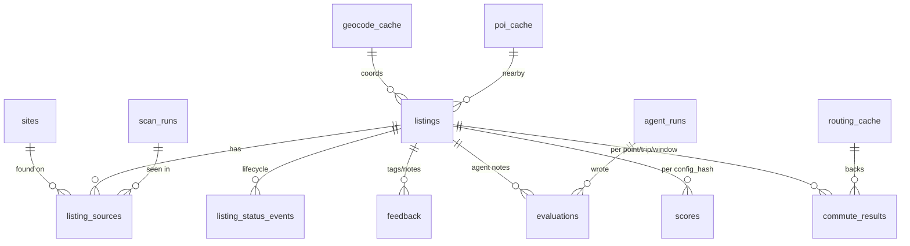

## Plan: Backend and data model

This sub-plan creates the FastAPI backend, the Postgres schema and the REST API. Together they form the only write path into the app's data: both the UI and the agent (through the CLI) go through it. The backend contains no LLM code. It validates the data, stores it, dedupes across sites, caches routing and POI lookups through pluggable provider adapters, scores listings against the active config, exports the compact digests the agent reads, and can spawn an external agent command for the "Run agent" button. The schema is rent-first and buy-ready (`listing_kind`), and every derived value records the `config_hash` it was computed with. Pattern reference: the IA backend (FastAPI + psycopg 3 + plain SQL migrations + Poetry with `poetry.toml` in-project venv).

### Data model



### Steps

1. **Scaffold `backend/`**:
   - `pyproject.toml` with package `findhome` under `src/`.
   - Runtime deps: `fastapi`, `uvicorn[standard]`, `pydantic>=2`, `pydantic-settings`, `psycopg[binary,pool]`, `httpx`, `ruamel.yaml`, `jsonschema`, `watchfiles`, `typer`, `rich`, `rapidfuzz`, `selectolax`.
   - Optional extra `scrape` with `playwright`.
   - Dev deps: `pytest`, `pytest-asyncio`, `ruff`.
   - `poetry.toml` with `virtualenvs.in-project = true`.
   - Script entry `findhome = "findhome.cli.main:app"`.
   - Package layout:
     - `api/` (main, routers)
     - `core/` (settings, logging, db pool)
     - `config/` (from 02)
     - `db/` (migrate, repositories)
     - `domain/` (pydantic models, scoring, dedupe)
     - `providers/` (routing, geocoding, poi)
     - `scanning/` (from 04)
     - `digest/` (from 04)
     - `agentrun/` (launcher)
     - `cli/` (from 04)

2. **Write the migrations** as plain SQL in `backend/migrations/` (`001_init.sql`, ...), plus a runner `findhome.db.migrate` with a `schema_migrations` table. Use the IA pattern with checksum verification and a `--check` mode for the smoke check. Tables:
   - `sites` (slug PK, name, kinds[], status `unverified|active|broken|disabled`, config_hash, last_scan_at).
   - `listings`:
     - Identity and kind: id uuid, `short_id` text unique (e.g. `L-7Q2K`, the handle used in digests to save tokens), `listing_kind` enum rent|buy, canonical_url.
     - Location: address_raw, address_norm, area, lat, lon, geocode_source.
     - Size and building: size_m2, rooms_rok, has_sovalkov, floor, has_elevator, has_balcony, build_year.
     - Rent: rent_sek, deposit_sek, contract_type, contract_start, contract_end, max_duration_months.
     - Buy (nullable): price_sek, avgift_sek, drift_sek.
     - Pets: pet_status enum yes|no|ask|unknown, pet_evidence text.
     - Other: furnished, available_from, description_excerpt, photo_urls jsonb, floorplan_urls jsonb, attributes jsonb (anything not yet a column), status (current lifecycle status), dedupe_key, first_seen_at, last_seen_at, last_changed_at, content_hash.
   - `listing_sources` (listing_id, site_slug, external_id, url, scan_run_id, raw_snapshot_path, first_seen_at, last_seen_at, active bool; unique on (site_slug, external_id)).
   - `listing_status_events` (listing_id, from_status, to_status, actor `user|agent|system`, at, note).
   - `feedback` (listing_id, polarity `like|dislike|neutral`, tags text[], note, at).
   - `evaluations` (listing_id, agent_run_id, summary, pros[], cons[], questions_for_landlord[], extracted jsonb, confidence, at).
   - `scores` (listing_id, config_hash, total, breakdown jsonb, computed_at; unique on (listing_id, config_hash)).
   - `commute_results` (listing_id, point_id, trip_direction, window_label, mode, provider, config_hash, samples jsonb `[{slot, minutes, transfers, depart, arrive}]`, median_min, p90_min, worst_min, spread_min, computed_at).
   - `routing_cache` (key hash of provider|mode|origin_rounded|dest_rounded|day_type|slot|arrive_or_depart, response jsonb, minutes, created_at, expires_at).
   - `geocode_cache`.
   - `poi_cache` (provider, category, lat_round, lon_round, radius, result jsonb, expires_at).
   - `scan_runs` (id, site_slug, method, started_at, finished_at, status, counts jsonb, error, log_path).
   - `agent_runs` (id, profile, command, started_at, finished_at, exit_code, log_path, run_dir, summary).

3. **Implement dedupe and normalisation** in `domain/`:
   - `normalize.py` maps raw site fields to `ListingIn`:
     - Parses Swedish formats ("3 rok", "12 500 kr/mån", "andrahand", "tillsvidare").
     - Maps pet phrases to `pet_status` with the matched text kept as `pet_evidence`.
     - Computes `content_hash` over the meaningful fields, which drives the "changed" detection.
   - `dedupe.py` works in two stages:
     - Exact: (site_slug, external_id) → same source.
     - Cross-site: `dedupe_key` = normalised street + number + floor + round(size_m2) + rent band of 500 SEK, then a `rapidfuzz` check on the address. A match attaches a new `listing_sources` row to the existing canonical listing instead of creating a new listing.
   - Unit tests use a few hand-written fixtures.

4. **Build the provider adapters** in `providers/`.
   - Routing protocol:

     ```python
     class RoutingProvider(Protocol):
         name: str
         modes: set[Mode]
         async def travel(self, origin: LatLon, dest: LatLon, mode: Mode,
                          when: datetime, when_is: Literal["arrive_by", "depart_at"]) -> TravelResult | None: ...
     ```

   - Implement `haversine` fully (straight-line km plus a configurable speed per mode, for prefiltering).
   - `osm` (OSRM route + Nominatim geocode), `resrobot` (Trafiklab route planner with coordinate origin/destination and arrival-time search, both to verify) and `google` (Routes API `computeRoutes` with a minimal fixed `X-Goog-FieldMask` so calls stay in the cheapest tier) are implemented as working clients behind enable flags, tested against recorded fixtures only. Live calls happen in the `routing-providers` follow-up task, once keys exist.
   - `commute.py` expands each (point, trip, window, day_type) into slots, applies the haversine prefilter and the per-run budget, looks up `routing_cache` before calling a provider, and aggregates the samples into median/p90/worst/spread per window.
   - `poi.py` defines an `overpass` client (cached) and a `google_places` stub.

5. **Write the scoring v0** in `domain/scoring.py`, a deterministic weighted sum driven by `profile.yaml`.
   - Each enabled preference group produces a 0-1 sub-score with an explanation string.
   - The commute sub-score uses each point's weight × each trip window's weight over the median minutes, with a penalty when p90 − median exceeds a configurable threshold (the reliability term).
   - Hard filters gate the listing before scoring: an excluded listing gets `total = null` and a `rejected_by` list.
   - Results are stored per `config_hash`.
   - In init the formula is simple and fully covered by tests. Tuning is the `scoring-v1` backlog task.

6. **Expose the REST API** from `api/routers/`. All JSON, all pydantic-validated, with the OpenAPI spec exported to `config/schemas/ingest/openapi.json`.
   - `GET /health` (DB reachable, config valid, active config_hash).
   - `GET /api/config/{name}` and `PATCH /api/config/{name}` (JSON patch through the writer from 02), plus `POST /api/config/validate`.
   - `POST /api/ingest/listings` (batch of `ListingIn` with source info; returns created/updated/unchanged/duplicate counts and short_ids).
   - `POST /api/ingest/evaluations`.
   - `GET /api/listings` (filters, sort by score), `GET /api/listings/{short_id}`, `POST /api/listings/{short_id}/status`, `POST /api/listings/{short_id}/feedback`.
   - `POST /api/commute/compute` (`listing_ids`, `budget`), `GET /api/commute/{short_id}`.
   - `POST /api/scores/recompute`.
   - `GET /api/digest/history`, `GET /api/digest/listing/{short_id}` (formats defined in 04).
   - `GET /api/sites`, `POST /api/scans` (start a scripted scan as a background task).
   - `GET /api/runs`, `POST /api/agent-runs` (profile name), `GET /api/agent-runs/{id}/log` (Server-Sent Events tail).
   - Bind to `127.0.0.1` only. There's no auth, because this is a single-user local app; the guide records that as a known limit.

7. **Build the agent-run launcher** in `agentrun/launcher.py`.
   - Read the profile from `config/agent.yaml`.
   - Create `runs/<UTC timestamp>-<profile>/` containing `scratchpad.md` (template from 04), `context/history_digest.md` (pre-generated so the agent starts with it) and `log.jsonl`.
   - Spawn the command with `asyncio.create_subprocess_exec` (no shell; args taken from YAML as a list) and `cwd` at the repo root, set `FINDHOME_RUN_DIR` and `FINDHOME_API=http://127.0.0.1:8200`, and stream stdout/stderr into `log.jsonl` and the SSE endpoint.
   - Enforce `timeout_min` and allow only one concurrent run per profile.
   - Record the run in `agent_runs`.

8. **Add tests and wiring.**
   - `backend/tests/`: migration applies on an empty DB; ingest is idempotent (posting the same payload twice gives `unchanged`); cross-site dedupe works; hard filters exclude `pet_status=no`; the commute expansion and aggregation are right with a fake provider; `/health` returns 200.
   - Add the `FH: Migrate DB` and `FH: Pytest` tasks to `.vscode/tasks.json` (created in 01).
   - Commit as `feat(backend): data model, API, providers skeleton (init-project 03)`.
